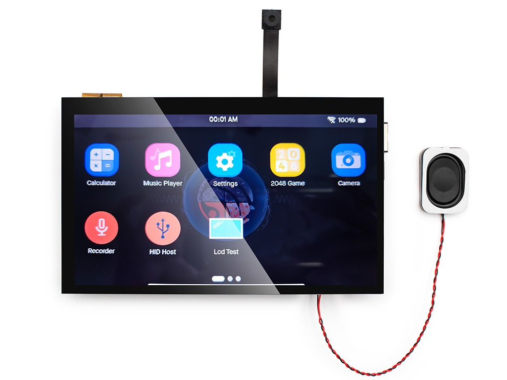
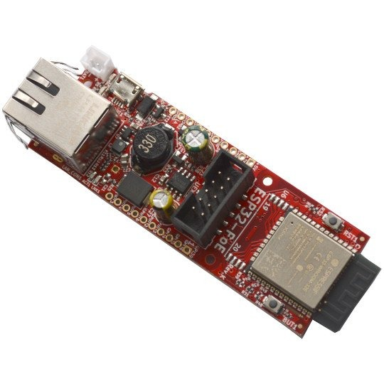
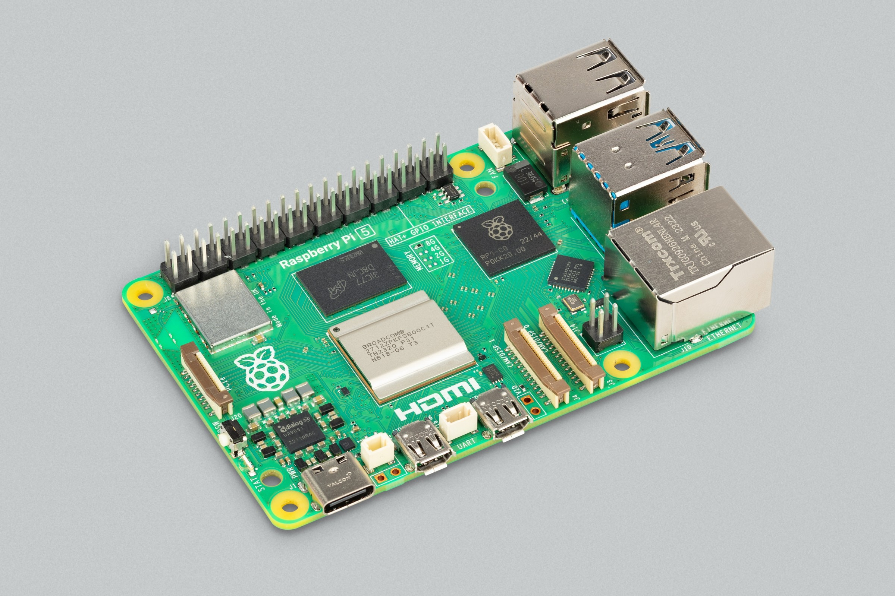

# ctrl32 hardware

**Tested boards for ctrl32 - setup guides, pin maps, schematics and example projects.**

ctrl32 turns an ESP32 board or a Raspberry Pi into a PLC with its own HMI: ladder, FBD and Structured Text programs, screens on the board's display and in any browser (WEBview), Modbus RTU / TCP, CANopen, MQTT, OPC UA and EtherCAT - built in one editor and downloaded over USB or the network.

[Download the editor](https://ctrl32.com/download/) · [Documentation](https://ctrl32.com/docs/) · [Hardware catalog](https://ctrl32.com/hardware/) · [These guides on the web](https://ctrl32.com/docs/hardware/)

## Tested boards

Each board has a guide of its own - what ctrl32 does on it, the wiring, the first upload, the setup in the editor step by step - and an **all-in-one** example project that uses everything the board can do.

| | Board | Chip | Interfaces |
|---|---|---|---|
|  | [Makerfabs MaTouch ESP32-P4 7"](boards/makerfabs/makerfabs-matouch-esp32-p4-tft-with-touch-7-mipi/README.md) | ESP32-P4 | Ethernet, CAN, RS-485, HMI 1024x600 |
|  | [Olimex ESP32-PoE](boards/olimex/olimex-esp32-poe/README.md) | ESP32 | Ethernet |
|  | [Raspberry Pi 5](boards/raspberry-pi/raspberry-pi-5/README.md) | Linux | Ethernet, CAN, RS-485 |

## What is in a board's folder

| | |
|---|---|
| `README.md` | the overview: photo, the capability table, the pin map, the steps |
| `hardware.md`, `install.md`, `configure.md`, `troubleshooting.md` | the guide, one page per step |
| `examples/` | the example projects - open them in the ctrl32 editor |
| `pinout/` | the pin map (SVG and PNG) |
| `schematics/`, `datasheets/`, `3d/` | the maker's schematic, KiCad project, datasheets and 3D model |

## Suggest a board

Want a board tested? Open an issue with the board's name and a link to its maker's page. A board gets a guide here once it runs ctrl32 on our test bench.

## Licence

Texts, pin maps and screenshots: [CC BY 4.0](LICENSE). Example projects: [MIT](LICENSE). The makers' photos, schematics and models belong to their makers - see [NOTICE](NOTICE.md).
