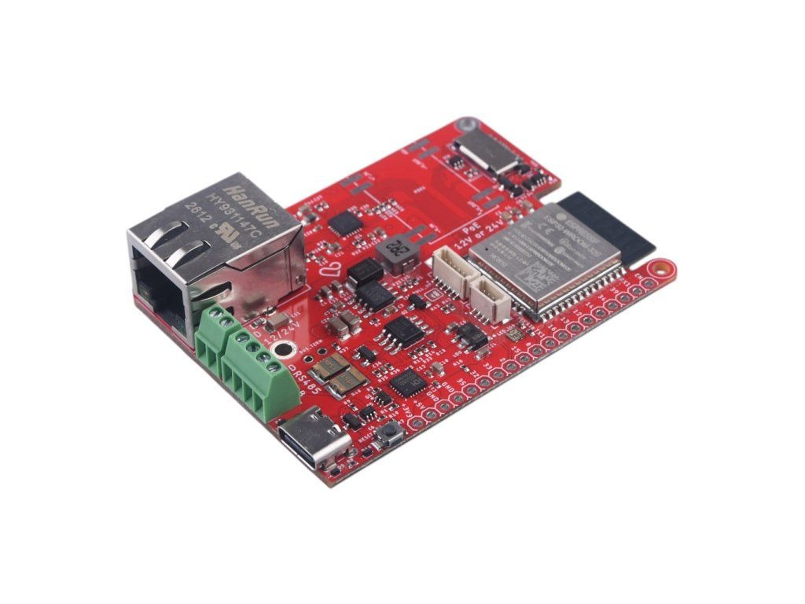
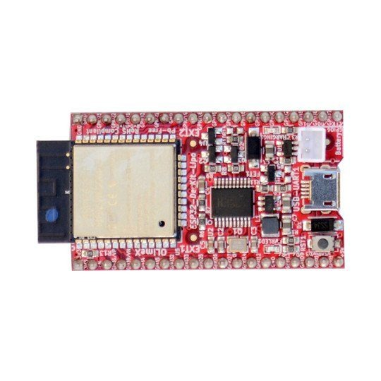
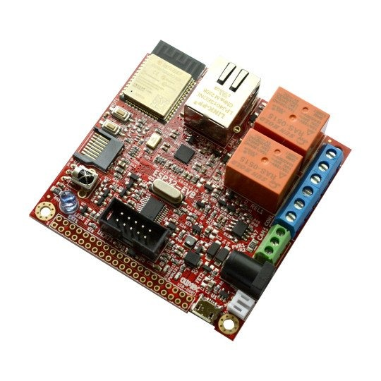
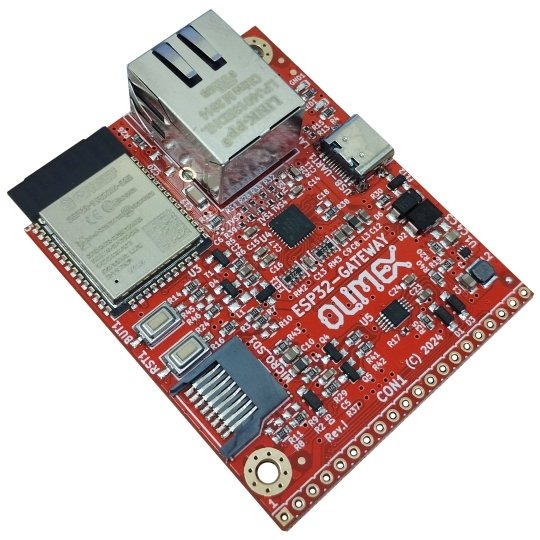
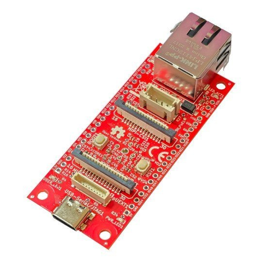
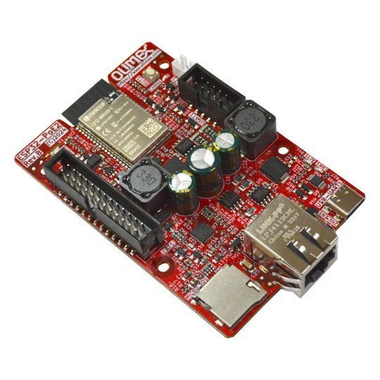
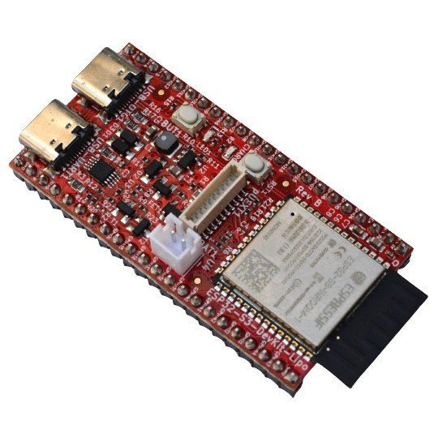
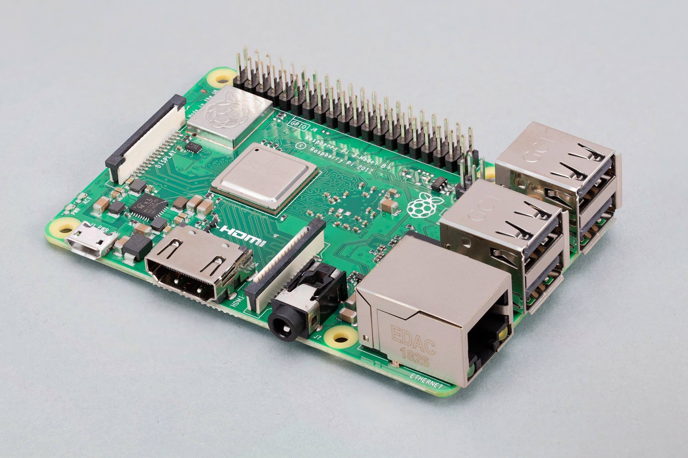
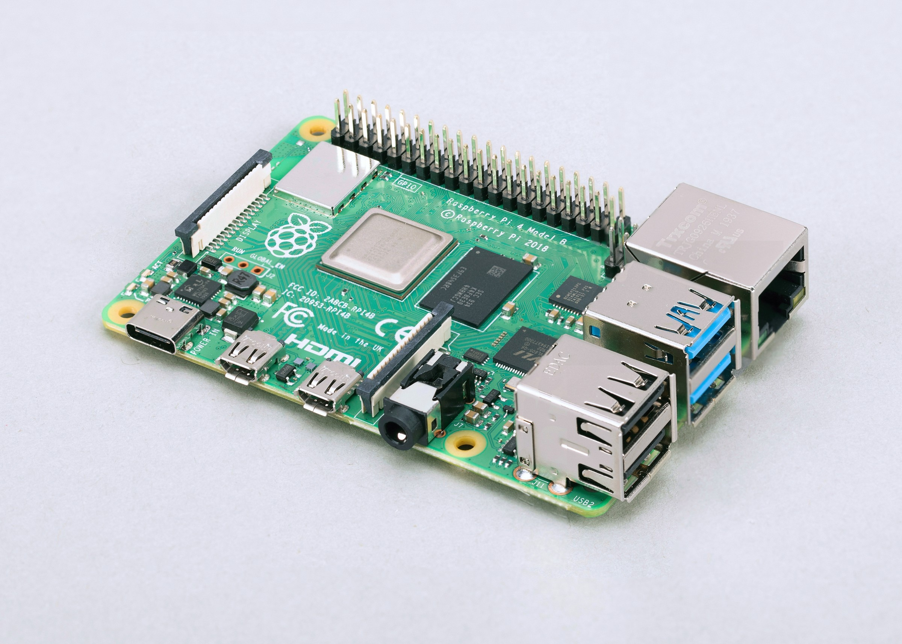

# Tested boards

Every board here runs ctrl32 as it is and has a guide of its own: what ctrl32 does on it, how to wire it, how to put the runtime on it, how to set it up - step by step, with pictures - and an example project that uses everything the board can do.

| | Board | Chip | Interfaces |
|---|---|---|---|
|  | [LaskaKit ESPlan](laskakit/laskakit-esplan/README.md) | ESP32 | Ethernet, RS-485 |
|  | [Makerfabs MaTouch ESP32-P4 7"](makerfabs/makerfabs-matouch-esp32-p4-tft-with-touch-7-mipi/README.md) | ESP32-P4 | Ethernet, CAN, RS-485, HMI 1024x600 |
|  | [Makerfabs MaTouch Lite ESP32-S3 3.95"](makerfabs/makerfabs-matouch-lite-esp32-s3-spi-resistive-touch-395-st7796/README.md) | ESP32-S3 | CAN, RS-485, HMI 320x480 |
|  | [Olimex ESP32-DevKit-LiPo](olimex/olimex-esp32-devkit-lipo/README.md) | ESP32 | - |
|  | [Olimex ESP32-EVB](olimex/olimex-esp32-evb/README.md) | ESP32 | Ethernet, CAN, HMI 240x320 |
|  | [Olimex ESP32-GATEWAY](olimex/olimex-esp32-gateway/README.md) | ESP32 | Ethernet |
|  | [Olimex ESP32-P4-DevKit](olimex/olimex-esp32-p4-devkit/README.md) | ESP32-P4 | Ethernet |
|  | [Olimex ESP32-P4-PC](olimex/olimex-esp32-p4-pc/README.md) | ESP32-P4 | Ethernet |
|  | [Olimex ESP32-PoE](olimex/olimex-esp32-poe/README.md) | ESP32 | Ethernet |
|  | [Olimex ESP32-PoE-ISO](olimex/olimex-esp32-poe-iso/README.md) | ESP32 | Ethernet |
|  | [Olimex ESP32-POE2](olimex/olimex-esp32-poe2/README.md) | ESP32 | Ethernet |
|  | [Olimex ESP32-S3-DevKit-Lipo](olimex/olimex-esp32-s3-devkit-lipo/README.md) | ESP32-S3 | - |
|  | [Raspberry Pi 3 Model B+](raspberry-pi/raspberry-pi-3-model-b/README.md) | Linux | Ethernet, CAN, RS-485 |
|  | [Raspberry Pi 4 Model B](raspberry-pi/raspberry-pi-4-model-b/README.md) | Linux | Ethernet, CAN, RS-485 |
|  | [Raspberry Pi 5](raspberry-pi/raspberry-pi-5/README.md) | Linux | Ethernet, CAN, RS-485 |

## By maker

- [LaskaKit](laskakit/README.md)
- [Makerfabs](makerfabs/README.md)
- [Olimex](olimex/README.md)
- [Raspberry Pi](raspberry-pi/README.md)
