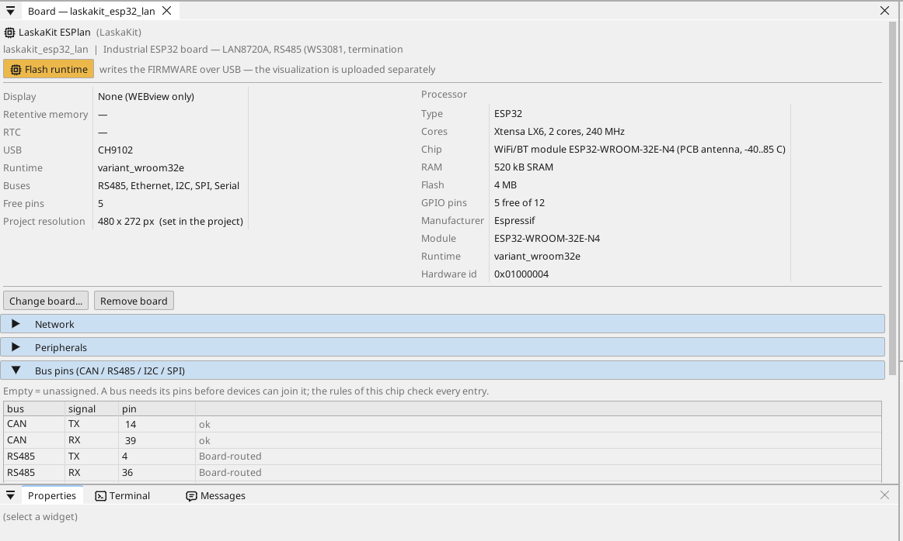
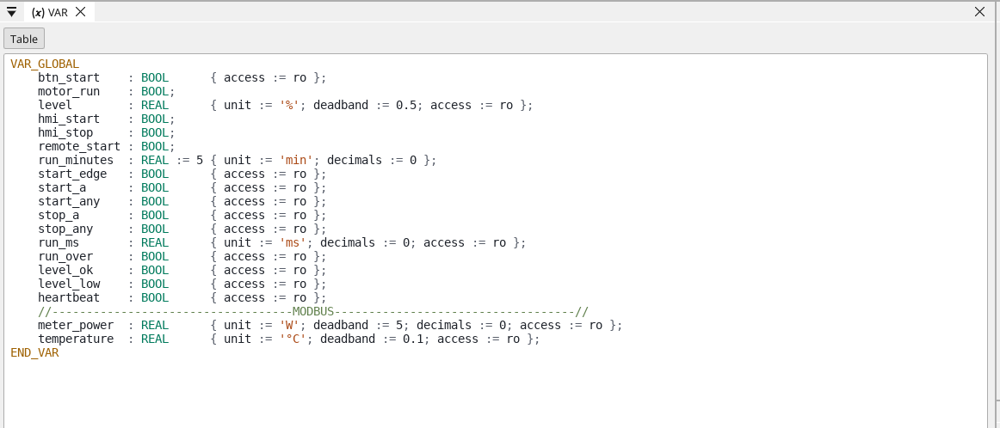
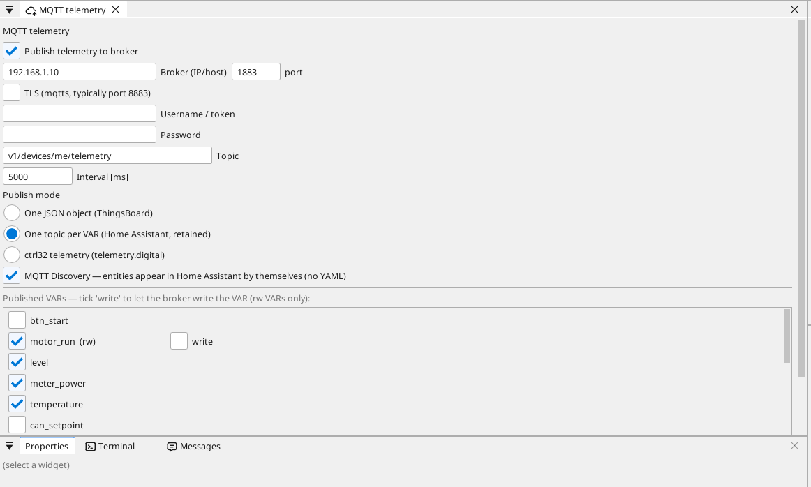

# Konfiguracja płytki

## Strona płytki

Kliknij dwukrotnie płytkę w drzewie urządzeń. Strona pokazuje, co płytka ma na pokładzie, i każdy pin: wolny pin dostaje zmienną jednym kliknięciem - wejście, wyjście albo, na pinie analogowym, wejście analogowe.

## Sieć

Port Ethernet startuje sam i pobiera adres z twojego routera (DHCP).
Stały adres ustawia się na stronie płytki, w jej sekcji **Network**;
Wi-Fi na stronie **WiFi** w drzewie urządzeń.

## Wejścia, wyjścia i zmienne

Każdy sygnał programu jest **zmienną**. Zmienna na pinie odczytuje lub steruje pinem; zmienna analogowa mówi, co jest do niej podłączone (napięcie, 4-20 mA, termistor), oraz jej zakres w jednostkach.

## Komunikacja

**Modbus TCP.** Urządzenie w sieci dodaje się w **Ethernet → Modbus TCP master**; jego rejestry stają się zmiennymi.

**Modbus RTU / RS-485.** Płytka ma własny transceiver RS-485 (WS3081, zabezpieczony). ctrl32 jest masterem Modbus RTU - urządzenia i ich rejestry dodaje się w drzewie urządzeń w RS485 - albo slave'em Modbus RTU, którego odczytują inne mastery.

**CAN.** ESP32 ma jeden kontroler CAN (TWAI). Płytka nie ma transceivera CAN: podłącz moduł transceivera 3,3 V do dwóch wolnych pinów i wskaż je na stronie płytki (Bus pins) - działają wtedy na nim urządzenia CANopen, surowe ramki CAN i magistrale pojazdowe (J1939).

**MQTT.** Płytka publikuje wybrane zmienne do brokera; w trybie Home Assistant broker sam je znajduje, a zmienną oznaczoną *write* można stamtąd ustawić.

## WEBview

Płytka udostępnia swoją stronę operatora każdej przeglądarce w sieci - otwórz adres płytki. Stronę rysuje się w edytorze jak ekran.

---

[← Instalacja runtime](install.pl.md) | [Przegląd](README.pl.md) | [Przykładowe projekty →](examples/README.pl.md)
