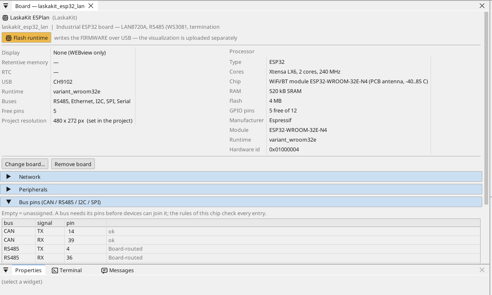
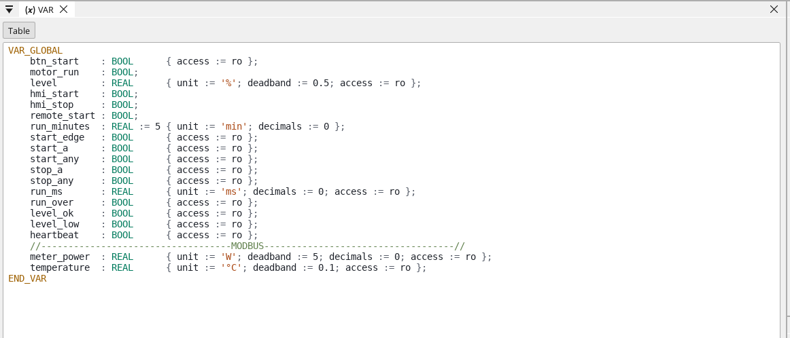
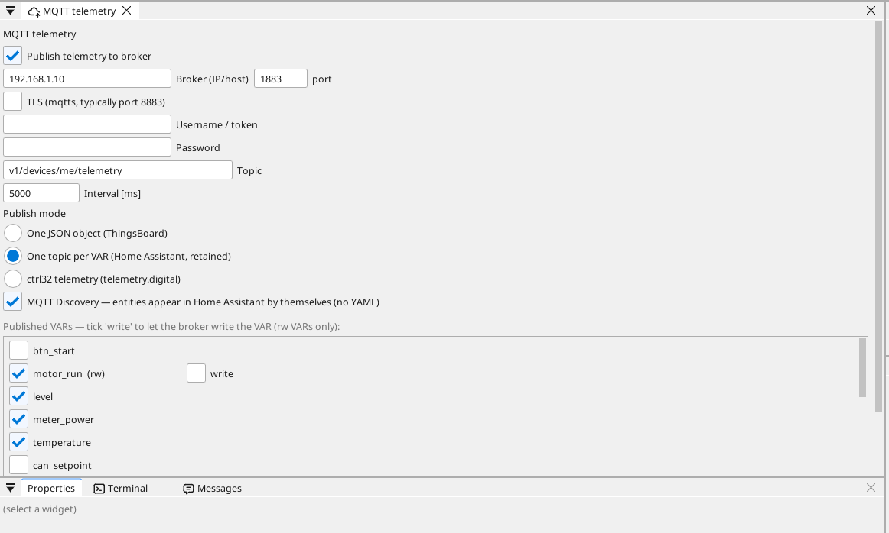

# Kartı yapılandırın

## Kart sayfası

Cihaz ağacında karta çift tıklayın. Sayfa kartın neler taşıdığını ve her pini gösterir: boş bir pin tek tıkla bir değişken alır - bir giriş, bir çıkış ya da analog yetenekli bir pinde analog bir giriş.

## Ağ

Ethernet portu kendiliğinden başlar ve adresini yönlendiricinizden alır
(DHCP). Sabit bir adres kart sayfasında, **Network** bölümünde ayarlanır;
Wi-Fi ise cihaz ağacındaki **WiFi** sayfasında.

## Girişler, çıkışlar ve değişkenler

Programın her sinyali bir **değişkendir**. Bir pindeki değişken pini okur veya sürer; analog bir değişken ona neyin bağlı olduğunu (bir gerilim, 4-20 mA, bir termistör) ve birim cinsinden aralığını söyler.

## İletişim

**Modbus TCP.** Ağdaki bir cihaz **Ethernet → Modbus TCP master** altında eklenir; register'ları değişken olur.

**Modbus RTU / RS-485.** Kart kendi RS-485 alıcı-vericisini (WS3081, korumalı) taşır. ctrl32 bir Modbus RTU master'dır - cihazlar ve register'ları cihaz ağacında RS485 altında eklenir - ya da başka master'ların okuduğu bir Modbus RTU slave.

**CAN.** ESP32 bir CAN denetleyicisine (TWAI) sahiptir. Kartta CAN alıcı-vericisi yoktur: 3,3 V'luk bir alıcı-verici modülünü iki boş pine bağlayın ve bunları kart sayfasında adlandırın (Bus pins) - CANopen cihazları, ham CAN çerçeveleri ve araç veri yolları (J1939) bunun üzerinde çalışır.

**MQTT.** Kart seçilen değişkenleri bir broker'a yayınlar; Home Assistant modunda broker bunları kendiliğinden bulur ve *write* olarak işaretlenen bir değişken oradan ayarlanabilir.

## WEBview

Kart operatör sayfasını ağdaki her tarayıcıya sunar - kartın adresini açın. Sayfa editörde bir ekran gibi çizilir.

---

[← Runtime'ı kurun](install.tr.md) | [Genel bakış](README.tr.md) | [Örnek projeler →](examples/README.tr.md)
