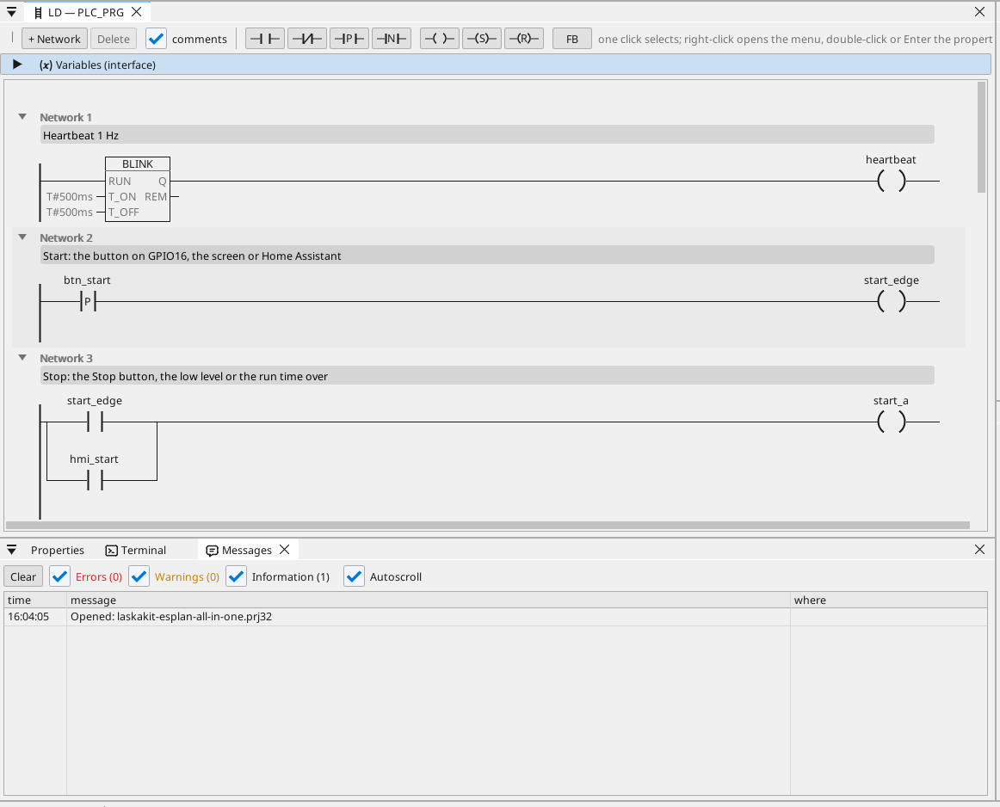
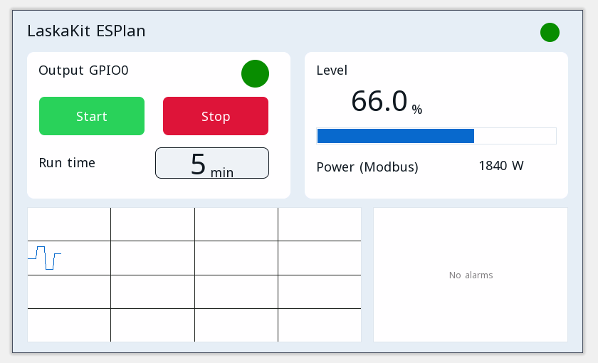

# All-in-one

Una salida de motor con marcha / paro, un temporizador de marcha, un nivel analógico, una temperatura Modbus RTU, tramas CAN, un contador Modbus TCP, MQTT y la página del operador en un navegador.

**Descarga:** [all-in-one.prj32](all-in-one.prj32) - ábrelo en el editor ctrl32 (**File → Open**).

## Qué hace

El programa es un pequeño control de máquina - la forma de la mayoría de las máquinas:

- **Start** llega desde el botón en GPIO16, desde **Start** en la página del operador o desde Home Assistant por MQTT.
- **Stop** llega desde **Stop**, desde un nivel bajo o al agotarse el tiempo de marcha - el enclavamiento apaga la salida en **GPIO0**.
- El **tiempo de marcha** se ajusta en minutos y se conserva tras un corte de corriente.
- El **nivel** es una entrada analógica en **GPIO35** (de 0 a 3,3 V escalado de 0 a 100 %); por debajo del 10 % la salida se detiene y salta una alarma, por encima del 15 % puede volver a arrancar.
- Un sensor **Modbus RTU** en el RS-485 de la placa da la temperatura (unidad 1, registro de entrada 1).
- **CAN** envía el nivel y el estado de la salida en la trama 0x181 cada 100 ms y recibe una consigna en la trama 0x201.
- Un contador de energía **Modbus TCP** en la red da la potencia demandada (192.168.1.60 - cámbiala por la de tu contador).
- **MQTT** publica los valores en un broker de Home Assistant, que los encuentra por sí solo; la salida también se puede arrancar desde Home Assistant.
- **WEBview** sirve la página del operador a cualquier navegador de la red.

## El programa

## La página del operador

## Abrirlo y ejecutarlo

1. Abre `all-in-one.prj32` en el editor.
2. Cambia las direcciones (el dispositivo Modbus, el broker MQTT) por las de tu red.
3. Inicia la **simulación** (barra de herramientas) para probarlo en el PC, o descárgalo a la placa - consulta [Instalar el runtime](../../install.es.md).

## Qué deberías ver

Pulsa el botón en GPIO16: la salida en GPIO0 se enciende y su LED en la página se ilumina. Pasado el tiempo de marcha se apaga sola, y cuando el nivel baja del 10 % la alarma aparece en la tabla. En Home Assistant la placa aparece con sus valores.

---

[← Proyectos de ejemplo](../README.es.md) | [Resumen](../../README.es.md)
