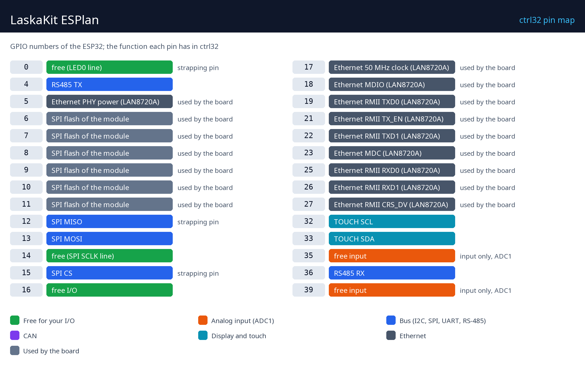

# Hardware and wiring

## What you need

- The LaskaKit ESPlan.
- A USB-C data cable - for the first upload of the runtime.
- For power: 12 or 24 V DC on the screw terminal (7-40 V), or 5 V over USB-C.
- An Ethernet cable and a free port on your network.
- A PC with the [ctrl32 editor](https://ctrl32.com/download/) (Windows).
- Optional, for the all-in-one example: a Modbus RTU temperature sensor (unit 1) on the RS-485 terminal; a push-button from GPIO14 to GND; a potentiometer (10 k) between 3.3 V and GND with its wiper on GPIO35.

## Power

| Source | Where | Note |
|---|---|---|
| 7-40 V DC | the screw terminal | 12 or 24 V recommended |
| USB 5 V | the USB-C connector | the road for the first upload |
| PoE | through the optional PoE module (802.3af) | add-on |

## Pin map

| GPIO | Function in ctrl32 | Note |
|---|---|---|
| 0 | free (LED0 line) | ⚠ strapping pin |
| 4 | RS485 TX |  |
| 5 | Ethernet PHY power (LAN8720A) | ⚠ used by the board |
| 6 | SPI flash of the module | ⚠ used by the board |
| 7 | SPI flash of the module | ⚠ used by the board |
| 8 | SPI flash of the module | ⚠ used by the board |
| 9 | SPI flash of the module | ⚠ used by the board |
| 10 | SPI flash of the module | ⚠ used by the board |
| 11 | SPI flash of the module | ⚠ used by the board |
| 12 | SPI MISO | ⚠ strapping pin |
| 13 | SPI MOSI |  |
| 14 | free (SPI SCLK line) |  |
| 15 | SPI CS | ⚠ strapping pin |
| 16 | free I/O |  |
| 17 | Ethernet 50 MHz clock (LAN8720A) | ⚠ used by the board |
| 18 | Ethernet MDIO (LAN8720A) | ⚠ used by the board |
| 19 | Ethernet RMII TXD0 (LAN8720A) | ⚠ used by the board |
| 21 | Ethernet RMII TX_EN (LAN8720A) | ⚠ used by the board |
| 22 | Ethernet RMII TXD1 (LAN8720A) | ⚠ used by the board |
| 23 | Ethernet MDC (LAN8720A) | ⚠ used by the board |
| 25 | Ethernet RMII RXD0 (LAN8720A) | ⚠ used by the board |
| 26 | Ethernet RMII RXD1 (LAN8720A) | ⚠ used by the board |
| 27 | Ethernet RMII CRS_DV (LAN8720A) | ⚠ used by the board |
| 32 | TOUCH SCL |  |
| 33 | TOUCH SDA |  |
| 35 | free input | ⚠ input only, ADC1 |
| 36 | RS485 RX |  |
| 39 | free input | ⚠ input only, ADC1 |

**RS-485:** A and B on the terminal, the WS3081 transceiver on GPIO4 (TX) /
GPIO36 (RX); a jumper switches the 120 ohm termination - set it on the two
ends of the line only. The **uSup** connectors carry I2C (GPIO33 / GPIO32)
and SPI. The board's LED is on GPIO0 (a strapping pin - keep it an output
driven by the program).

## Safety

- The board is not intended for safety functions. An emergency stop, a
  door switch or a light curtain is wired in hardware, never through a
  program.
- The GPIO pins are 3.3 V. A 24 V signal needs an opto-coupler or a level
  shifter; a relay coil needs a driver (a relay module has one).

---

[← Overview](README.md) | [Overview](README.md) | [Install the runtime →](install.md)
