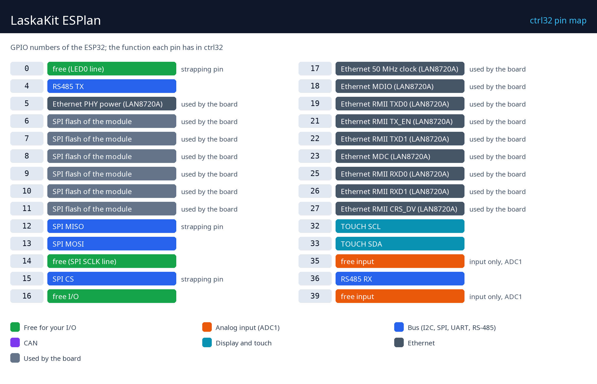

# Donanım ve kablolama

## Neye ihtiyacınız var

- LaskaKit ESPlan.
- Bir USB-C veri kablosu - runtime'ın ilk yüklemesi için.
- Besleme için: vidalı klemenste 12 veya 24 V DC (7-40 V) ya da USB-C üzerinden 5 V.
- Bir Ethernet kablosu ve ağınızda boş bir port.
- [ctrl32 editörü](https://ctrl32.com/download/) kurulu bir PC (Windows).
- İsteğe bağlı, all-in-one örneği için: RS-485 klemensinde bir Modbus RTU sıcaklık sensörü (unit 1); GPIO16 ile GND arasında bir buton; 3,3 V ile GND arasında, orta ucu GPIO35'te bir potansiyometre (10 k); GPIO14 (TX) / GPIO39 (RX) üzerinde 3,3 V'luk bir CAN alıcı-vericisi.

## Besleme

| Kaynak | Nerede | Not |
|---|---|---|
| 7-40 V DC | vidalı klemens | 12 veya 24 V önerilir |
| USB 5 V | USB-C konnektörü | ilk yüklemenin yolu |
| PoE | isteğe bağlı PoE modülü üzerinden (802.3af) | ek modül |

## Pin haritası

| GPIO | ctrl32'deki işlevi | Not |
|---|---|---|
| 0 | free (LED0 line) | ⚠ strapping pini |
| 4 | RS485 TX |  |
| 5 | Ethernet PHY power (LAN8720A) | ⚠ kart tarafından kullanılır |
| 6 | modülün SPI flash'ı | ⚠ kart tarafından kullanılır |
| 7 | modülün SPI flash'ı | ⚠ kart tarafından kullanılır |
| 8 | modülün SPI flash'ı | ⚠ kart tarafından kullanılır |
| 9 | modülün SPI flash'ı | ⚠ kart tarafından kullanılır |
| 10 | modülün SPI flash'ı | ⚠ kart tarafından kullanılır |
| 11 | modülün SPI flash'ı | ⚠ kart tarafından kullanılır |
| 12 | SPI MISO | ⚠ strapping pini |
| 13 | SPI MOSI |  |
| 14 | free (SPI SCLK line) |  |
| 15 | SPI CS | ⚠ strapping pini |
| 16 | boş - G/Ç |  |
| 17 | Ethernet 50 MHz clock (LAN8720A) | ⚠ kart tarafından kullanılır |
| 18 | Ethernet MDIO (LAN8720A) | ⚠ kart tarafından kullanılır |
| 19 | Ethernet RMII TXD0 (LAN8720A) | ⚠ kart tarafından kullanılır |
| 21 | Ethernet RMII TX_EN (LAN8720A) | ⚠ kart tarafından kullanılır |
| 22 | Ethernet RMII TXD1 (LAN8720A) | ⚠ kart tarafından kullanılır |
| 23 | Ethernet MDC (LAN8720A) | ⚠ kart tarafından kullanılır |
| 25 | Ethernet RMII RXD0 (LAN8720A) | ⚠ kart tarafından kullanılır |
| 26 | Ethernet RMII RXD1 (LAN8720A) | ⚠ kart tarafından kullanılır |
| 27 | Ethernet RMII CRS_DV (LAN8720A) | ⚠ kart tarafından kullanılır |
| 32 | TOUCH SCL |  |
| 33 | TOUCH SDA |  |
| 35 | boş - giriş | ⚠ yalnızca giriş, ADC1 |
| 36 | RS485 RX |  |
| 39 | boş - giriş | ⚠ yalnızca giriş, ADC1 |

**RS-485:** A ve B klemenste, WS3081 alıcı-vericisi GPIO4 (TX) / GPIO36
(RX) üzerinde; bir jumper 120 ohm sonlandırmayı devreye alır - bunu
yalnızca hattın iki ucunda takın. **uSup** konnektörleri I2C (GPIO33 /
GPIO32) ve SPI taşır. Kartın LED'i GPIO0 üzerindedir (bir strapping pini -
onu programın sürdüğü bir çıkış olarak bırakın).

## Güvenlik

- Kart güvenlik fonksiyonları için tasarlanmamıştır. Acil stop, kapı
  şalteri veya ışık perdesi donanımla bağlanır, asla bir program
  üzerinden değil.
- GPIO pinleri 3,3 V'tur. 24 V'luk bir sinyal bir optokuplör veya seviye
  dönüştürücü gerektirir; bir röle bobini bir sürücü gerektirir (röle
  modülünde vardır).

---

[← Genel bakış](README.tr.md) | [Genel bakış](README.tr.md) | [Runtime'ı kurun →](install.tr.md)
