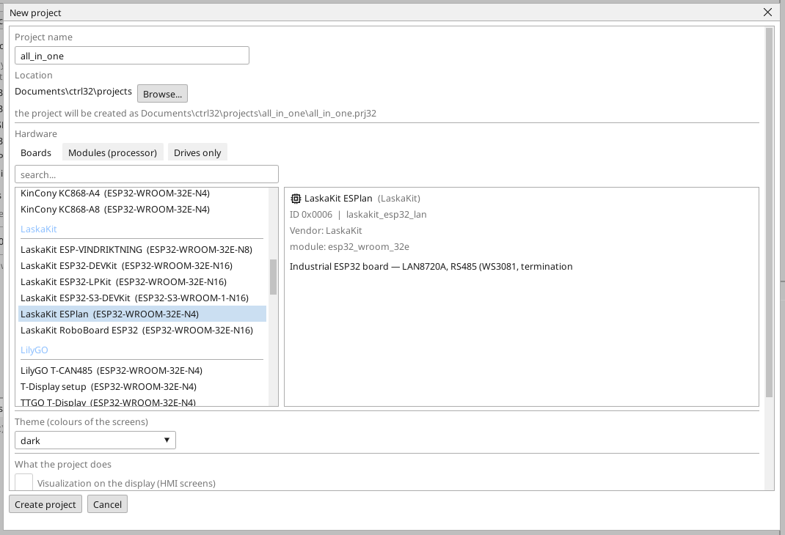
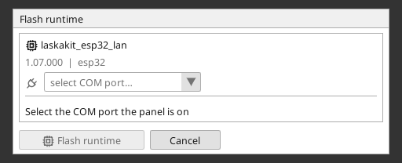
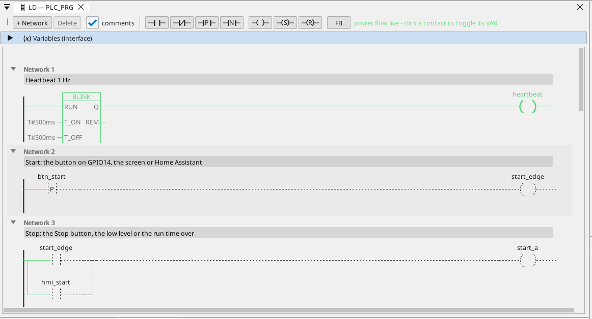

# Nahrání runtime ctrl32

Runtime je program v desce, který vykonává tvůj projekt - cyklus PLC, obrazovky, komunikaci. Do desky se nahraje jednou; potom je každá změna projektu nahráním, které přepíše jen projekt.

## 1. Připoj desku

Připoj desku k PC kabelem USB. Deska má převodník USB-UART CH9102. Windows 10 a 11 si jeho ovladač
většinou nainstalují samy; pokud se port neobjeví, nainstaluj ovladač
CH343SER od výrobce čipu (WCH).

## 2. Vytvoř projekt

Spusť editor ctrl32 a zvol **New project** (Ctrl+N). Zadej **název** projektu, v seznamu desek vyber **LaskaKit ESPlan** (pod **LaskaKit**) a stiskni **Create project**.

Chceš-li začít hotovým příkladem, otevři [projekt all-in-one](examples/all-in-one/README.cs.md) (**File → Open**).

## 3. Zapiš runtime

Vyber COM port desky ve výběru portu na panelu nástrojů, klikni na desku ve stromu zařízení a stiskni **Flash runtime**. Editor runtime zapíše, přečte zpět a ověří; trvá to asi minutu a deska se restartuje. Dělá se to jednou - a znovu až tehdy, když editor přinese novou řadu runtime.

## 4. Nahraj projekt

Stiskni tlačítko nahrání na panelu nástrojů (F5). Editor projekt sestaví, zapíše ho do neaktivního slotu programu v desce, ověří ho a až pak přepne - nepovedené nahrání nechá běžící program nedotčený.

## 5. Ověř, že běží

Stiskni **ONLINE** (ikona zástrčky vedle výběru portu) a sleduj program v desce: co vede, je zelené, každá proměnná nese živou hodnotu. Bez desky ukáže totéž **simulace** (tlačítko na panelu vedle ONLINE).

Něco nejde? Viz [Řešení problémů](troubleshooting.cs.md).

*Snímky obrazovky: editor ctrl32 1.07.*

---

[← Hardware a zapojení](hardware.cs.md) | [Přehled](README.cs.md) | [Nastavení →](configure.cs.md)
