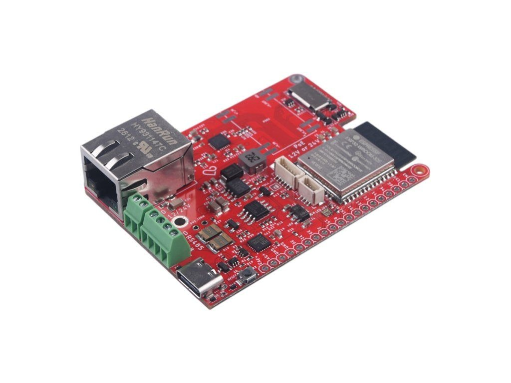
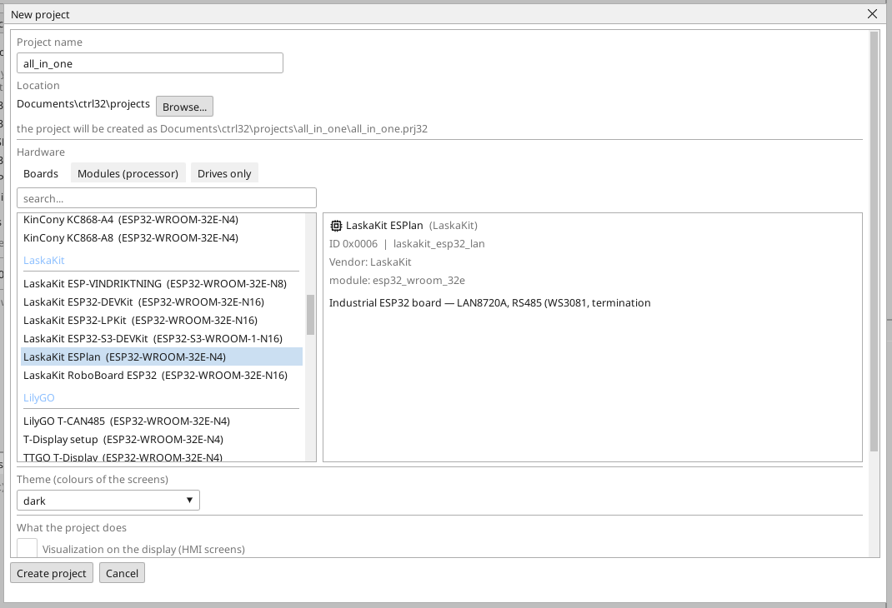
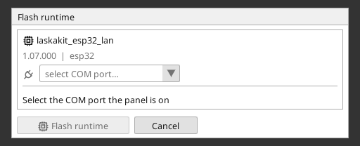
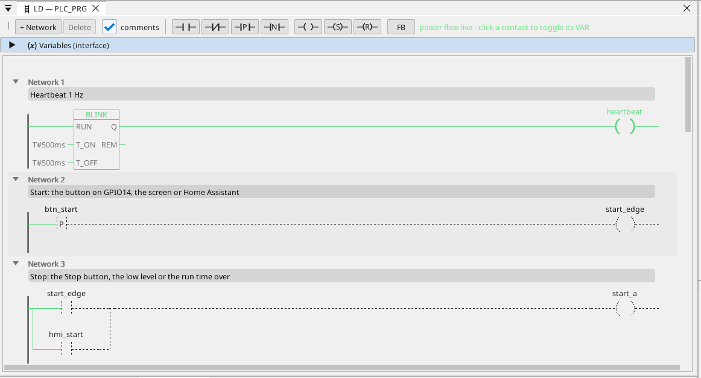

# Instalacja runtime ctrl32

Runtime to program na płytce, który wykonuje twój projekt - cykl PLC, ekrany, komunikację. Trafia na płytkę raz; potem każda zmiana projektu to wgranie, które nadpisuje wyłącznie projekt.

## 1. Podłączenie płytki

Podłącz płytkę do PC kablem USB. Płytka ma konwerter USB-UART CH9102. Windows 10 i 11 zwykle same
instalują jego sterownik; jeśli port się nie pojawia, zainstaluj
sterownik CH343SER od producenta układu (WCH).

## 2. Tworzenie projektu

Uruchom edytor ctrl32 i wybierz **New project** (Ctrl+N). Wpisz **nazwę** projektu, wybierz **LaskaKit ESPlan** z listy płytek (w **LaskaKit**) i naciśnij **Create project**.

Aby zamiast tego zacząć od gotowego przykładu, otwórz [projekt all-in-one](examples/all-in-one/README.pl.md) (**File → Open**).

## 3. Zapis runtime

Wybierz port COM płytki w selektorze portów na pasku narzędzi, kliknij płytkę w drzewie urządzeń i naciśnij **Flash runtime**. Edytor zapisuje runtime, odczytuje go z powrotem i weryfikuje; trwa to około minuty, a płytka uruchamia się ponownie. Robi się to raz - i ponownie tylko wtedy, gdy edytor przynosi nową linię runtime.

## 4. Wgranie projektu

Naciśnij przycisk wgrywania na pasku narzędzi (F5). Edytor buduje projekt, zapisuje go do nieaktywnego slotu programu płytki, weryfikuje i dopiero wtedy przełącza - nieudane wgranie nie narusza działającego programu.

## 5. Sprawdź, czy działa

Naciśnij **ONLINE** (ikona wtyczki obok selektora portów), aby obserwować program na płytce: to, co przewodzi, jest zielone, każda zmienna ma swoją bieżącą wartość. Bez płytki pod ręką ten sam widok daje **symulacja** (przycisk obok ONLINE na pasku narzędzi).

Coś nie działa? Zobacz [Rozwiązywanie problemów](troubleshooting.pl.md).

*Zrzuty ekranu: edytor ctrl32 1.07.*

---

[← Sprzęt i okablowanie](hardware.pl.md) | [Przegląd](README.pl.md) | [Konfiguracja →](configure.pl.md)
