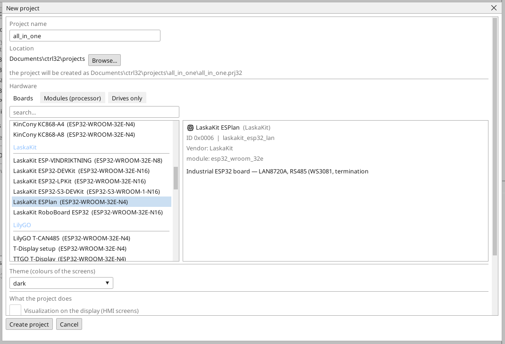
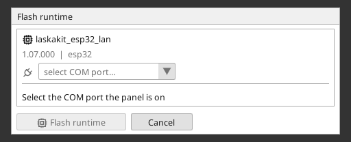
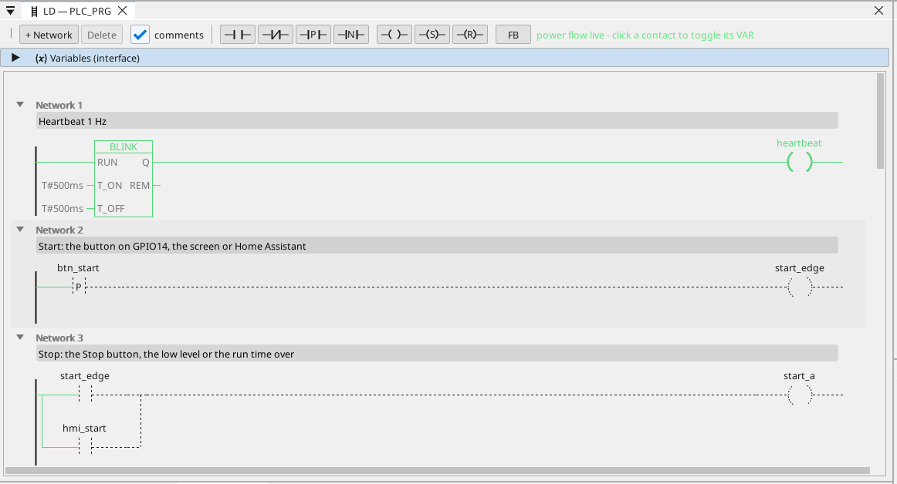

# Instalează runtime-ul ctrl32

Runtime-ul este programul de pe placă care rulează proiectul tău - ciclul PLC, ecranele, comunicația. Ajunge pe placă o singură dată; după aceea fiecare modificare a proiectului este o descărcare care nu rescrie nimic în afară de proiect.

## 1. Conectează placa

Conectează placa la PC cu cablul USB. Placa are un convertor USB-UART CH9102. Windows 10 și 11 îi instalează de
obicei driverul singure; dacă portul nu apare, instalează driverul
CH343SER de la producătorul cipului (WCH).

## 2. Creează proiectul

Pornește editorul ctrl32 și alege **New project** (Ctrl+N). Introdu **numele** proiectului, alege **LaskaKit ESPlan** în lista de plăci (sub **LaskaKit**) și apasă **Create project**.

Pentru a porni în schimb de la exemplul gata făcut, deschide [proiectul all-in-one](examples/all-in-one/README.ro.md) (**File → Open**).

## 3. Scrie runtime-ul

Alege portul COM al plăcii în selectorul de port din bara de instrumente, fă clic pe placă în arborele de dispozitive și apasă **Flash runtime**. Editorul scrie runtime-ul, îl citește înapoi și îl verifică; durează cam un minut, iar placa repornește. Acest lucru se face o dată - și din nou doar când editorul aduce o nouă linie de runtime.

## 4. Descarcă proiectul

Apasă butonul de descărcare din bara de instrumente (F5). Editorul construiește proiectul, îl scrie în slotul de program inactiv al plăcii, îl verifică și abia apoi comută - o descărcare eșuată lasă neatins programul care rulează.

## 5. Verifică că rulează

Apasă **ONLINE** (pictograma ștecher de lângă selectorul de port) pentru a urmări programul pe placă: ce conduce este verde, fiecare variabilă își poartă valoarea live. Fără o placă la îndemână, aceeași vedere o oferă **simularea** (butonul din bara de instrumente de lângă ONLINE).

Ceva nu funcționează? Vezi [Depanare](troubleshooting.ro.md).

*Capturi de ecran: editorul ctrl32 1.07.*

---

[← Hardware și cablare](hardware.ro.md) | [Prezentare](README.ro.md) | [Configurare →](configure.ro.md)
