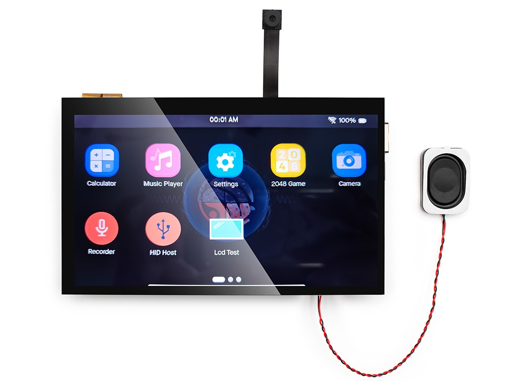
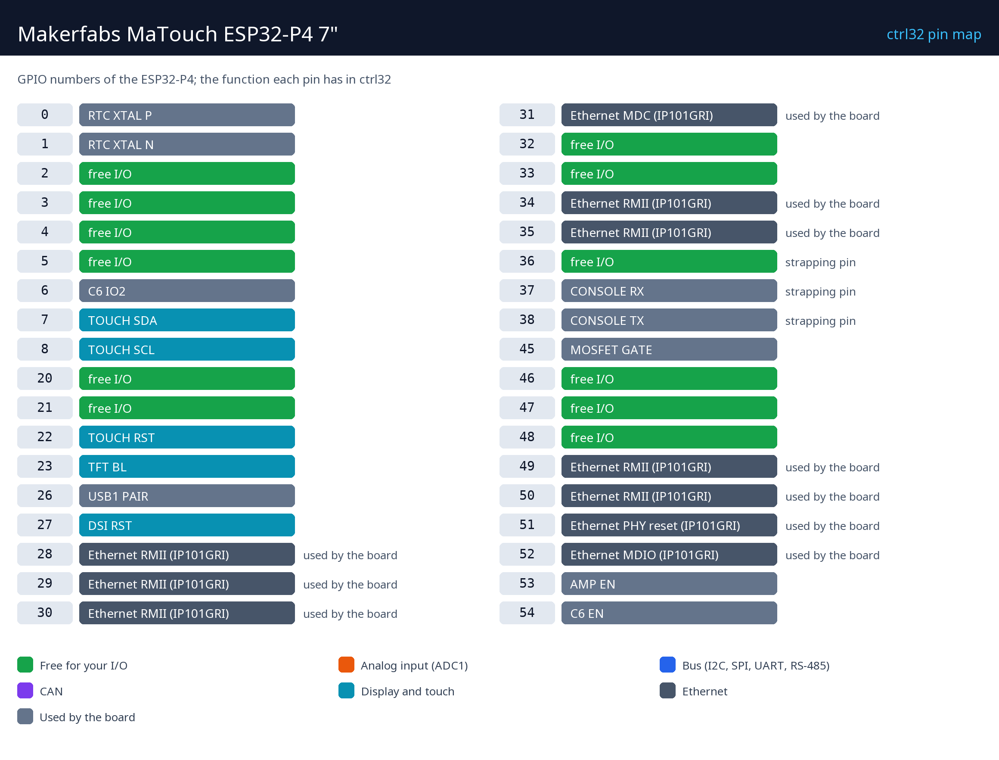

# Makerfabs MaTouch ESP32-P4 7"

     

A Makerfabs MaTouch ESP32-P4 7" egy teljes érintőpanel egyetlen panelen: 1024 x 600-as MIPI kijelző kapacitív érintéssel, a kétmagos ESP32-P4 32 MB PSRAM-mal, Ethernet, és Wi-Fi 6 egy ESP32-C6-on keresztül. A ctrl32-vel HMI és PLC egyben - a szerkesztőben rajzolt képernyők a kijelzőn futnak, mellettük létraprogram fut, és ugyanazok az értékek eljutnak bármely böngészőbe (WEBview), Modbus eszközökhöz, CAN-ra és MQTT-re.

**Mire jó:**

- Kezelőpanel egy gépen, saját logikával
- Okosotthon- vagy épületvezérlő panel a falon
- Modbus / CAN átjáró képernyővel

A panel oldala a katalógusban: [Makerfabs MaTouch ESP32-P4 7"](https://ctrl32.com/hardware/boards/makerfabs-matouch-esp32-p4-tft-with-touch-7-mipi/)

## Mire képes a ctrl32 ezen a panelen

<!-- capabilities:start -->
| Funkció | Ezen a panelen | Megjegyzés |
|---|---|---|
| Chip | ESP32-P4 (ESP32-P4NRW32) |  |
| Memória | 16 MB flash, 32 MB PSRAM |  |
| Programméret | 4096 változó, 512 riasztás, 512 blokk | a szerkesztő letöltés előtt ellenőrzi |
| Digitális bemenetek / kimenetek | 12 szabad GPIO | lásd a lábkiosztást |
| Analóg bemenetek | I2C ADC-n keresztül (ADS1115) |  |
| Ethernet | igen - IP101GRI |  |
| Wi-Fi | Wi-Fi 6 (2.4 GHz) |  |
| CAN (TWAI) | 1 | külső adó-vevő kell hozzá |
| Modbus RTU (RS-485) | igen | szabad lábakon, külső adó-vevő kell hozzá |
| Modbus TCP | kliens és szerver |  |
| MQTT | igen (TLS is) | Home Assistant discovery |
| WEBview | igen | a kezelőoldal bármely böngészőben |
| Kijelző / érintés (HMI) | 7" 1024x600, GT911 |  |
| USB | USB-C (CH340K USB-UART, Native USB) |  |
| Tápellátás | 5 V USB (4.0–5.25 V), 3.7 V Li-Po / Li-Ion |  |
<!-- capabilities:end -->

### Ami nem támogatott

- A kamera (SC2336 a MIPI CSI-n) - a ctrl32 gépi látást csak a 64 bites Linux runtime-on futtat.
- Az audiokodek, a mikrofon és a hangszórókimenet.
- Az ESP32-C6 Bluetooth-a.
- A microSD foglalat - a ctrl32 a programot és a képernyőket a panel flash memóriájában tartja.

## Az útmutató

| Lépés | Oldal |
|---|---|
| 1 | [Hardver és bekötés](hardware.hu.md) - amire szükséged van, tápellátás, lábkiosztás |
| 2 | [A runtime telepítése](install.hu.md) - a szerkesztő, a panel, az első feltöltés |
| 3 | [Beállítás](configure.hu.md) - hálózat, I/O, kommunikáció |
| 4 | [Példaprojektek](examples/README.hu.md) - minden, amire a panel képes, megnyitásra készen |
| - | [Hibaelhárítás](troubleshooting.hu.md) |

## Fájlok

| Fájl | Mi |
|---|---|
| [pinout/pinout.svg](pinout/pinout.svg) | a lábkiosztás, vektoros (és [PNG](pinout/pinout.png)) |
| [makerfabs-matouch_esp32-p4_tft_with_touch_7_v1.2.pdf](schematics/makerfabs-matouch_esp32-p4_tft_with_touch_7_v1.2.pdf) | MaTouch ESP32-P4 TFT with Touch 7“ V1.2 |
| [makerfabs-matouch-p4-7-display-datasheet.pdf](datasheets/makerfabs-matouch-p4-7-display-datasheet.pdf) | 7" 1024x600 MIPI display AML070JGI50 datasheet |
| [makerfabs-matouch-p4-es8311-datasheet.pdf](datasheets/makerfabs-matouch-p4-es8311-datasheet.pdf) | ES8311 audio codec datasheet |
| [esp32-p4-datasheet.pdf](datasheets/esp32-p4-datasheet.pdf) | ESP32-P4 datasheet (pre-release) |
| [makerfabs-matouch-p4-sc2336-camera-datasheet.pdf](datasheets/makerfabs-matouch-p4-sc2336-camera-datasheet.pdf) | SC2336 2 MP MIPI camera module datasheet |
| [NOTICE](https://github.com/ctrl32/hardware/blob/main/NOTICE.md) | honnan származnak a fotók, a kapcsolási rajzok és a modellek |

## Tovább

- [ctrl32 dokumentáció](https://ctrl32.com/docs/) - a szerkesztő, a nyelvek, minden blokk
- [A szerkesztő letöltése](https://ctrl32.com/download/)
- Minden tesztelt panel
- Makerfabs MaTouch Lite ESP32-S3 3.95" - a kis testvér
- [Okosotthon-vezérlőpanel a MaTouch ESP32-P4-en](https://ctrl32.com/examples/smart-home-control-panel-on-an-esp32-p4-7-touch-display/) - egy teljes példa a weben

