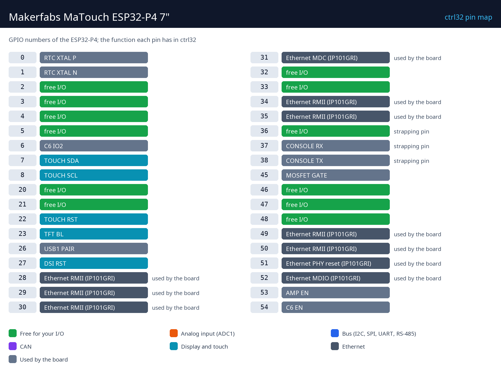

# Makerfabs MaTouch ESP32-P4 7"

     

The Makerfabs MaTouch ESP32-P4 7" is a complete touch panel on one board: a 1024 x 600 MIPI display with capacitive touch, the dual-core ESP32-P4 with 32 MB of PSRAM, Ethernet, and Wi-Fi 6 through an ESP32-C6. With ctrl32 it is an HMI and a PLC in one - screens drawn in the editor run on the glass, a ladder program runs beside them, and the same values reach any browser (WEBview), Modbus devices, CAN and MQTT.

**Good for:**

- An operator panel on a machine, with its own logic
- A smart-home or building control panel on the wall
- A Modbus / CAN gateway with a screen

Board page in the catalog: [Makerfabs MaTouch ESP32-P4 7"](https://ctrl32.com/hardware/boards/makerfabs-matouch-esp32-p4-tft-with-touch-7-mipi/)

## What ctrl32 can do on this board

<!-- capabilities:start -->
| Feature | On this board | Notes |
|---|---|---|
| Chip | ESP32-P4 (ESP32-P4NRW32) |  |
| Memory | 16 MB flash, 32 MB PSRAM |  |
| Program size | 4096 variables, 512 alarms, 512 blocks | checked by the editor before a download |
| Digital inputs / outputs | 12 free GPIO | see the pin map |
| Analog inputs | through an I2C ADC (ADS1115) |  |
| Ethernet | yes - IP101GRI |  |
| Wi-Fi | Wi-Fi 6 (2.4 GHz) |  |
| CAN (TWAI) | 1 | needs an external transceiver |
| Modbus RTU (RS-485) | yes | on free pins, needs an external transceiver |
| Modbus TCP | client and server |  |
| MQTT | yes (TLS too) | Home Assistant discovery |
| WEBview | yes | the operator page in any browser |
| Display / touch (HMI) | 7" 1024x600, GT911 |  |
| USB | USB-C (CH340K USB-UART, Native USB) |  |
| Power | 5 V USB (4.0–5.25 V), 3.7 V Li-Po / Li-Ion |  |
<!-- capabilities:end -->

### What is not supported

- The camera (SC2336 on MIPI CSI) - ctrl32 runs vision on the 64-bit Linux runtime only.
- The audio codec, the microphone and the speaker output.
- Bluetooth of the ESP32-C6.
- The microSD slot - ctrl32 keeps the program and the screens in the board's flash.

## The guide

| Step | Page |
|---|---|
| 1 | [Hardware and wiring](hardware.md) - what you need, power, the pin map |
| 2 | [Install the runtime](install.md) - the editor, the board, the first upload |
| 3 | [Configure](configure.md) - network, I/O, communication |
| 4 | [Example projects](examples/README.md) - everything the board does, ready to open |
| - | [Troubleshooting](troubleshooting.md) |

## Files

| File | What |
|---|---|
| [pinout/pinout.svg](pinout/pinout.svg) | the pin map, vector (also [PNG](pinout/pinout.png)) |
| [makerfabs-matouch_esp32-p4_tft_with_touch_7_v1.2.pdf](schematics/makerfabs-matouch_esp32-p4_tft_with_touch_7_v1.2.pdf) | MaTouch ESP32-P4 TFT with Touch 7“ V1.2 |
| [makerfabs-matouch-p4-7-display-datasheet.pdf](datasheets/makerfabs-matouch-p4-7-display-datasheet.pdf) | 7" 1024x600 MIPI display AML070JGI50 datasheet |
| [makerfabs-matouch-p4-es8311-datasheet.pdf](datasheets/makerfabs-matouch-p4-es8311-datasheet.pdf) | ES8311 audio codec datasheet |
| [esp32-p4-datasheet.pdf](datasheets/esp32-p4-datasheet.pdf) | ESP32-P4 datasheet (pre-release) |
| [makerfabs-matouch-p4-sc2336-camera-datasheet.pdf](datasheets/makerfabs-matouch-p4-sc2336-camera-datasheet.pdf) | SC2336 2 MP MIPI camera module datasheet |
| [NOTICE](https://github.com/ctrl32/hardware/blob/main/NOTICE.md) | where the photos, schematics and models come from |

## Next steps

- [ctrl32 documentation](https://ctrl32.com/docs/) - the editor, the languages, every block
- [Download the editor](https://ctrl32.com/download/)
- [All tested boards](../../README.md)
- Makerfabs MaTouch Lite ESP32-S3 3.95" - the small sibling
- [Smart home control panel on the MaTouch ESP32-P4](https://ctrl32.com/examples/smart-home-control-panel-on-an-esp32-p4-7-touch-display/) - a full example on the web

