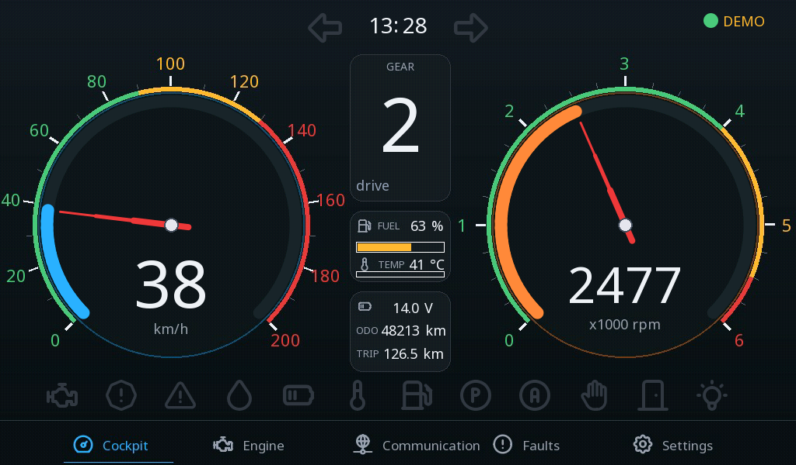

# Example projects

Each project opens in the ctrl32 editor (**File → Open**) and runs on the Makerfabs MaTouch ESP32-P4 7" as it is.

| | Project | What it shows |
|---|---|---|
|  | [All-in-one](all-in-one/README.md) | A motor controlled from the touch screen, two buttons and Home Assistant, with a pressure gauge, a fan on a Modbus RTU temperature, a Modbus TCP power meter, CAN frames, a trend and the alarms. |
|  | [Home dashboard](home-dashboard/README.md) | A whole-house control panel in a dark frosted-glass style - heating per room, energy with PV and a battery, lights, the garage and the weather - with a simulated house behind it. |
|  | [Car cockpit](car-cockpit/README.md) | An instrument cluster on a J1939 vehicle bus - speed and rpm gauges, gear, fuel, coolant, the warning lamps, the control units on the bus, the active fault code in words and the driver's settings. |
|  | [Flexo press on a SIMATIC](flexo-press-simatic/README.md) | The HMI of an eight-colour flexographic press controlled by a SIMATIC S7-1200 - the press with its moving web, sixteen print servos, the register, the dryers, jobs as recipes and the diagnostics, over the S7 protocol. |

---

[← Configure](../configure.md) | [Overview](../README.md) | [Troubleshooting →](../troubleshooting.md)
