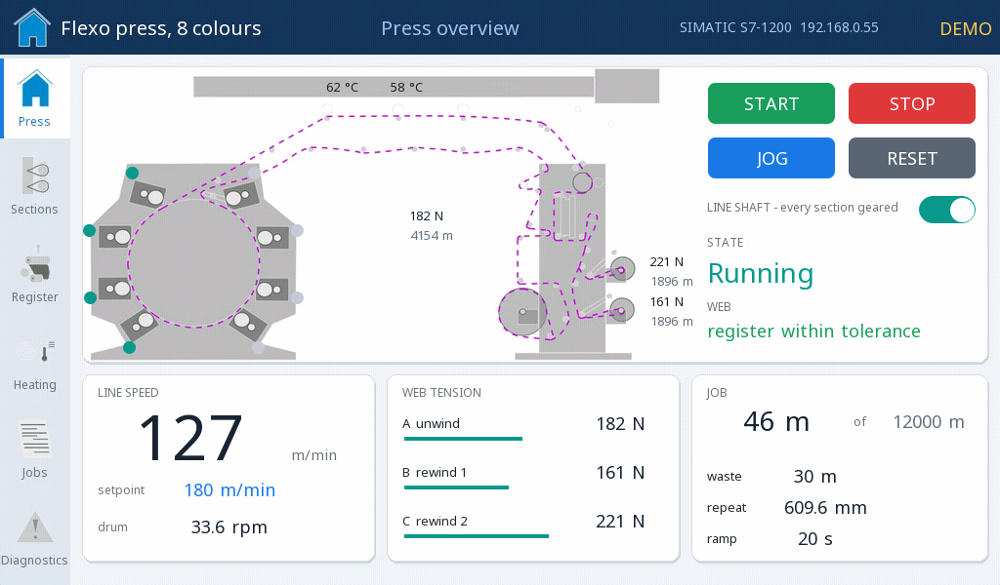

# Vzorové projekty

Každý projekt sa otvorí v editore ctrl32 (**File → Open**) a beží na doske Makerfabs MaTouch ESP32-P4 7" tak, ako je.

| | Projekt | Čo ukazuje |
|---|---|---|
|  | [All-in-one](all-in-one/README.sk.md) | Motor ovládaný z dotykovej obrazovky, dvoma tlačidlami a z Home Assistant, s ukazovateľom tlaku, ventilátorom podľa teploty z Modbus RTU, elektromerom Modbus TCP, rámcami CAN, priebehom a alarmami. |
|  | [Home dashboard](home-dashboard/README.sk.md) | Ovládací panel celého domu v tmavom štýle matného skla - kúrenie po miestnostiach, energia s FV a batériou, svetlá, garáž a počasie - so simulovaným domom za ním. |
|  | [Car cockpit](car-cockpit/README.sk.md) | Prístrojový panel na vozidlovej zbernici J1939 - ukazovatele rýchlosti a otáčok, prevodový stupeň, palivo, chladiaca kvapalina, varovné kontrolky, riadiace jednotky na zbernici, aktívny kód poruchy slovami a nastavenia vodiča. |
|  | [Flexo press on a SIMATIC](flexo-press-simatic/README.sk.md) | HMI osemfarebného flexotlačového stroja riadeného SIMATIC S7-1200 - stroj s pohybujúcim sa pásom, šestnásť tlačových servopohonov, register, sušiče, zákazky ako recepty a diagnostika, cez protokol S7. |

---

[← Nastavenie](../configure.sk.md) | [Prehľad](../README.sk.md) | [Riešenie problémov →](../troubleshooting.sk.md)
