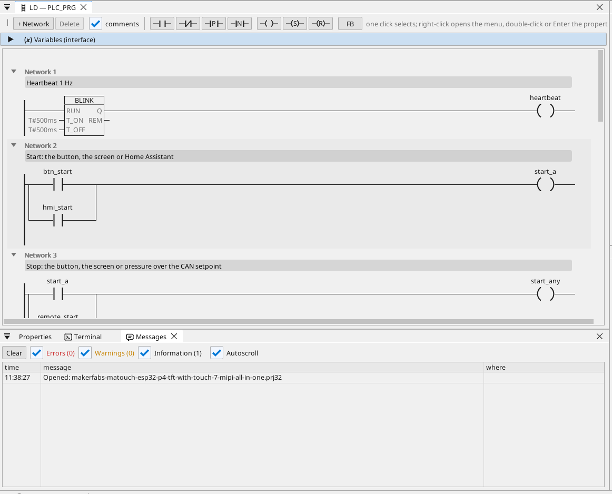
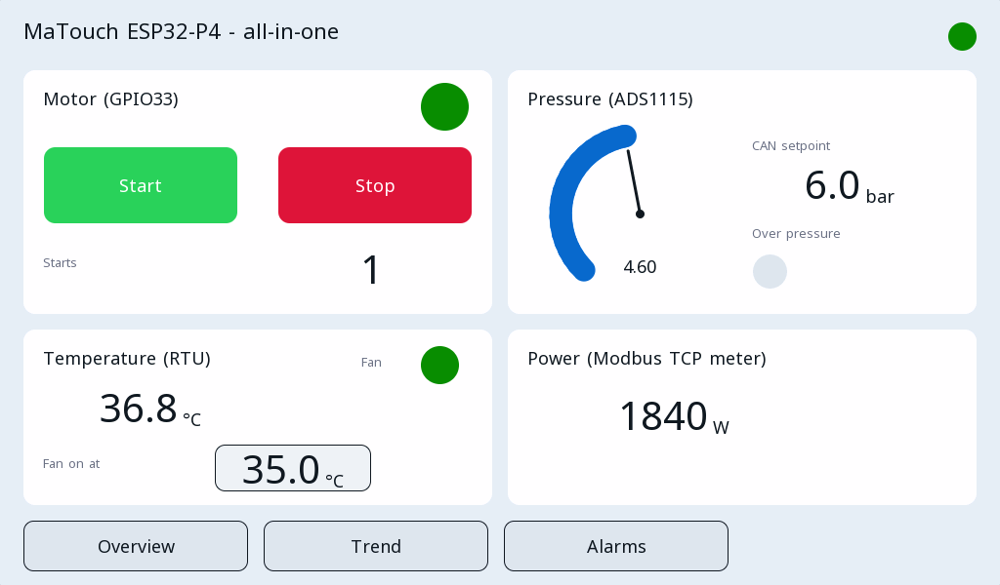

# All-in-one

Egy motor, amelyet az érintőképernyő, két gomb és Home Assistant vezérel, nyomásmérővel, egy Modbus RTU hőmérséklet szerint működő ventilátorral, egy Modbus TCP teljesítménymérővel, CAN keretekkel, egy trenddel és a riasztásokkal.

**Letöltés:** [all-in-one.prj32](all-in-one.prj32) - nyisd meg a ctrl32 szerkesztőben (**File → Open**).

## Mit csinál

A program egy kis gépvezérlés:

- A **Start** jöhet egy gombról a GPIO47-en, a képernyő **Start**
  gombjáról vagy Home Assistantból MQTT-n keresztül; a **Stop** egy
  gombról a GPIO48-on, a képernyő **Stop** gombjáról, vagy akkor jön,
  ha a nyomás a **CAN**-on érkező alapjel fölé emelkedik (0x201 keret).
- Az öntartás vezérli a motorkimenetet a **GPIO33**-on; egy számláló
  áramszünet után is megőrzi az indítások számát.
- A **nyomás** egy analóg bemenet egy **ADS1115**-ön keresztül az I2C
  buszon (0-10 V egy 1:4-es osztón át, 0-10 bar), és 100 ms-onként
  kimegy a CAN-ra (0x181 keret).
- A **hőmérséklet** egy **Modbus RTU** érzékelőtől jön (unit 1, 1-es
  bemeneti regiszter, 0,1 °C); egy ventilátor hiszterézissel követi.
- Egy **Modbus TCP** mérő adja a teljesítményigényt.
- Három **képernyő** a kijelzőn: az áttekintés, egy trend és a
  riasztások; egy egyszerűbb oldal bármely böngészőben (WEBview).

## A program

## A kezelőoldal

## Megnyitás és futtatás

1. Nyisd meg a `all-in-one.prj32` fájlt a szerkesztőben.
2. Írd át a címeket (a Modbus eszközét, az MQTT brókerét) a saját hálózatodéira.
3. Indítsd el a **szimulációt** (eszköztár), hogy kipróbáld a PC-n, vagy töltsd le a panelre - lásd [A runtime telepítése](../../install.hu.md).

## Amit látnod kell

Az áttekintés megjelenik a kijelzőn. Nyomd meg a **Start** gombot: a
motor LED-je világít, és az indításszámláló nő. A mérő a nyomást
mutatja, a Trend képernyő a hőmérséklettel együtt rajzolja, és az
Alarms képernyőn riasztás jelenik meg, ha a nyomás 8 bar fölé megy.

---

[← Példaprojektek](../README.hu.md) | [Áttekintés](../../README.hu.md)
