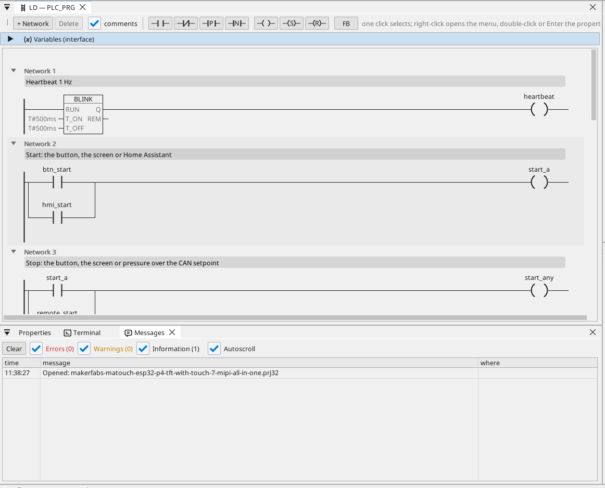
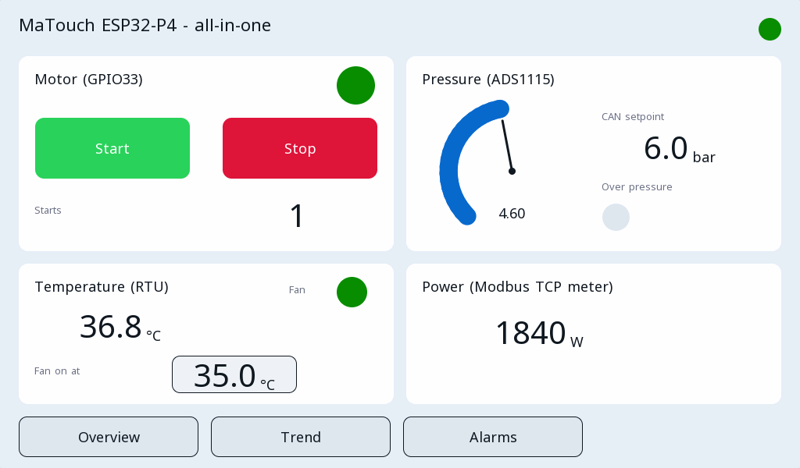

# All-in-one

A motor controlled from the touch screen, two buttons and Home Assistant, with a pressure gauge, a fan on a Modbus RTU temperature, a Modbus TCP power meter, CAN frames, a trend and the alarms.

**Download:** [all-in-one.prj32](all-in-one.prj32) - open it in the ctrl32 editor (**File → Open**).

## What it does

The program is a small machine controller:

- **Start** comes from a button on GPIO47, from **Start** on the
  screen, or from Home Assistant over MQTT; **Stop** from a button on
  GPIO48, from **Stop** on the screen, or from the pressure rising
  above the setpoint that arrives over **CAN** (frame 0x201).
- The latch drives the motor output on **GPIO33**; a counter keeps the
  number of starts through a power cut.
- The **pressure** is an analog input through an **ADS1115** on the I2C
  bus (0-10 V through a 1:4 divider, 0-10 bar) and goes out over CAN
  every 100 ms (frame 0x181).
- The **temperature** comes from a **Modbus RTU** sensor (unit 1,
  input register 1, 0.1 °C); a fan follows it with hysteresis.
- A **Modbus TCP** meter gives the power demand.
- Three **screens** on the glass: the overview, a trend and the alarms;
  a simpler page in any browser (WEBview).

## The program

## The operator page

## Open and run it

1. Open `all-in-one.prj32` in the editor.
2. Change the addresses (the Modbus device, the MQTT broker) to the ones of your network.
3. Run the **simulation** (toolbar) to try it on the PC, or download it to the board - see [Install the runtime](../../install.md).

## What you should see

The overview comes up on the glass. Press **Start**: the motor LED
lights and the start counter goes up. The gauge shows the pressure,
the Trend screen draws it with the temperature, and an alarm appears
on the Alarms screen when the pressure goes over 8 bar.

---

[← Example projects](../README.md) | [Overview](../../README.md)
