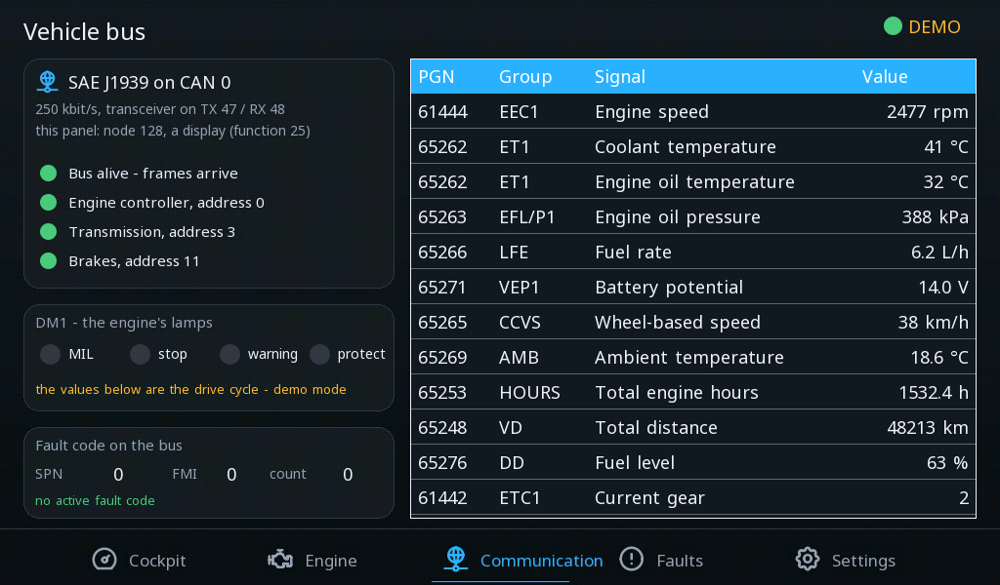
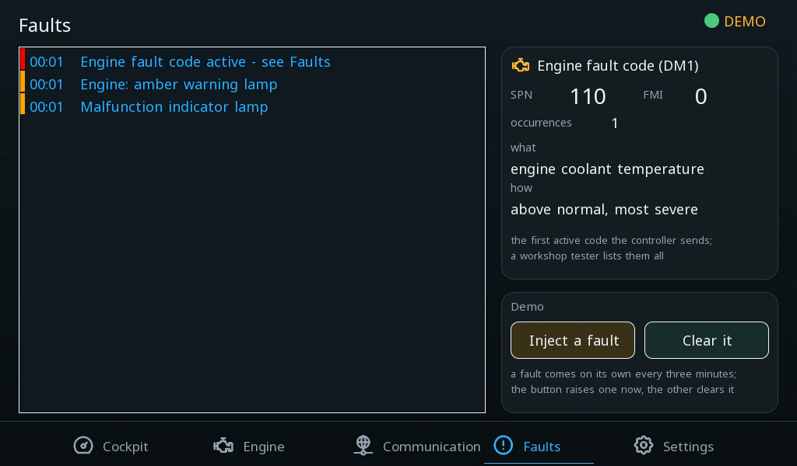

# Car cockpit

An instrument cluster on a J1939 vehicle bus - speed and rpm gauges, gear, fuel, coolant, the warning lamps, the control units on the bus, the active fault code in words and the driver's settings.

**Download:** [car-cockpit.prj32](car-cockpit.prj32) - open it in the ctrl32 editor (**File → Open**).

## What it does

Five screens on the 7" glass:

- **Cockpit** - speed and rpm gauges, the gear, fuel, coolant and
  battery, the odometer and trip, the clock, the turn signals and the
  warning lamps.
- **Engine** - the engine's values in detail.
- **Bus** - the **J1939** network: the panel's node, the engine, the
  transmission and the brakes and whether they answer, the DM1 lamps,
  every signal with its parameter group.
- **Faults** - the alarm list and the engine's active fault code
  (SPN / FMI / count) with its meaning in words.
- **Settings** - demo mode, units, the speed warning, the redline, the
  coolant and fuel warnings, the service interval.

The communication is **SAE J1939** on the board's CAN (a 3.3 V
transceiver on GPIO47 / GPIO48, 250 kbit/s): the engine, the
transmission and the brakes broadcast their parameter groups and the
panel reads them - no program is needed for a value to arrive. In
**demo mode** (on by default) the program SIM drives a cycle: pulls
away, shifts, cruises, brakes, stops - and now and then a fault.

## The screens

**Cockpit**

**Bus**

**Faults**

## Open and run it

1. Open `car-cockpit.prj32` in the editor.
2. Run it as it is in demo mode; on a vehicle connect the CAN transceiver to GPIO47 / GPIO48 and switch demo mode off on the Settings screen.
3. Run the **simulation** (toolbar) to try it on the PC, or download it to the board - see [Install the runtime](../../install.md).

## What you should see

The cluster comes up in demo mode: the needles move through the drive
cycle, the gear changes, the turn signals blink. Switch demo mode off on
the Settings screen and connect the bus - the gauges then show the
vehicle.

---

[← Example projects](../README.md) | [Overview](../../README.md)
