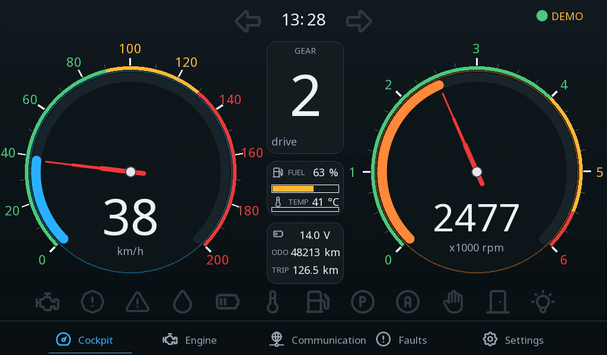
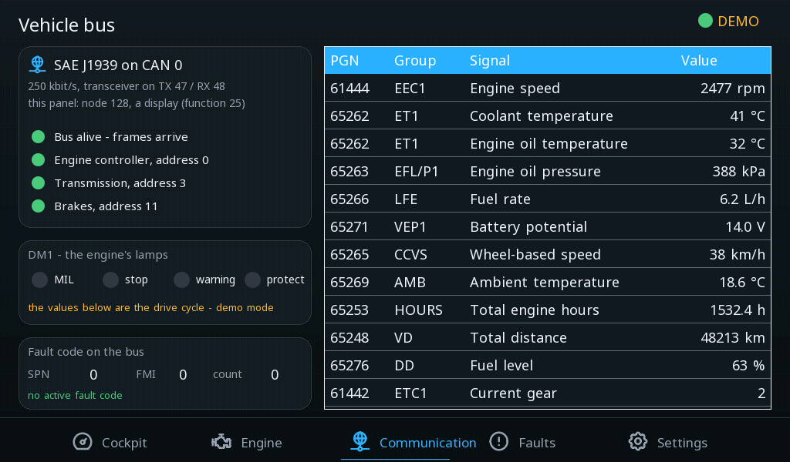
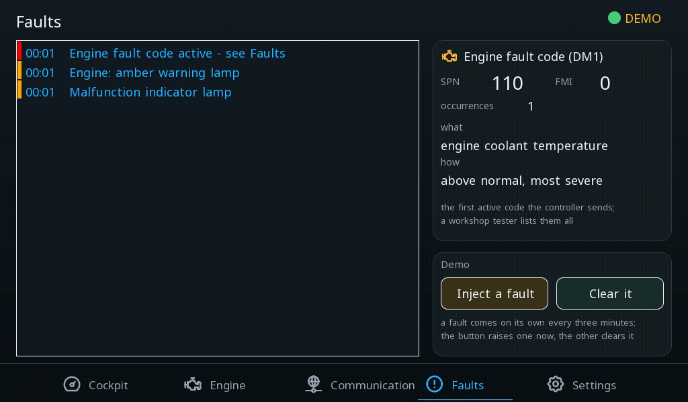

# Car cockpit

Prístrojový panel na vozidlovej zbernici J1939 - ukazovatele rýchlosti a otáčok, prevodový stupeň, palivo, chladiaca kvapalina, varovné kontrolky, riadiace jednotky na zbernici, aktívny kód poruchy slovami a nastavenia vodiča.

**Stiahnuť:** [car-cockpit.prj32](car-cockpit.prj32) - otvor ho v editore ctrl32 (**File → Open**).

## Čo robí

Päť obrazoviek na 7" skle:

- **Cockpit** - ukazovatele rýchlosti a otáčok, prevodový stupeň,
  palivo, chladiaca kvapalina a batéria, počítadlo kilometrov a úsekov,
  hodiny, smerovky a varovné kontrolky.
- **Engine** - hodnoty motora podrobne.
- **Bus** - sieť **J1939**: uzol panelu, motor, prevodovka a brzdy a
  či odpovedajú, kontrolky DM1, každý signál so svojou skupinou
  parametrov.
- **Faults** - zoznam alarmov a aktívny kód poruchy motora (SPN / FMI
  / počet) s jeho významom slovami.
- **Settings** - demo režim, jednotky, varovanie rýchlosti, červená
  zóna otáčok, varovania chladiacej kvapaliny a paliva, servisný
  interval.

Komunikácia je **SAE J1939** na CAN dosky (3,3 V prevodník na GPIO47 /
GPIO48, 250 kbit/s): motor, prevodovka a brzdy vysielajú svoje skupiny
parametrov a panel ich číta - aby hodnota prišla, netreba žiadny
program. V **demo režime** (štandardne zapnutý) program SIM jazdí
cyklus: rozbehne sa, preraďuje, ide ustálene, brzdí, zastaví - a občas
porucha.

## Obrazovky

**Kokpit**

**Zbernica**

**Poruchy**

## Otvor a spusti

1. Otvor `car-cockpit.prj32` v editore.
2. Spusti ho tak, ako je, v demo režime; vo vozidle pripoj prevodník CAN na GPIO47 / GPIO48 a vypni demo režim na obrazovke Settings.
3. Spusti **simuláciu** (panel nástrojov) a vyskúšaj ho na PC, alebo ho nahraj do dosky - pozri [Nahratie runtime](../../install.sk.md).

## Čo by si mal vidieť

Panel nabehne v demo režime: ručičky sa hýbu podľa jazdného cyklu,
prevodový stupeň sa mení, smerovky blikajú. Vypni demo režim na
obrazovke Settings a pripoj zbernicu - ukazovatele potom zobrazujú
vozidlo.

---

[← Vzorové projekty](../README.sk.md) | [Prehľad](../../README.sk.md)
