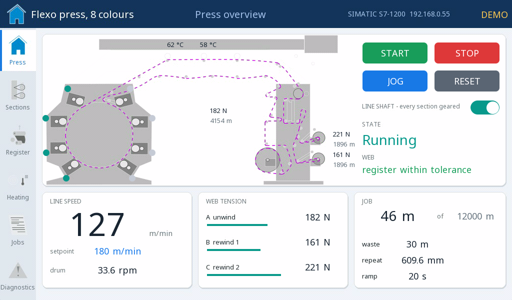
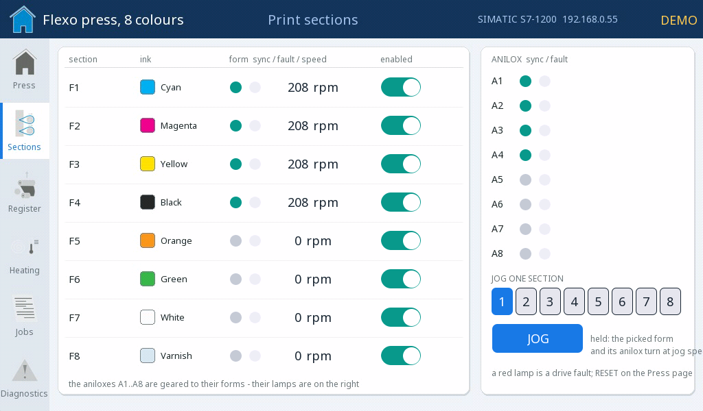
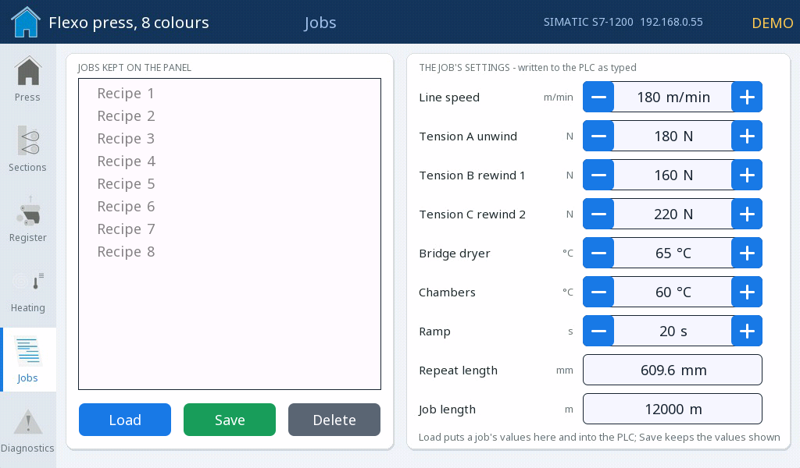

# Flexo press on a SIMATIC

The HMI of an eight-colour flexographic press controlled by a SIMATIC S7-1200 - the press with its moving web, sixteen print servos, the register, the dryers, jobs as recipes and the diagnostics, over the S7 protocol.

**Download:** [flexo-press-simatic.prj32](flexo-press-simatic.prj32) - open it in the ctrl32 editor (**File → Open**).

## What it does

Six pages on a light industrial panel:

- **Overview** - the press as a drawing with the web moving over it,
  the sections' sync lamps, the dryer temperatures, the web tensions and
  the roll lengths; START (confirmed), STOP, JOG, RESET.
- **Sections** - the sixteen print servos: plate cylinders and
  aniloxes, in sync, fault, speed, enabled.
- **Register** - the register error of each section and the correction.
- **Heating** - the drying chambers and the bridge dryer.
- **Jobs** - the job as a **recipe** kept on the panel: load, save,
  delete.
- **Diagnostics** - the alarms, the PLC link and a trend of speed and
  tension.

The panel talks to a **SIMATIC S7-1200** over **+7** (the S7 protocol,
ISO-on-TCP): it reads the PLC's status block DB100 every 100 ms and
writes its setpoints and commands to DB101 - nothing else is needed in
the PLC. In **demo mode** (on by default) the program SIM runs the press
on the panel itself.

## The screens

**Overview**

**Sections**

**Jobs**

## Open and run it

1. Open `flexo-press-simatic.prj32` in the editor.
2. Run it as it is in demo mode; with a PLC set its address on the +7 page and create the two data blocks DB100 / DB101.
3. Run the **simulation** (toolbar) to try it on the PC, or download it to the board - see [Install the runtime](../../install.md).

## What you should see

The overview comes up in demo mode. Press START and confirm: the line
ramps up, the web moves over the drawing and the tensions settle. Switch
demo mode off on the Diagnostics page and set the PLC's address - the
panel then shows the real press.

---

[← Example projects](../README.md) | [Overview](../../README.md)
