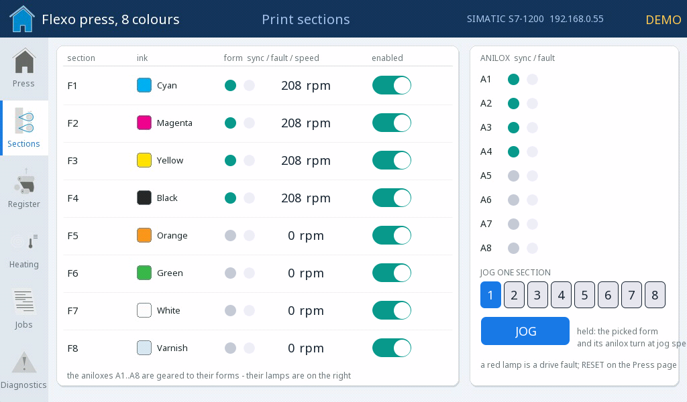
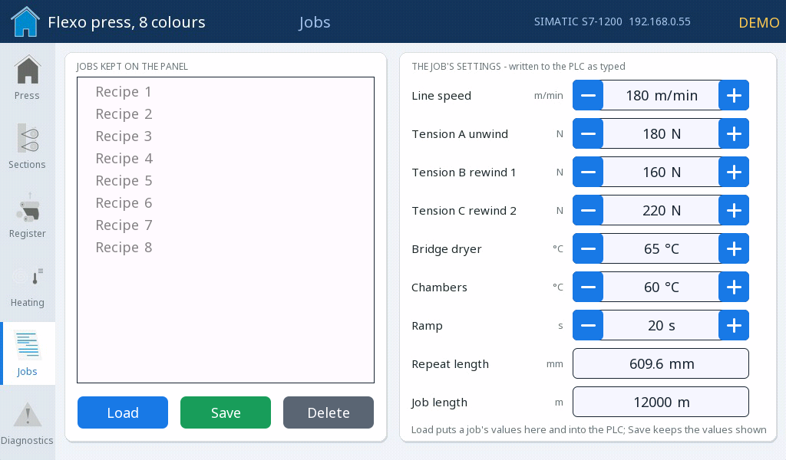

# Flexo press on a SIMATIC

HMI ośmiokolorowej maszyny fleksograficznej sterowanej przez SIMATIC S7-1200 - maszyna z przesuwającą się wstęgą, szesnaście serwonapędów drukujących, register, suszarki, zlecenia jako receptury i diagnostyka, przez protokół S7.

**Pobieranie:** [flexo-press-simatic.prj32](flexo-press-simatic.prj32) - otwórz go w edytorze ctrl32 (**File → Open**).

## Co robi

Sześć stron na jasnym panelu przemysłowym:

- **Overview** - maszyna jako rysunek z przesuwającą się po nim
  wstęgą, lampki synchronizacji zespołów, temperatury suszarek,
  naprężenia wstęgi i długości rolek; START (z potwierdzeniem), STOP,
  JOG, RESET.
- **Sections** - szesnaście serwonapędów drukujących: cylindry
  formowe i aniloksy, synchronizacja, błąd, prędkość, zezwolenie.
- **Register** - błąd registra każdego zespołu i korekta.
- **Heating** - komory suszące i suszarka mostowa.
- **Jobs** - zlecenie jako **receptura** przechowywana w panelu:
  wczytaj, zapisz, usuń.
- **Diagnostics** - alarmy, połączenie z PLC i wykres prędkości i
  naprężenia.

Panel rozmawia z **SIMATIC S7-1200** przez **+7** (protokół S7,
ISO-on-TCP): co 100 ms odczytuje blok stanu DB100 sterownika i zapisuje
swoje wartości zadane i polecenia do DB101 - w PLC nic więcej nie
jest potrzebne. W **trybie demo** (domyślnie włączonym) program SIM
prowadzi maszynę w samym panelu.

## Ekrany

**Przegląd**

**Zespoły**

**Zlecenia**

## Otwórz i uruchom

1. Otwórz `flexo-press-simatic.prj32` w edytorze.
2. Uruchom go bez zmian w trybie demo; ze sterownikiem PLC ustaw jego adres na stronie +7 i utwórz dwa bloki danych DB100 / DB101.
3. Uruchom **symulację** (pasek narzędzi), aby wypróbować projekt na PC, albo wgraj go na płytkę - zobacz [Instalacja runtime](../../install.pl.md).

## Co powinieneś zobaczyć

Przegląd pojawia się w trybie demo. Naciśnij START i potwierdź: linia
się rozpędza, wstęga przesuwa się po rysunku, a naprężenia się
stabilizują. Wyłącz tryb demo na stronie Diagnostics i ustaw adres
PLC - panel pokazuje wtedy prawdziwą maszynę.

---

[← Przykładowe projekty](../README.pl.md) | [Przegląd](../../README.pl.md)
