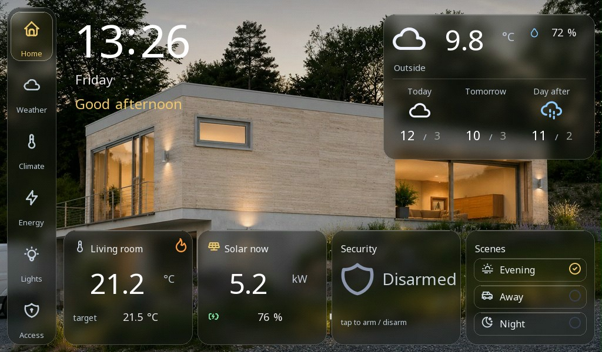
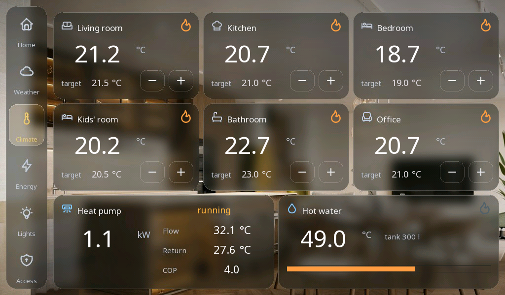
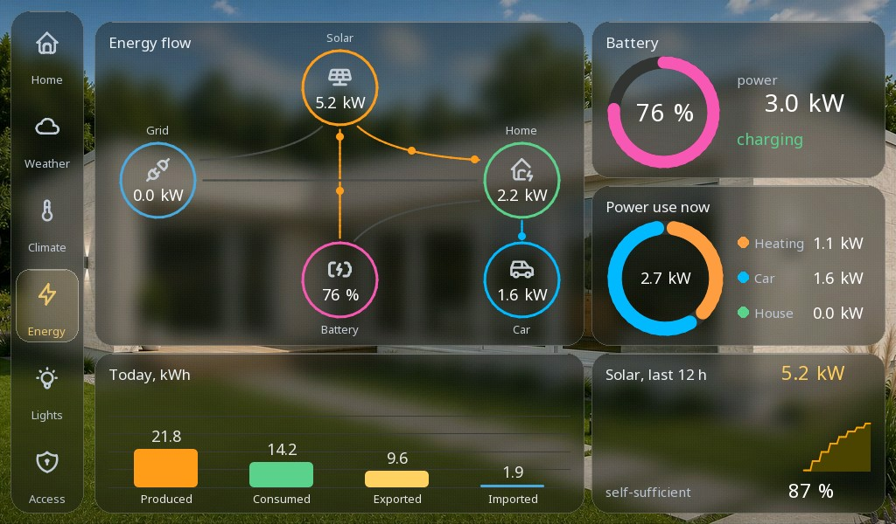

# Home dashboard

Un pannello di controllo per tutta la casa in stile vetro satinato scuro - riscaldamento per stanza, energia con fotovoltaico e batteria, luci, il garage e il meteo - con una casa simulata dietro.

**Download:** [home-dashboard.prj32](home-dashboard.prj32) - aprilo nell'editor ctrl32 (**File → Open**).

## Cosa fa

Sei schermate sopra fotografie della casa, ciascuna un insieme di
schede in vetro satinato:

- **Home** - l'ora, il meteo, le stanze, l'allarme e gli scenari.
- **Weather** - oggi e i giorni successivi.
- **Climate** - sei stanze, ciascuna con la sua temperatura, il suo
  setpoint e il riscaldamento; la pompa di calore e il bollitore
  dell'acqua calda.
- **Energy** - la produzione fotovoltaica, il consumo della casa, la
  batteria e la rete, i kWh del giorno.
- **Lights** - le luci delle stanze e i loro scenari.
- **Access** - la porta del garage, la stazione di ricarica dell'auto,
  l'allarme.

Il programma **SIM** è la casa: la temperatura esterna segue il giorno,
la produzione fotovoltaica il sole, il consumo ha i suoi picchi del
mattino e della sera, le stanze si riscaldano con isteresi fino ai loro
setpoint. Sostituisci le sue variabili con i tuoi dispositivi Modbus,
MQTT o CAN per comandare una casa reale.

## Le schermate

**Home**

**Clima**

**Energia**

## Aprirlo ed eseguirlo

1. Apri `home-dashboard.prj32` nell'editor.
2. Eseguilo così com'è - la casa è simulata; per una casa reale sostituisci le variabili del programma SIM con i tuoi dispositivi.
3. Avvia la **simulazione** (barra degli strumenti) per provarlo sul PC, oppure scaricalo sulla scheda - vedi [Installare il runtime](../../install.it.md).

## Cosa dovresti vedere

La schermata Home compare con l'ora, il meteo e le stanze; i valori si
muovono mentre il giorno simulato avanza. Un tocco sul setpoint di una
stanza lo cambia, e la stanza si riscalda fino a quel valore.

---

[← Progetti di esempio](../README.it.md) | [Panoramica](../../README.it.md)
