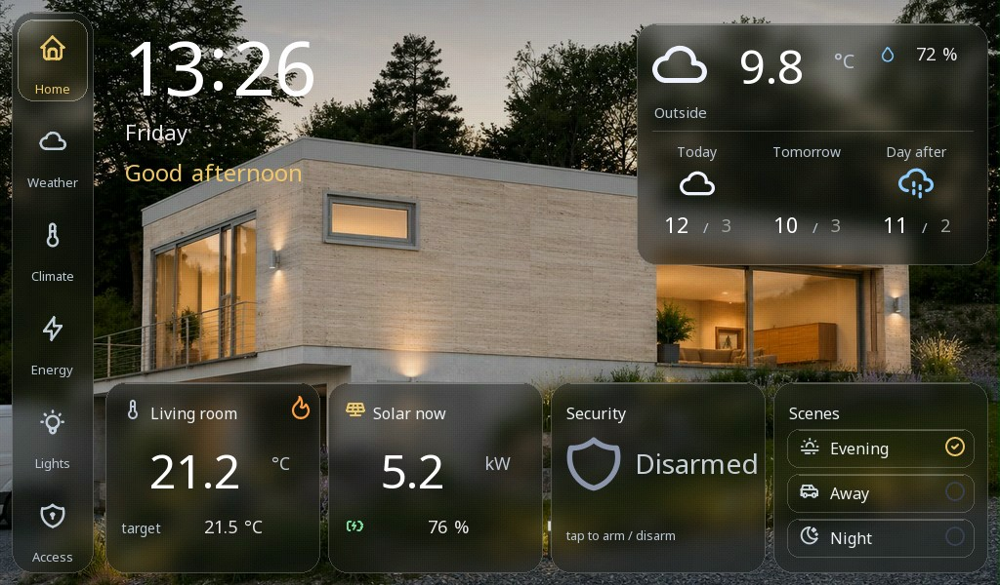
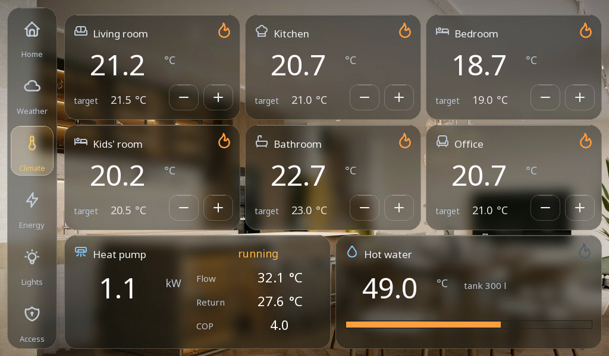
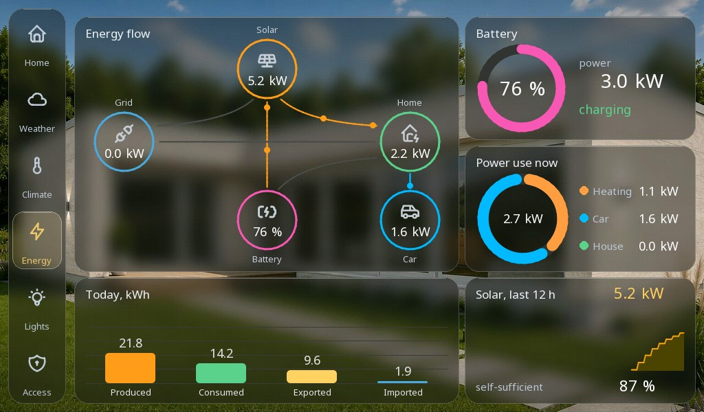

# Home dashboard

A whole-house control panel in a dark frosted-glass style - heating per room, energy with PV and a battery, lights, the garage and the weather - with a simulated house behind it.

**Download:** [home-dashboard.prj32](home-dashboard.prj32) - open it in the ctrl32 editor (**File → Open**).

## What it does

Six screens over photographs of the house, each a set of frosted cards:

- **Home** - the time, the weather, the rooms, the alarm and the scenes.
- **Weather** - today and the next days.
- **Climate** - six rooms, each with its temperature, its setpoint and
  the heating; the heat pump and the hot-water tank.
- **Energy** - the PV output, the house load, the battery and the grid,
  the day's kWh.
- **Lights** - the rooms' lights and their scenes.
- **Access** - the garage door, the car charger, the alarm.

The program **SIM** is the house: the outdoor temperature follows the
day, the PV output the sun, the load has its morning and evening peaks,
the rooms heat with hysteresis to their setpoints. Replace its
variables with your Modbus, MQTT or CAN devices to drive a real house.

## The screens

**Home**

**Climate**

**Energy**

## Open and run it

1. Open `home-dashboard.prj32` in the editor.
2. Run it as it is - the house is simulated; for a real house replace the program SIM's variables with your devices.
3. Run the **simulation** (toolbar) to try it on the PC, or download it to the board - see [Install the runtime](../../install.md).

## What you should see

The home screen comes up with the time, the weather and the rooms; the
values move as the simulated day goes on. A tap on a room's setpoint
changes it, and the room heats up to it.

---

[← Example projects](../README.md) | [Overview](../../README.md)
