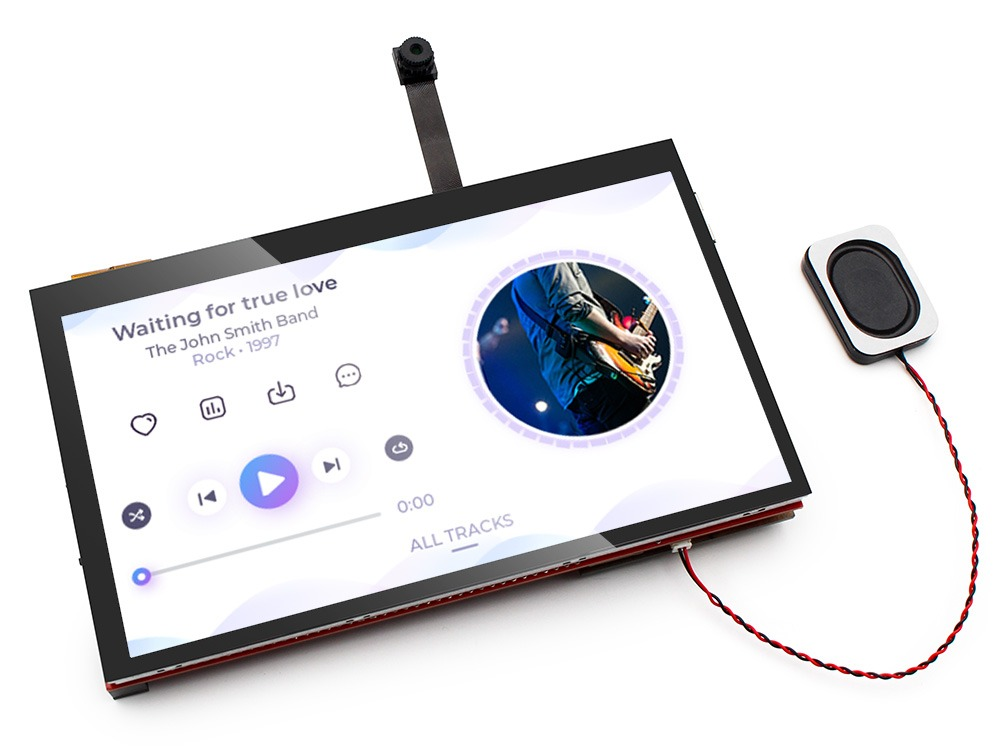
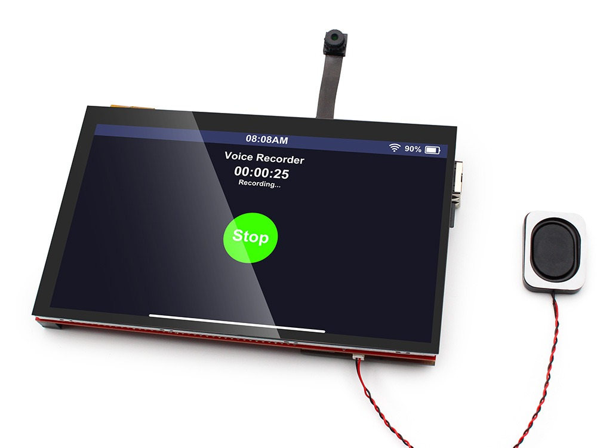
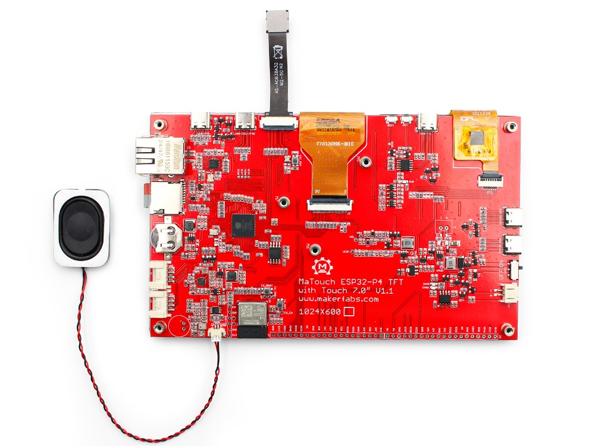
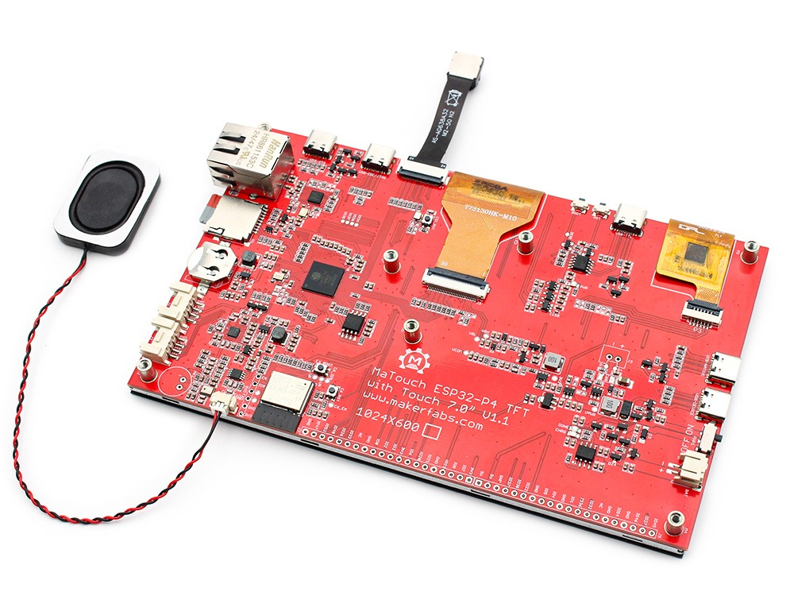
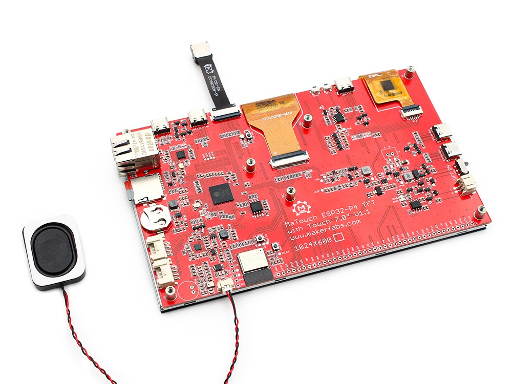
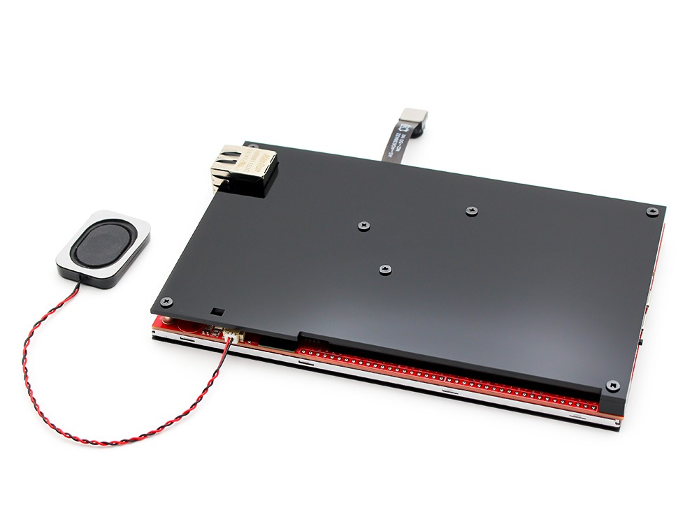
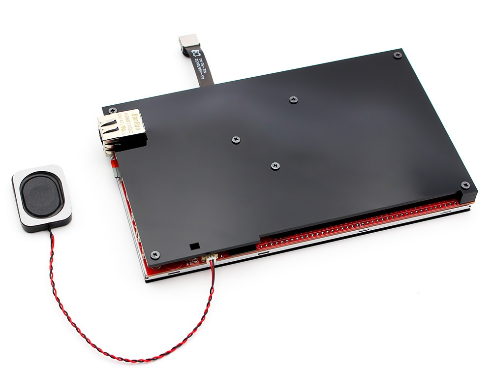

# Hardware a zapojení

## Co je potřeba

- Makerfabs MaTouch ESP32-P4 TFT with Touch 7" MIPI.
- Datový kabel USB-C - na první nahrání runtime a na napájení.
- Napájení: zdroj 5 V přes USB-C aspoň 2 A (většinu odebírá podsvícení displeje).
- Síťový kabel nebo Wi-Fi tvé sítě.
- PC s [editorem ctrl32](https://ctrl32.com/download/) (Windows).
- Volitelně pro příklad all-in-one: dvě tlačítka a reléový modul na konektoru J6; modul ADS1115 na sběrnici I2C; 3,3V převodník RS-485 (např. MAX3485) a 3,3V převodník CAN (např. SN65HVD230).

## Napájení

| Zdroj | Kde | Poznámka |
|---|---|---|
| USB 5 V | konektor USB-C | 2 A a více - většinu odebírá podsvícení 7" displeje |
| Baterie Li-Po | konektor baterie | 3,7 V, nabíjí se na desce |

!!! warning "Slabý zdroj"
    Port USB v PC desku se zapnutým podsvícením často neutáhne. Pokud se
    deska restartuje ve chvíli, kdy se rozsvítí obrazovka, použij zdroj
    5 V / 2 A nebo USB hub s vlastním napájením.

## Mapa pinů

| GPIO | Funkce v ctrl32 | Poznámka |
|---|---|---|
| 0 | RTC XTAL P | ⚠  |
| 1 | RTC XTAL N | ⚠  |
| 2 | volný I/O |  |
| 3 | volný I/O |  |
| 4 | volný I/O |  |
| 5 | volný I/O |  |
| 6 | C6 IO2 | ⚠  |
| 7 | TOUCH SDA |  |
| 8 | TOUCH SCL |  |
| 20 | volný I/O |  |
| 21 | volný I/O |  |
| 22 | TOUCH RST |  |
| 23 | TFT BL |  |
| 26 | USB1 PAIR | ⚠  |
| 27 | DSI RST |  |
| 28 | Ethernet RMII (IP101GRI) | ⚠ používá deska |
| 29 | Ethernet RMII (IP101GRI) | ⚠ používá deska |
| 30 | Ethernet RMII (IP101GRI) | ⚠ používá deska |
| 31 | Ethernet MDC (IP101GRI) | ⚠ používá deska |
| 32 | volný I/O |  |
| 33 | volný I/O |  |
| 34 | Ethernet RMII (IP101GRI) | ⚠ používá deska |
| 35 | Ethernet RMII (IP101GRI) | ⚠ používá deska |
| 36 | volný I/O | ⚠ strapping pin |
| 37 | CONSOLE RX | ⚠ strapping pin |
| 38 | CONSOLE TX | ⚠ strapping pin |
| 45 | MOSFET GATE | ⚠  |
| 46 | volný I/O |  |
| 47 | volný I/O |  |
| 48 | volný I/O |  |
| 49 | Ethernet RMII (IP101GRI) | ⚠ používá deska |
| 50 | Ethernet RMII (IP101GRI) | ⚠ používá deska |
| 51 | Ethernet PHY reset (IP101GRI) | ⚠ používá deska |
| 52 | Ethernet MDIO (IP101GRI) | ⚠ používá deska |
| 53 | AMP EN | ⚠  |
| 54 | C6 EN | ⚠  |

Volné piny jsou na konektorech **J6** a **J10** a na dvou konektorech
Grove (**J1**, **J2**). Sběrnice I2C desky (GPIO7 / GPIO8) nese řadič
dotyku a audiokodek; další čipy I2C (ADS1115, čidlo) se připojí na tutéž
sběrnici. CAN ani RS-485 nemají na desce převodník: příklad je dává na
volné piny - **CAN** TX GPIO20 / RX GPIO21 (Grove J2), **RS-485** TX GPIO4
/ RX GPIO5 / DE GPIO32 (J10) - každou na 3,3V modul převodníku.

## Bezpečnost

- Deska není určena pro bezpečnostní funkce. Nouzové zastavení, dveřní
  spínač nebo světelná závora se zapojují v hardwaru, nikdy přes program
  nebo dotykovou obrazovku.
- Piny GPIO mají 3,3 V. Signál 24 V potřebuje optočlen; cívka relé
  potřebuje budič (reléový modul ho má).
- Kapacitní dotyk může u silného zdroje rušení (měnič) zaznamenat falešný
  stisk. Kritické příkazy na obrazovce si vyžádají potvrzení.

## Fotky

---

[← Přehled](README.cs.md) | [Přehled](README.cs.md) | [Nahrání runtime →](install.cs.md)
