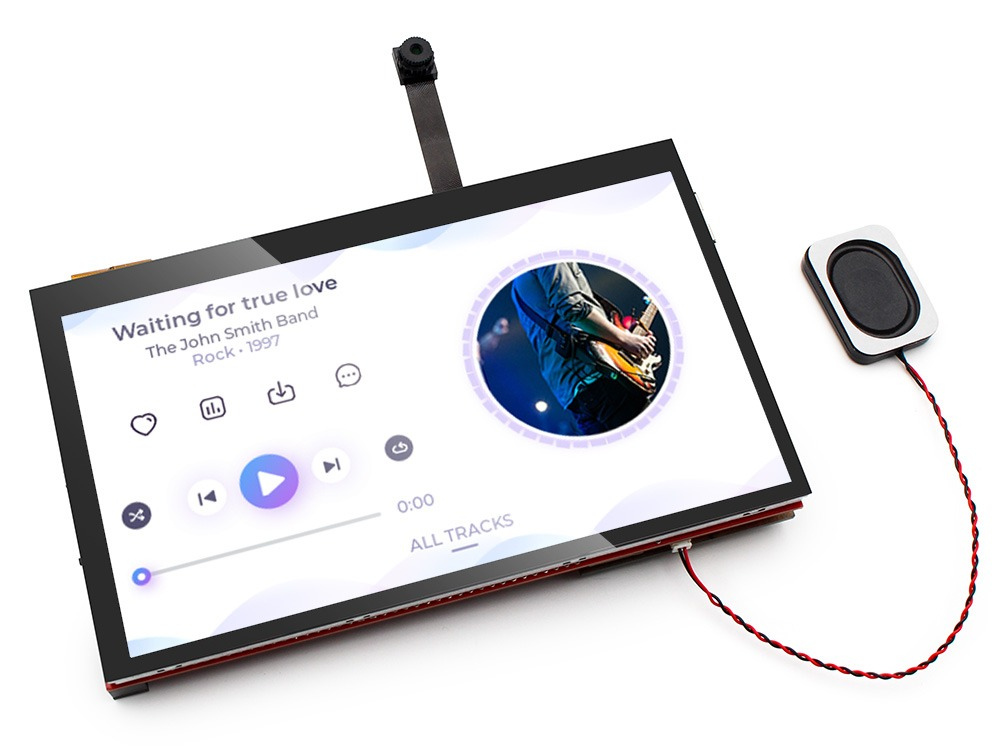
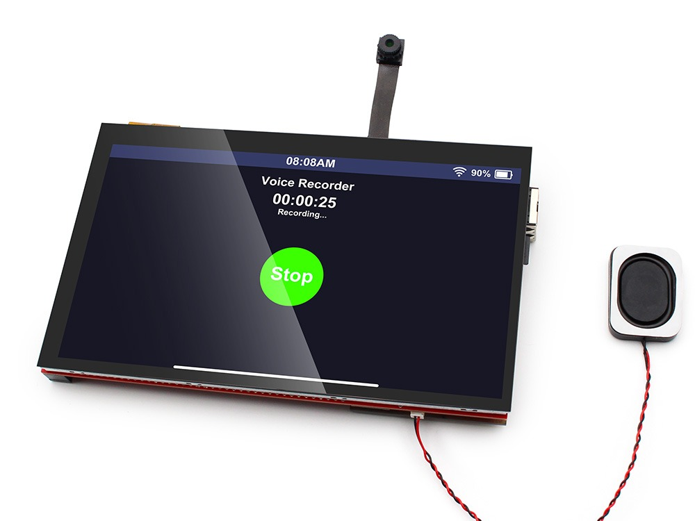
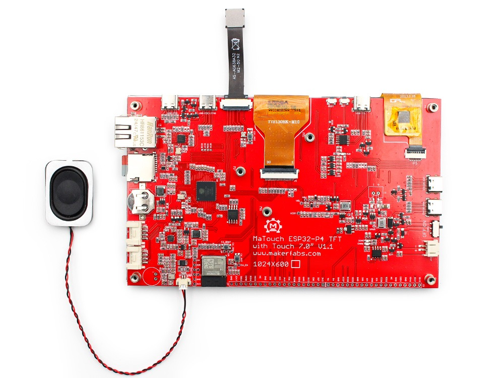
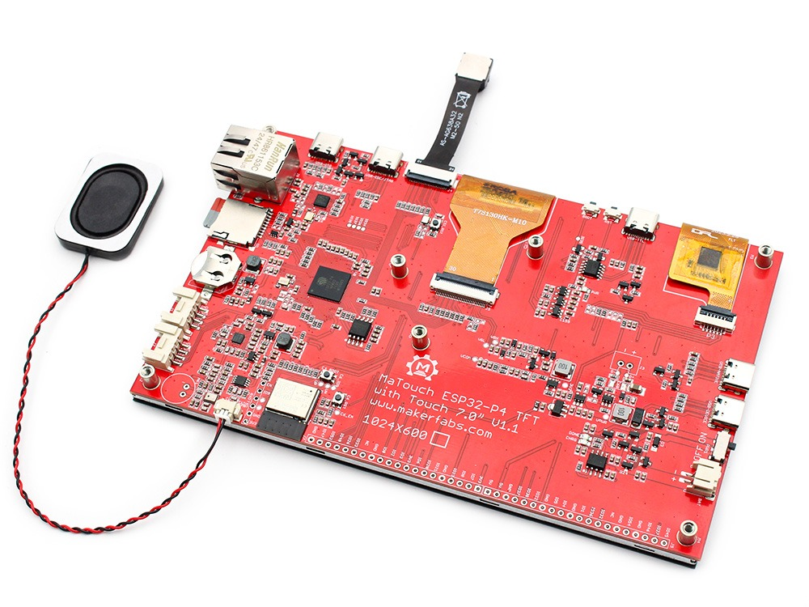
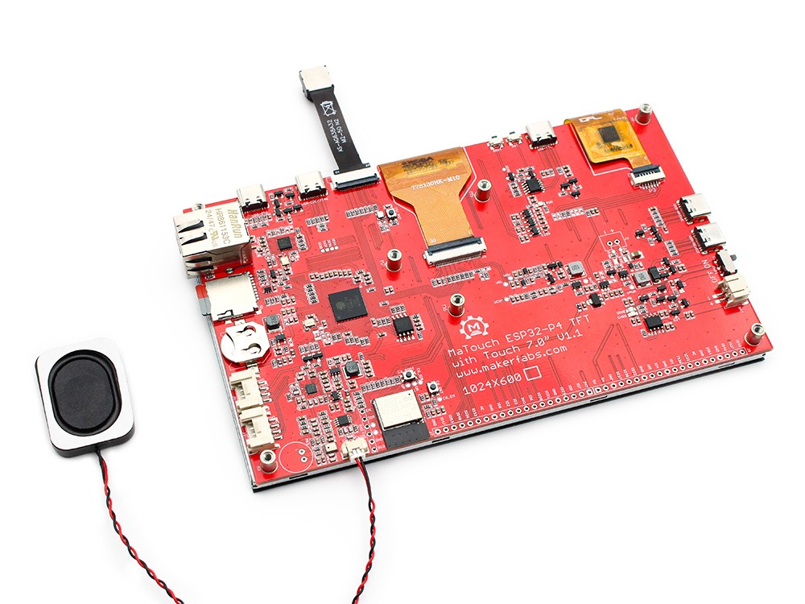
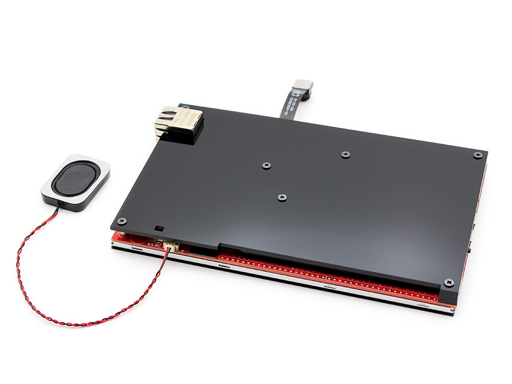
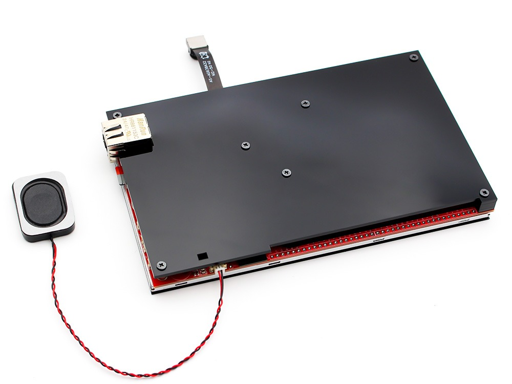

# Hardware and wiring

## What you need

- The Makerfabs MaTouch ESP32-P4 TFT with Touch 7" MIPI.
- A USB-C data cable - for the first upload of the runtime and for power.
- For power: a 5 V USB-C supply of at least 2 A (the display backlight draws most of it).
- An Ethernet cable, or the Wi-Fi of your network.
- A PC with the [ctrl32 editor](https://ctrl32.com/download/) (Windows).
- Optional, for the all-in-one example: two push-buttons and a relay module on the J6 header; an ADS1115 module on the I2C bus; a 3.3 V RS-485 transceiver (e.g. MAX3485) and a 3.3 V CAN transceiver (e.g. SN65HVD230).

## Power

| Source | Where | Note |
|---|---|---|
| USB 5 V | the USB-C connector | 2 A or more - the 7" backlight draws most of it |
| Li-Po battery | the battery connector | 3.7 V, charged on board |

!!! warning "A weak supply"
    A PC's USB port often cannot carry the board with the backlight on.
    If the board restarts while the screen comes up, use a 5 V / 2 A
    supply or a powered USB hub.

## Pin map

| GPIO | Function in ctrl32 | Note |
|---|---|---|
| 0 | RTC XTAL P | ⚠  |
| 1 | RTC XTAL N | ⚠  |
| 2 | free I/O |  |
| 3 | free I/O |  |
| 4 | free I/O |  |
| 5 | free I/O |  |
| 6 | C6 IO2 | ⚠  |
| 7 | TOUCH SDA |  |
| 8 | TOUCH SCL |  |
| 20 | free I/O |  |
| 21 | free I/O |  |
| 22 | TOUCH RST |  |
| 23 | TFT BL |  |
| 26 | USB1 PAIR | ⚠  |
| 27 | DSI RST |  |
| 28 | Ethernet RMII (IP101GRI) | ⚠ used by the board |
| 29 | Ethernet RMII (IP101GRI) | ⚠ used by the board |
| 30 | Ethernet RMII (IP101GRI) | ⚠ used by the board |
| 31 | Ethernet MDC (IP101GRI) | ⚠ used by the board |
| 32 | free I/O |  |
| 33 | free I/O |  |
| 34 | Ethernet RMII (IP101GRI) | ⚠ used by the board |
| 35 | Ethernet RMII (IP101GRI) | ⚠ used by the board |
| 36 | free I/O | ⚠ strapping pin |
| 37 | CONSOLE RX | ⚠ strapping pin |
| 38 | CONSOLE TX | ⚠ strapping pin |
| 45 | MOSFET GATE | ⚠  |
| 46 | free I/O |  |
| 47 | free I/O |  |
| 48 | free I/O |  |
| 49 | Ethernet RMII (IP101GRI) | ⚠ used by the board |
| 50 | Ethernet RMII (IP101GRI) | ⚠ used by the board |
| 51 | Ethernet PHY reset (IP101GRI) | ⚠ used by the board |
| 52 | Ethernet MDIO (IP101GRI) | ⚠ used by the board |
| 53 | AMP EN | ⚠  |
| 54 | C6 EN | ⚠  |

The free pins sit on the **J6** and **J10** headers and on the two Grove
connectors (**J1**, **J2**). The board's I2C bus (GPIO7 / GPIO8) carries
the touch controller and the audio codec; more I2C chips (an ADS1115, a
sensor) join the same bus. CAN and RS-485 have no transceiver on the
board: the example puts them on free pins - **CAN** TX GPIO20 / RX GPIO21
(Grove J2), **RS-485** TX GPIO4 / RX GPIO5 / DE GPIO32 (J10) - each to a
3.3 V transceiver module.

## Safety

- The board is not intended for safety functions. An emergency stop, a
  door switch or a light curtain is wired in hardware, never through a
  program or a touch screen.
- The GPIO pins are 3.3 V. A 24 V signal needs an opto-coupler; a relay
  coil needs a driver (a relay module has one).
- Capacitive touch can register a false press next to a strong
  interference source (a drive). Critical commands on a screen ask for a
  confirmation.

## Photos

---

[← Overview](README.md) | [Overview](README.md) | [Install the runtime →](install.md)
