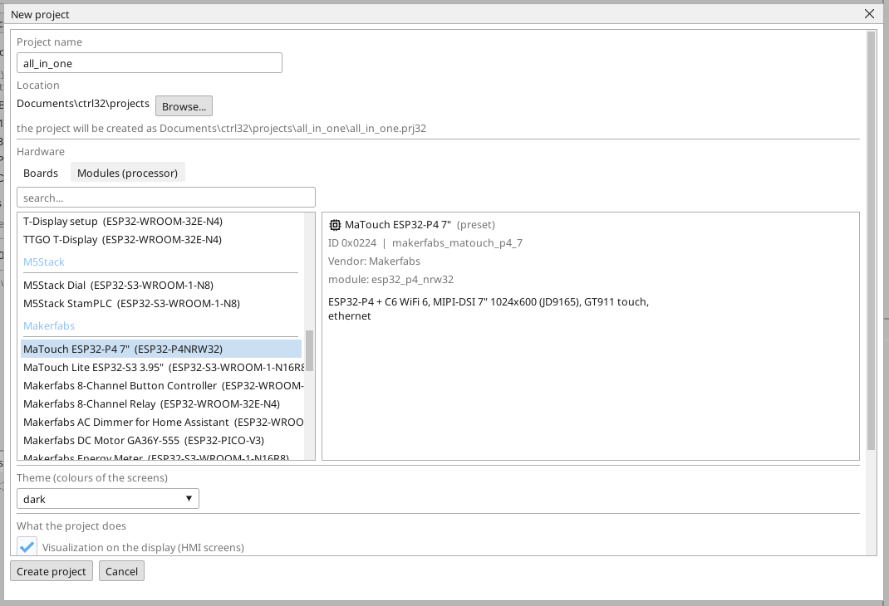
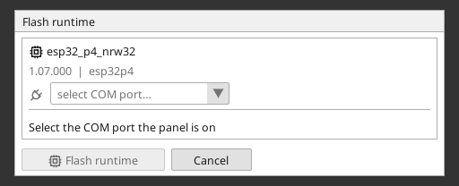
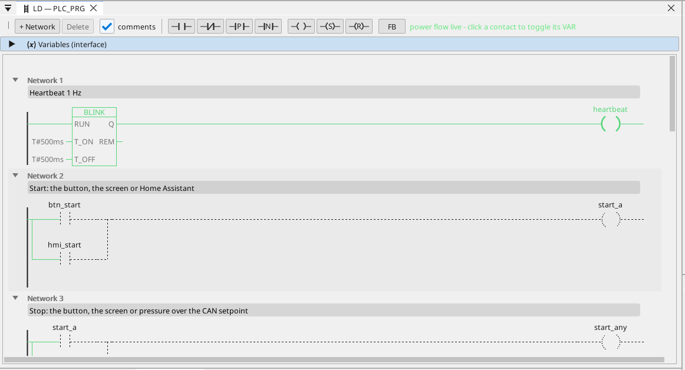

# Die ctrl32-Runtime installieren

Die Runtime ist das Programm auf dem Board, das Ihr Projekt ausführt - den SPS-Zyklus, die Bildschirme, die Kommunikation. Sie kommt einmal auf das Board; danach ist jede Änderung des Projekts ein Download, der nichts als das Projekt überschreibt.

## 1. Das Board anschließen

Verbinden Sie das Board über das USB-Kabel mit dem PC. Am USB-C-Anschluss sitzt ein USB-UART-Wandler CH340K. Windows 10 und 11
installieren seinen Treiber von selbst; erscheint der Port nicht,
installieren Sie den CH340-Treiber des Chipherstellers (WCH) und stecken
Sie das Kabel erneut ein.

## 2. Das Projekt anlegen

Starten Sie den ctrl32-Editor und wählen Sie **New project** (Strg+N). Geben Sie den **Namen** des Projekts ein, wählen Sie **MaTouch ESP32-P4 7"** in der Liste der Boards (unter **Makerfabs**) und drücken Sie **Create project**.

Um stattdessen mit dem fertigen Beispiel zu beginnen, öffnen Sie das [All-in-one-Projekt](examples/all-in-one/README.de.md) (**File → Open**).

## 3. Die Runtime schreiben

Wählen Sie den COM-Port des Boards in der Portauswahl der Symbolleiste, klicken Sie auf das Board im Gerätebaum und drücken Sie **Flash runtime**. Der Editor schreibt die Runtime, liest sie zurück und prüft sie; das dauert etwa eine Minute, und das Board startet neu. Das geschieht einmal - und erneut nur, wenn der Editor eine neue Runtime-Linie bringt.

## 4. Das Projekt laden

Drücken Sie die Download-Schaltfläche in der Symbolleiste (F5). Der Editor baut das Projekt, schreibt es in den inaktiven Programmslot des Boards, prüft es und schaltet erst dann um - ein fehlgeschlagener Download lässt das laufende Programm unberührt.

## 5. Prüfen, dass es läuft

Drücken Sie **ONLINE** (das Steckersymbol neben der Portauswahl), um das Programm auf dem Board zu beobachten: was leitet, ist grün, jede Variable trägt ihren Live-Wert. Ohne Board liefert die **Simulation** dieselbe Ansicht (die Schaltfläche neben ONLINE in der Symbolleiste).

Etwas geht nicht? Siehe [Fehlersuche](troubleshooting.de.md).

*Bildschirmfotos: ctrl32-Editor 1.07.*

---

[← Hardware und Verdrahtung](hardware.de.md) | [Übersicht](README.de.md) | [Einrichten →](configure.de.md)
