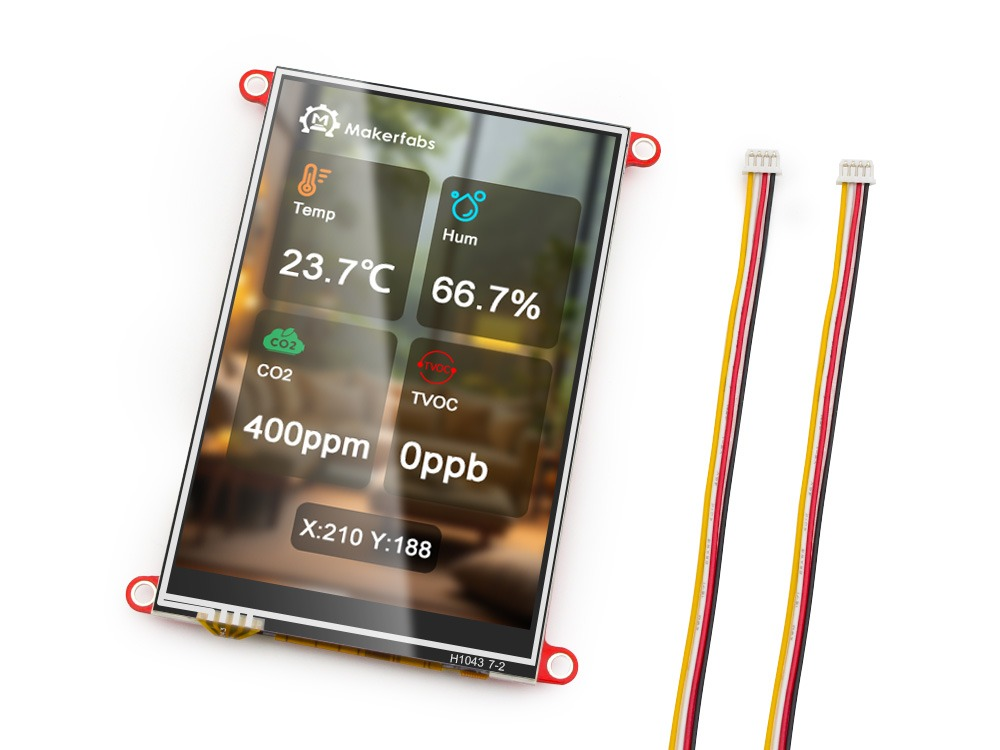
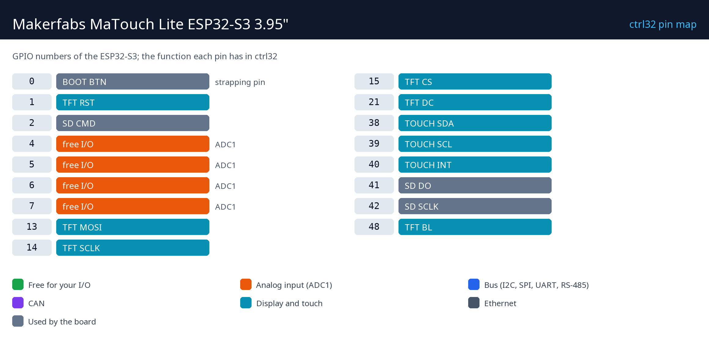

# Makerfabs MaTouch Lite ESP32-S3 3.95"

    

La Makerfabs MaTouch Lite est un écran tactile économique : un afficheur 3,95" de 320 x 480 avec tactile résistif sur un ESP32-S3 avec PSRAM et Wi-Fi. Avec ctrl32, c'est une IHM et un automate en un - des écrans dessinés dans l'éditeur sur la dalle, un programme ladder à côté, les mêmes valeurs dans tout navigateur (WEBview), Modbus TCP, CAN et MQTT. Le tactile résistif fonctionne avec des gants.

**Convient pour :**

- Un petit pupitre opérateur sur une machine, utilisé avec des gants
- Un thermostat mural ou un régulateur de pièce
- Un afficheur CAN pour un véhicule ou un variateur

Page de la carte dans le catalogue : [Makerfabs MaTouch Lite ESP32-S3 3.95"](https://ctrl32.com/hardware/boards/makerfabs-matouch-lite-esp32-s3-spi-resistive-touch-395-st7796/)

## Ce que ctrl32 sait faire sur cette carte

<!-- capabilities:start -->
| Fonction | Sur cette carte | Remarques |
|---|---|---|
| Puce | ESP32-S3 (esp32s3_wroom_1_n16r8) |  |
| Mémoire | 16 MB flash, 8 MB PSRAM |  |
| Taille du programme | 512 variables, 128 alarmes, 512 blocs | vérifié par l'éditeur avant un téléchargement |
| Entrées / sorties numériques | 4 GPIO libres | voir le brochage |
| Entrées analogiques | 4 sur la puce (ADC1) | GPIO4, GPIO5, GPIO6, GPIO7 |
| Ethernet | non |  |
| Wi-Fi | Wi-Fi 2.4 GHz |  |
| CAN (TWAI) | 1 | nécessite un transceiver externe |
| Modbus RTU (RS-485) | oui | sur des broches libres, nécessite un transceiver externe |
| Modbus TCP | client et serveur |  |
| MQTT | oui (TLS aussi) | découverte Home Assistant |
| WEBview | oui | la page opérateur dans tout navigateur |
| Écran / tactile (HMI) | 3.95" 320x480, NS2009 |  |
| USB | USB-C (CH340K USB-UART, Native USB) |  |
| Alimentation | 5 V USB (4.0–5.25 V), 3.7 V Li-Po / Li-Ion |  |
<!-- capabilities:end -->

### Ce qui n'est pas pris en charge

- Le Bluetooth.
- Le lecteur microSD - ctrl32 garde le programme et les écrans dans la mémoire flash de la carte.

## Le guide

| Étape | Page |
|---|---|
| 1 | [Matériel et câblage](hardware.fr.md) - ce dont vous avez besoin, l'alimentation, le brochage |
| 2 | [Installer le runtime](install.fr.md) - l'éditeur, la carte, le premier chargement |
| 3 | [Configurer](configure.fr.md) - réseau, E/S, communication |
| 4 | [Projets d'exemple](examples/README.fr.md) - tout ce que fait la carte, prêt à ouvrir |
| - | [Dépannage](troubleshooting.fr.md) |

## Fichiers

-

## Étapes suivantes

- [documentation ctrl32](https://ctrl32.com/docs/) - l'éditeur, les langages, chaque bloc
- [Télécharger l'éditeur](https://ctrl32.com/download/)
- [Toutes les cartes testées](../../README.fr.md)
- [Makerfabs MaTouch ESP32-P4 7"](../makerfabs-matouch-esp32-p4-tft-with-touch-7-mipi/README.fr.md) - la grande sœur

