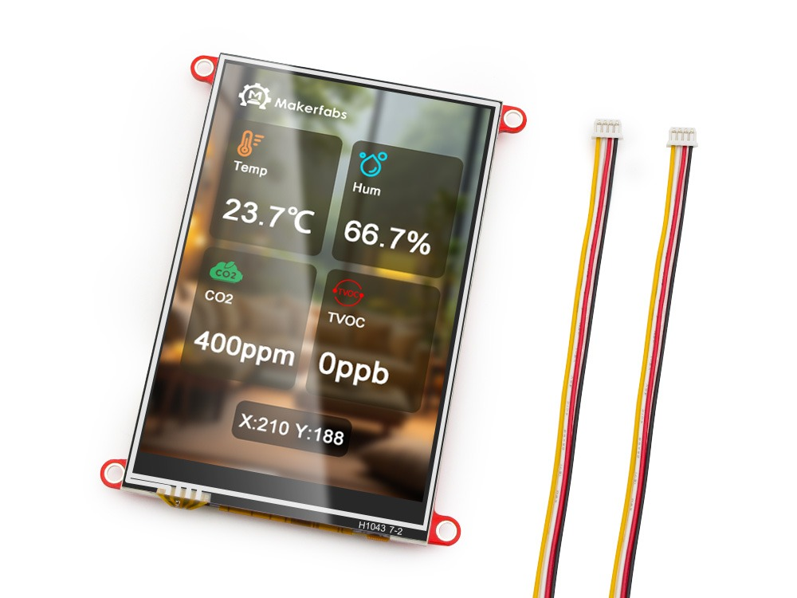
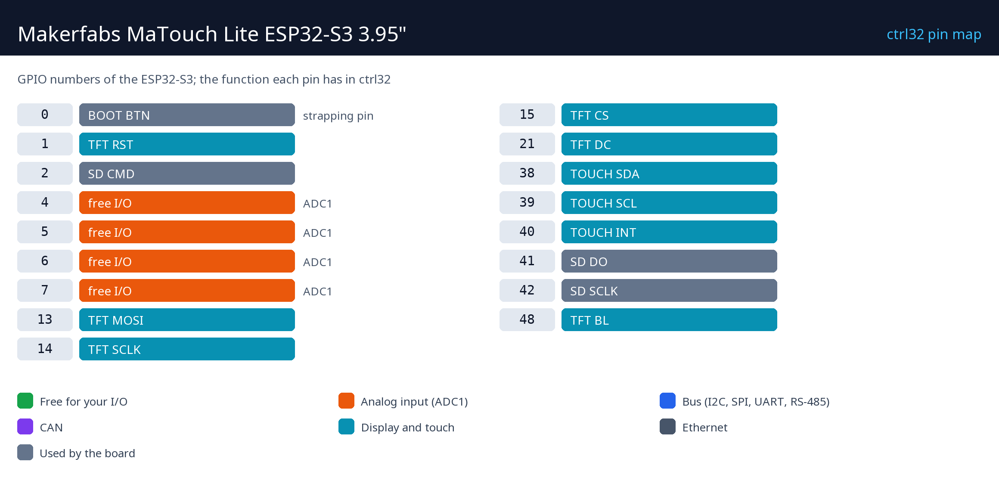

# Makerfabs MaTouch Lite ESP32-S3 3.95"

    

The Makerfabs MaTouch Lite is a low-cost touch panel: a 3.95" 320 x 480 display with resistive touch on an ESP32-S3 with PSRAM and Wi-Fi. With ctrl32 it is an HMI and a PLC in one - screens drawn in the editor on the glass, a ladder program beside them, the same values in any browser (WEBview), Modbus TCP, CAN and MQTT. Resistive touch works with gloves.

**Good for:**

- A small operator panel on a machine, operated with gloves
- A wall thermostat or a room controller
- A CAN display for a vehicle or a drive

Board page in the catalog: [Makerfabs MaTouch Lite ESP32-S3 3.95"](https://ctrl32.com/hardware/boards/makerfabs-matouch-lite-esp32-s3-spi-resistive-touch-395-st7796/)

## What ctrl32 can do on this board

<!-- capabilities:start -->
| Feature | On this board | Notes |
|---|---|---|
| Chip | ESP32-S3 (esp32s3_wroom_1_n16r8) |  |
| Memory | 16 MB flash, 8 MB PSRAM |  |
| Program size | 512 variables, 128 alarms, 512 blocks | checked by the editor before a download |
| Digital inputs / outputs | 4 free GPIO | see the pin map |
| Analog inputs | 4 on the chip (ADC1) | GPIO4, GPIO5, GPIO6, GPIO7 |
| Ethernet | no |  |
| Wi-Fi | Wi-Fi 2.4 GHz |  |
| CAN (TWAI) | 1 | needs an external transceiver |
| Modbus RTU (RS-485) | yes | on free pins, needs an external transceiver |
| Modbus TCP | client and server |  |
| MQTT | yes (TLS too) | Home Assistant discovery |
| WEBview | yes | the operator page in any browser |
| Display / touch (HMI) | 3.95" 320x480, NS2009 |  |
| USB | USB-C (CH340K USB-UART, Native USB) |  |
| Power | 5 V USB (4.0–5.25 V), 3.7 V Li-Po / Li-Ion |  |
<!-- capabilities:end -->

### What is not supported

- Bluetooth.
- The microSD slot - ctrl32 keeps the program and the screens in the board's flash.

## The guide

| Step | Page |
|---|---|
| 1 | [Hardware and wiring](hardware.md) - what you need, power, the pin map |
| 2 | [Install the runtime](install.md) - the editor, the board, the first upload |
| 3 | [Configure](configure.md) - network, I/O, communication |
| 4 | [Example projects](examples/README.md) - everything the board does, ready to open |
| - | [Troubleshooting](troubleshooting.md) |

## Files

-

## Next steps

- [ctrl32 documentation](https://ctrl32.com/docs/) - the editor, the languages, every block
- [Download the editor](https://ctrl32.com/download/)
- [All tested boards](../../README.md)
- [Makerfabs MaTouch ESP32-P4 7"](../makerfabs-matouch-esp32-p4-tft-with-touch-7-mipi/README.md) - the large sibling

