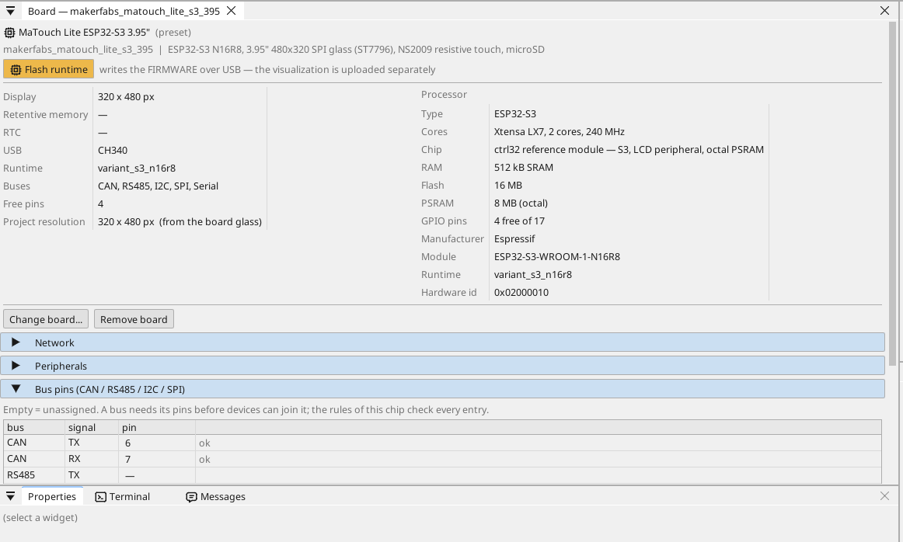
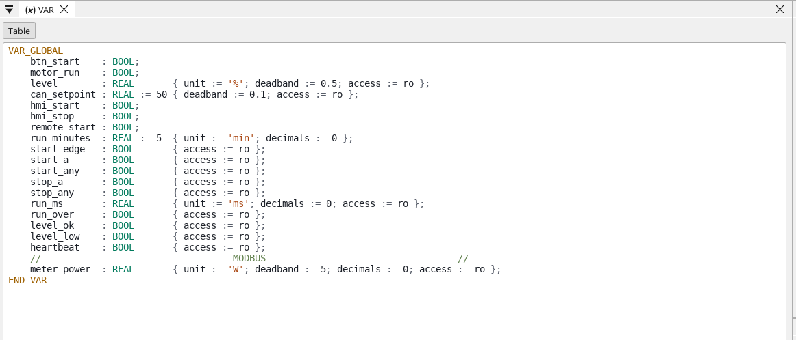
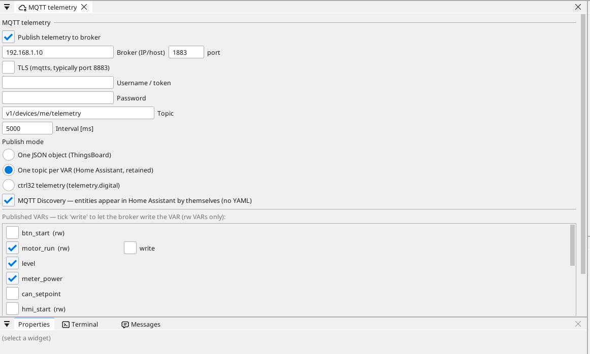
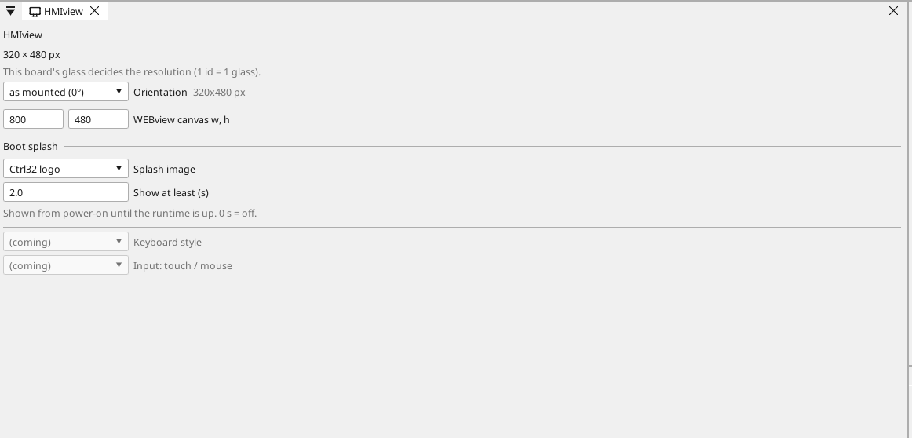
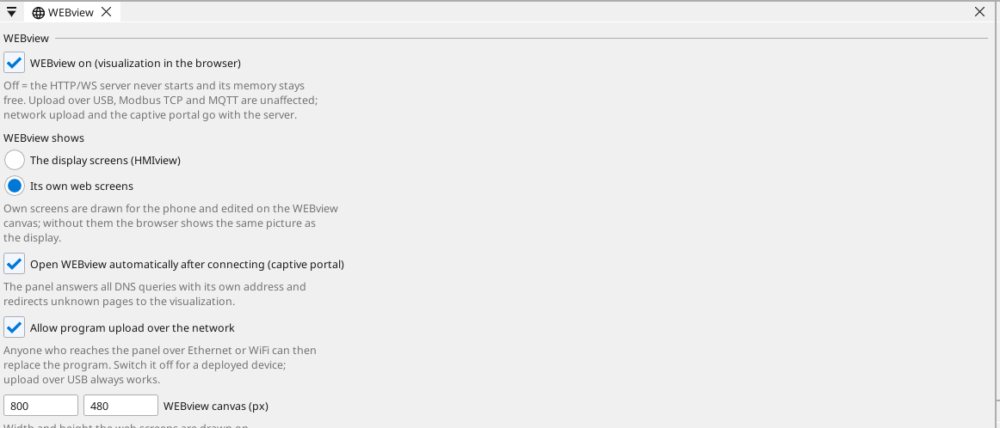

# Configure the board

## The board page

Double-click the board in the device tree. The page shows what the board carries and every pin: a free pin gets a variable in one click - an input, an output, or on an analog-capable pin an analog input.

## Network

The board joins your Wi-Fi: open the **WiFi** page of the device tree and
type the network's name and password (the example carries placeholders).
A fixed address is set on the board page, in its **Network** section.

## Inputs, outputs and variables

Every signal of the program is a **variable**. A variable on a pin reads or drives the pin; an analog variable says what is wired to it (a voltage, 4-20 mA, a thermistor) and its range in units.

## Communication

**Modbus TCP.** A device on the network is added under **Ethernet → Modbus TCP master**; its registers become variables.

**Modbus RTU / RS-485.** The board has no RS-485 transceiver and too few free pins for one beside the example's I/O; Modbus devices are reached over Modbus TCP on the Wi-Fi.

**CAN.** The ESP32-S3 has one CAN controller (TWAI). The board has no transceiver: put a 3.3 V transceiver module on two free pins and name them on the board page (Bus pins) - the example uses GPIO6 / GPIO7.

**MQTT.** The board publishes chosen variables to a broker; in the Home Assistant mode the broker finds them by itself, and a variable marked *write* can be set from there.

## Display and touch

The glass is 320 x 480, portrait as mounted; the HMIview page turns the
picture (the touch follows) and sets the boot splash. The resistive touch
needs firm presses - draw buttons at least 40 px tall.

## WEBview

The board serves its operator page to any browser on the network - open the board's address. The page is drawn in the editor like a screen.

---

[← Install the runtime](install.md) | [Overview](README.md) | [Example projects →](examples/README.md)
