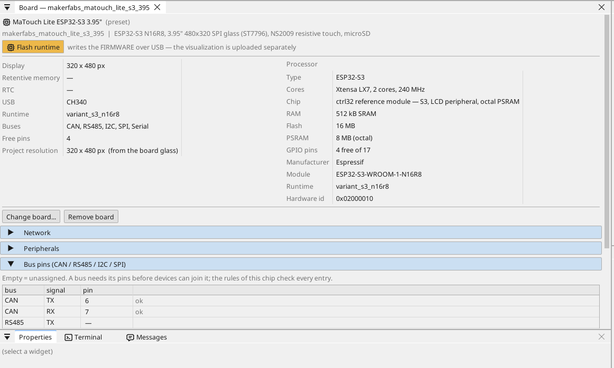
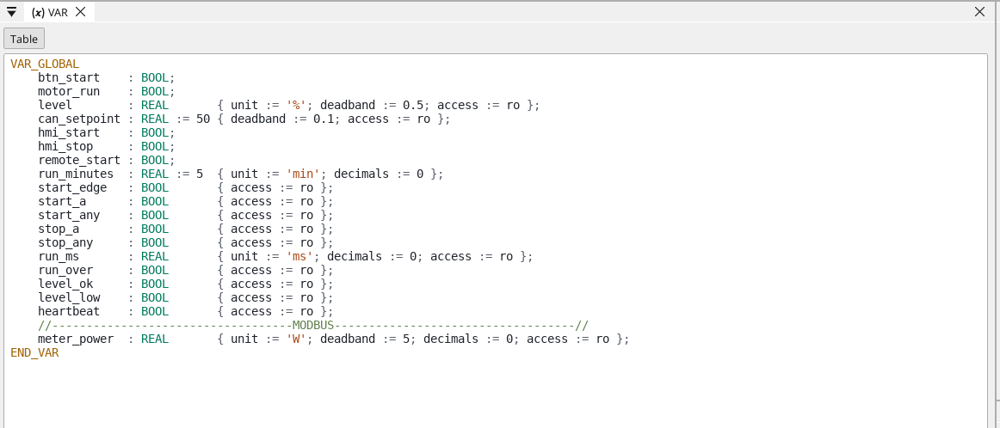
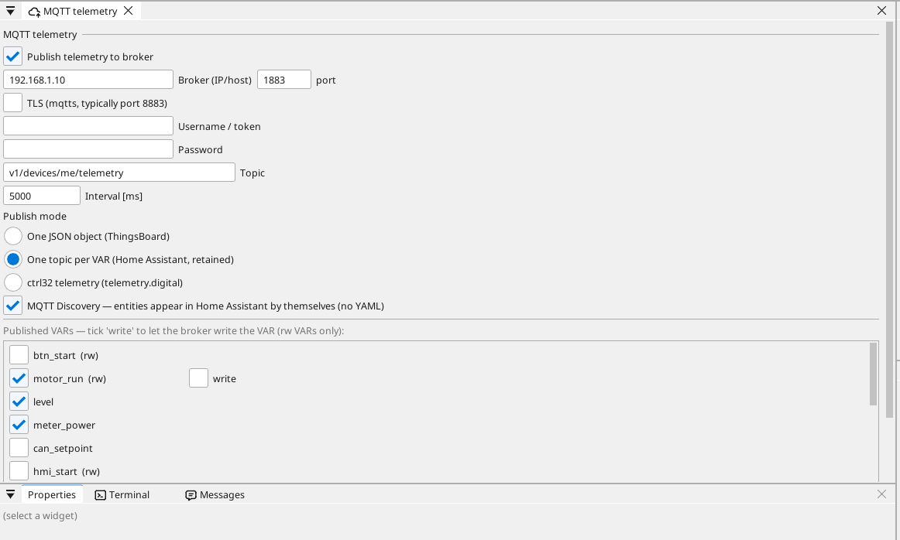
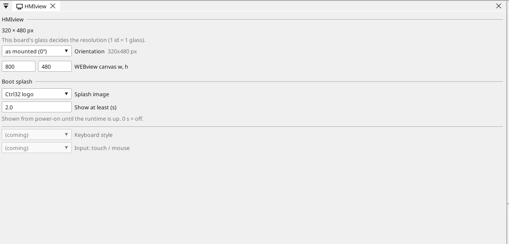

# Налаштуйте плату

## Сторінка плати

Двічі клацніть плату в дереві пристроїв. Сторінка показує, що є на платі, і кожен пін: вільний пін отримує змінну одним клацанням - вхід, вихід або, на піні з аналоговою функцією, аналоговий вхід.

## Мережа

Плата підключається до вашої мережі Wi-Fi: відкрийте сторінку **WiFi** у
дереві пристроїв і введіть назву мережі та пароль (у прикладі - заповнювачі).
Фіксована адреса задається на сторінці плати, у її розділі **Network**.

## Входи, виходи та змінні

Кожен сигнал програми - це **змінна**. Змінна на піні читає пін або керує ним; аналогова змінна каже, що до неї підключено (напруга, 4-20 мА, термістор), і її діапазон в одиницях.

## Зв'язок

**Modbus TCP.** Пристрій у мережі додається в **Ethernet → Modbus TCP master**; його регістри стають змінними.

**Modbus RTU / RS-485.** На платі немає трансивера RS-485 і замало вільних пінів для нього поруч із входами/виходами прикладу; до пристроїв Modbus звертаються через Modbus TCP по Wi-Fi.

**CAN.** ESP32-S3 має один CAN-контролер (TWAI). На платі немає трансивера: підключіть модуль трансивера 3,3 В до двох вільних пінів і назвіть їх на сторінці плати (**Bus pins**); приклад використовує GPIO6 / GPIO7.

**MQTT.** Плата публікує вибрані змінні на брокер; у режимі Home Assistant брокер сам їх знаходить, а змінну з позначкою *write* можна задати звідти.

## Дисплей і сенсор

Скло має 320 x 480, вертикально, як змонтовано; сторінка HMIview повертає
зображення (сенсор слідує за ним) і задає заставку під час запуску.
Резистивний сенсор потребує впевненого натискання - малюйте кнопки
заввишки щонайменше 40 px.

## WEBview

Плата надає свою сторінку оператора будь-якому браузеру в мережі - відкрийте адресу плати. Сторінка малюється в редакторі як екран.

---

[← Встановлення runtime](install.uk.md) | [Огляд](README.uk.md) | [Приклади проєктів →](examples/README.uk.md)
