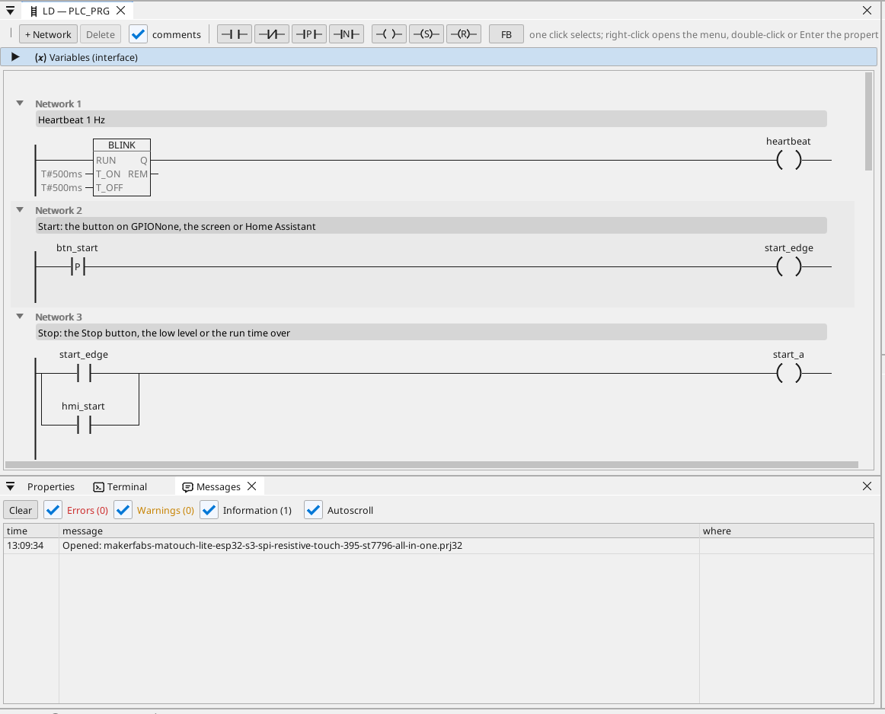

# All-in-one

Výstup motoru se startem a stopem, dobou chodu, analogovou hladinou, rámci CAN, elektroměrem Modbus TCP, MQTT a dotykovou obrazovkou.

**Stáhnout:** [all-in-one.prj32](all-in-one.prj32) - otevři ho v editoru ctrl32 (**File → Open**).

## Co dělá

Program je malé řízení stroje - tvar většiny strojů:

- **Start** přijde z obrazovky, z tlačítka **Start** na obrazovce nebo z Home Assistant přes MQTT.
- **Stop** přijde z tlačítka **Stop**, z nízké hladiny nebo po uplynutí doby chodu - paměť (latch) vypne výstup na **GPIO4**.
- **Doba chodu** se nastavuje v minutách a přežije výpadek napájení.
- **Hladina** je analogový vstup na **GPIO5** (0 až 3,3 V přepočtené na 0 až 100 %); pod 10 % se výstup zastaví a vznikne alarm, nad 15 % může znovu běžet.
- **CAN** posílá hladinu a stav výstupu v rámci 0x181 každých 100 ms a přijímá žádanou hodnotu v rámci 0x201.
- Elektroměr **Modbus TCP** v síti dává odběr (192.168.1.60 - změň na adresu svého elektroměru).
- **MQTT** posílá hodnoty do brokeru Home Assistant, který si je najde sám; výstup lze spustit i z Home Assistant.
- **Obrazovka** na displeji a stejná stránka v libovolném prohlížeči (**WEBview**).
- Deska se připojuje k tvé **Wi-Fi**: před nahráním zadej na stránce WiFi název sítě a heslo.

## Program

## Stránka operátora

## Otevři a spusť

1. Otevři `all-in-one.prj32` v editoru.
2. Změň adresy (zařízení Modbus, broker MQTT) na adresy své sítě.
3. Spusť **simulaci** (panel nástrojů) a vyzkoušej ho na PC, nebo ho nahraj do desky - viz [Nahrání runtime](../../install.cs.md).

## Co bys měl vidět

Stiskni **Start**: výstup na GPIO4 se zapne a jeho LED na stránce se rozsvítí. Po uplynutí doby chodu se sám vypne a když hladina klesne pod 10 %, v tabulce se objeví alarm. V Home Assistant se deska objeví se svými hodnotami.

---

[← Vzorové projekty](../README.cs.md) | [Přehled](../../README.cs.md)
