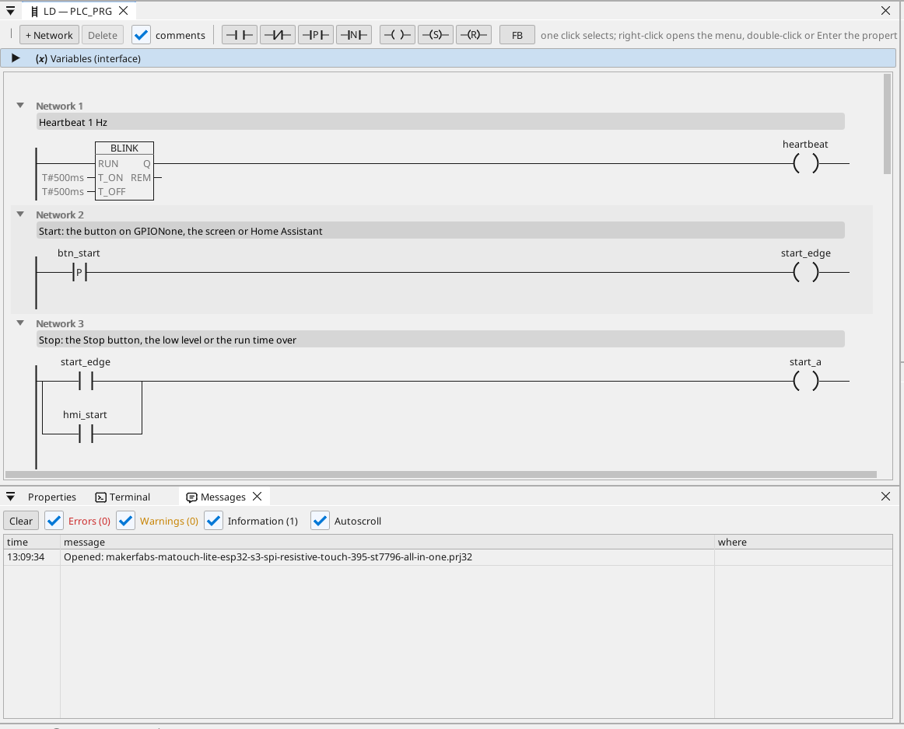

# All-in-one

Une sortie moteur avec marche / arrêt, une minuterie de marche, un niveau analogique, des trames CAN, un compteur Modbus TCP, MQTT et un écran tactile.

**Téléchargement :** [all-in-one.prj32](all-in-one.prj32) - ouvrez-le dans l'éditeur ctrl32 (**File → Open**).

## Ce qu'il fait

Le programme est une petite commande de machine - la forme de la plupart des machines :

- **Start** vient de l'écran, de **Start** sur l'écran, ou de Home Assistant via MQTT.
- **Stop** vient de **Stop**, d'un niveau bas ou de la fin de la durée de marche - l'auto-maintien coupe la sortie sur **GPIO4**.
- La **durée de marche** se règle en minutes et est conservée lors d'une coupure de courant.
- Le **niveau** est une entrée analogique sur **GPIO5** (0 à 3,3 V mis à l'échelle de 0 à 100 %) ; sous 10 % la sortie s'arrête et une alarme est levée, au-dessus de 15 % elle peut redémarrer.
- **CAN** envoie le niveau et l'état de la sortie dans la trame 0x181 toutes les 100 ms et reçoit une consigne dans la trame 0x201.
- Un compteur d'énergie **Modbus TCP** sur le réseau donne la puissance appelée (192.168.1.60 - remplacez-la par celle de votre compteur).
- **MQTT** publie les valeurs vers un broker Home Assistant, qui les trouve de lui-même ; la sortie peut être démarrée depuis Home Assistant.
- L'**écran** sur l'afficheur et la même page dans tout navigateur (**WEBview**).
- La carte rejoint votre **Wi-Fi** : saisissez le nom et le mot de passe du réseau sur la page WiFi avant le chargement.

## Le programme

## La page opérateur

## L'ouvrir et l'exécuter

1. Ouvrez `all-in-one.prj32` dans l'éditeur.
2. Remplacez les adresses (l'appareil Modbus, le broker MQTT) par celles de votre réseau.
3. Lancez la **simulation** (barre d'outils) pour l'essayer sur le PC, ou chargez-le dans la carte - voir [Installer le runtime](../../install.fr.md).

## Ce que vous devriez voir

Appuyez sur **Start** : la sortie sur GPIO4 s'enclenche et sa LED s'allume sur la page. Après la durée de marche, elle se coupe d'elle-même, et lorsque le niveau descend sous 10 %, l'alarme apparaît dans le tableau. Dans Home Assistant, la carte apparaît avec ses valeurs.

---

[← Projets d'exemple](../README.fr.md) | [Vue d'ensemble](../../README.fr.md)
