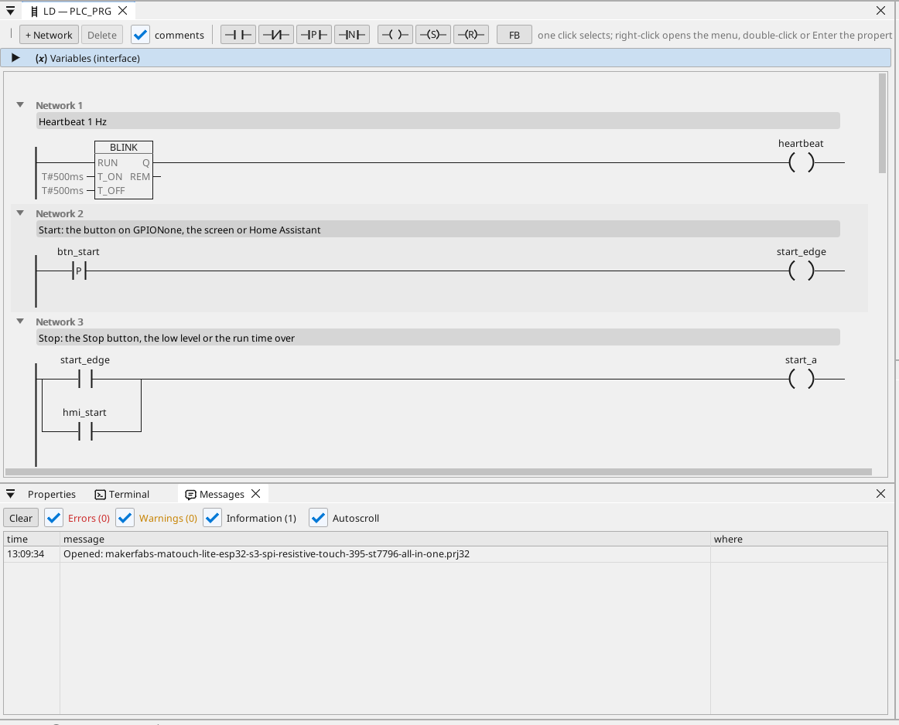

# All-in-one

Start / stop'lu bir motor çıkışı, bir çalışma zamanlayıcısı, analog bir seviye, CAN çerçeveleri, bir Modbus TCP sayacı, MQTT ve dokunmatik bir ekran.

**İndir:** [all-in-one.prj32](all-in-one.prj32) - ctrl32 editöründe açın (**File → Open**).

## Ne yapar

Program küçük bir makine kontrolcüsüdür - çoğu makinenin biçimi:

- **Start** şunlardan gelir: ekran, ekrandaki **Start** veya MQTT üzerinden Home Assistant.
- **Stop**, **Stop**'tan, düşük seviyeden ya da çalışma süresinin dolmasından gelir - mühürleme **GPIO4** üzerindeki çıkışı bırakır.
- **Çalışma süresi** dakika olarak ayarlanır ve elektrik kesintisinde korunur.
- **Seviye**, **GPIO5** üzerinde analog bir giriştir (0 - 3,3 V, 0 - 100 % aralığına ölçeklenir); %10'un altında çıkış durur ve bir alarm verilir, %15'in üzerinde yeniden başlayabilir.
- **CAN** seviyeyi ve çıkış durumunu her 100 ms'de 0x181 çerçevesinde gönderir ve 0x201 çerçevesinde bir ayar değeri alır.
- Ağdaki bir **Modbus TCP** enerji sayacı güç talebini verir (192.168.1.60 - bunu kendi sayacınıza göre değiştirin).
- **MQTT** değerleri bir Home Assistant broker'ına yayınlar; broker bunları kendiliğinden bulur; çıkış Home Assistant'tan da başlatılabilir.
- Ekrandaki **görüntü** ve her tarayıcıda aynı sayfa (**WEBview**).
- Kart **Wi-Fi** ağınıza bağlanır: yüklemeden önce WiFi sayfasında ağın adını ve parolasını yazın.

## Program

## Operatör sayfası

## Açın ve çalıştırın

1. `all-in-one.prj32` dosyasını editörde açın.
2. Adresleri (Modbus cihazı, MQTT broker'ı) kendi ağınızınkilerle değiştirin.
3. PC'de denemek için **simülasyonu** (araç çubuğu) çalıştırın ya da karta yükleyin - bkz. [Runtime'ı kurun](../../install.tr.md).

## Ne görmelisiniz

**Start**'a basın: GPIO4 üzerindeki çıkış devreye girer ve sayfadaki LED'i yanar. Çalışma süresi dolunca kendiliğinden kapanır, seviye %10'un altına düştüğünde ise alarm tabloda belirir. Home Assistant'ta kart değerleriyle görünür.

---

[← Örnek projeler](../README.tr.md) | [Genel bakış](../../README.tr.md)
