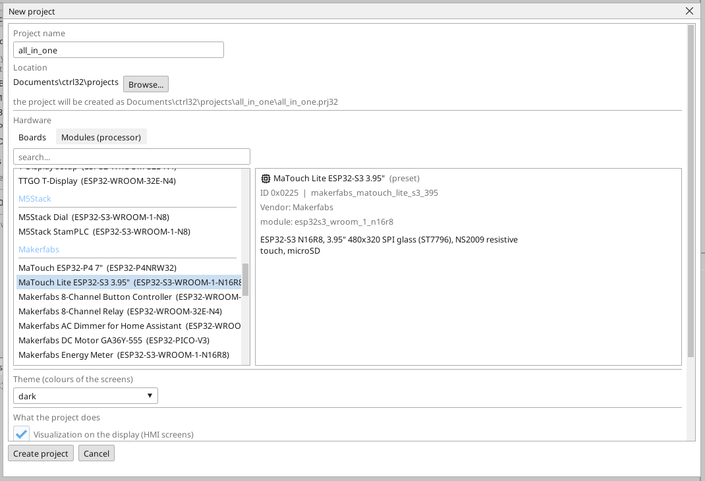
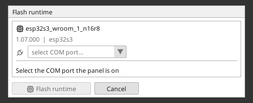
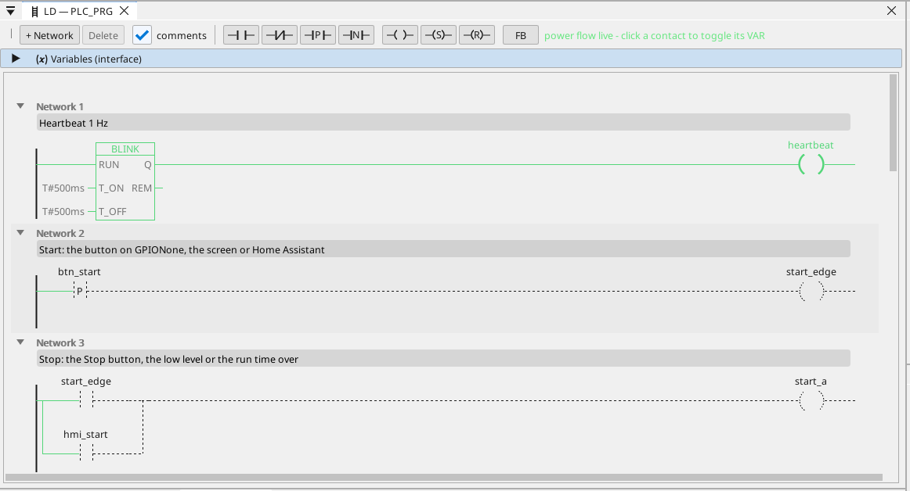

# Installare il runtime ctrl32

Il runtime è il programma sulla scheda che esegue il tuo progetto - il ciclo PLC, le schermate, la comunicazione. Va sulla scheda una volta; dopo, ogni modifica del progetto è un download che riscrive soltanto il progetto.

## 1. Collegare la scheda

Collega la scheda al PC con il cavo USB. Il connettore USB-C porta un convertitore USB-UART CH340K. Windows 10 e 11
ne installano il driver da soli; se la porta non compare, installa il
driver CH340 del produttore del chip (WCH).

## 2. Creare il progetto

Avvia l'editor ctrl32 e scegli **New project** (Ctrl+N). Inserisci il **nome** del progetto, scegli **MaTouch Lite ESP32-S3 3.95"** nell'elenco delle schede (sotto **Makerfabs**) e premi **Create project**.

Per partire invece dall'esempio pronto, apri il [progetto all-in-one](examples/all-in-one/README.it.md) (**File → Open**).

## 3. Scrivere il runtime

Scegli la porta COM della scheda nel selettore di porta della barra degli strumenti, fai clic sulla scheda nell'albero dei dispositivi e premi **Flash runtime**. L'editor scrive il runtime, lo rilegge e lo verifica; ci vuole circa un minuto e la scheda si riavvia. Si fa una volta - e di nuovo solo quando l'editor porta una nuova linea di runtime.

## 4. Scaricare il progetto

Premi il pulsante di download nella barra degli strumenti (F5). L'editor compila il progetto, lo scrive nello slot di programma inattivo della scheda, lo verifica e solo allora commuta - un download fallito lascia intatto il programma in esecuzione.

## 5. Verifica che funzioni

Premi **ONLINE** (l'icona della spina accanto al selettore di porta) per osservare il programma sulla scheda: ciò che conduce è verde, ogni variabile mostra il suo valore in tempo reale. Senza una scheda a portata di mano la stessa vista arriva dalla **simulazione** (il pulsante accanto a ONLINE nella barra degli strumenti).

Qualcosa non funziona? Vedi [Risoluzione dei problemi](troubleshooting.it.md).

*Schermate: editor ctrl32 1.07.*

---

[← Hardware e cablaggio](hardware.it.md) | [Panoramica](README.it.md) | [Configurare →](configure.it.md)
