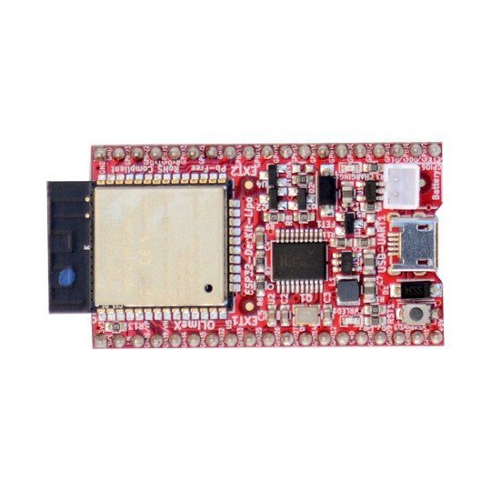
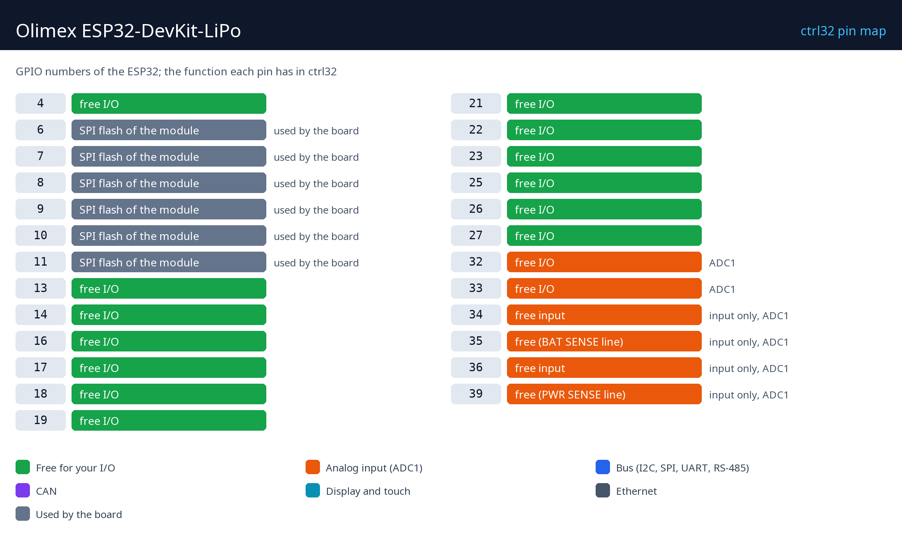

# Olimex ESP32-DevKit-LiPo

  

Olimex ESP32-DevKit-LiPo este o placă de dezvoltare ESP32 open-source cu Wi-Fi, toate GPIO-urile modulului pe doi conectori și un încărcător Li-Po care o ține în funcțiune când pică alimentarea. Cu ctrl32 este un mic PLC Wi-Fi: un program ladder pe cip, intrări și ieșiri pe pinii ei, pagina de operator în orice browser (WEBview), Modbus TCP și MQTT.

**Potrivit pentru:**

- Un controler Wi-Fi pentru o cameră, o seră sau o pompă
- Un data logger cu baterie de rezervă care publică prin MQTT
- Învățarea ctrl32 pe un breadboard

Pagina plăcii în catalog: [Olimex ESP32-DevKit-LiPo](https://ctrl32.com/hardware/boards/olimex-esp32-devkit-lipo/)

## Ce poate face ctrl32 pe această placă

<!-- capabilities:start -->
| Funcție | Pe această placă | Note |
|---|---|---|
| Cip | ESP32 (ESP32-WROOM-32E-N4) |  |
| Memorie | 4 MB flash |  |
| Mărimea programului | 128 variabile, 32 alarme, 128 blocuri | verificat de editor înainte de descărcare |
| Intrări / ieșiri digitale | 19 GPIO libere | 4 dintre ele doar intrări |
| Intrări analogice | 6 pe cip (ADC1) | GPIO32, GPIO33, GPIO34, GPIO35, GPIO36, GPIO39 |
| Ethernet | nu |  |
| Wi-Fi | Wi-Fi 2.4 GHz |  |
| CAN (TWAI) | 1 - pe pini liberi | necesită un transceiver extern |
| Modbus RTU (RS-485) | da - pe pini liberi | necesită un transceiver extern |
| Modbus TCP | client și server |  |
| MQTT | da | descoperire în Home Assistant |
| WEBview | da | pagina operatorului în orice browser |
| Afișaj / touch (HMI) | nu | pagina operatorului este WEBview |
| USB | Micro-USB (CH340 USB-UART) |  |
| Alimentare | 5 V USB, 3.7 V Li-Po / Li-Ion |  |
<!-- capabilities:end -->

### Ce nu este suportat

- Bluetooth - ESP32 îl are, ctrl32 nu îl folosește.
- Intrările de măsurare a bateriei și a alimentării (GPIO35 / GPIO39) sunt pini liberi în ctrl32, nu un indicator de baterie.

## Ghidul

| Pas | Pagină |
|---|---|
| 1 | [Hardware și cablare](hardware.ro.md) - de ce ai nevoie, alimentarea, harta pinilor |
| 2 | [Instalarea runtime-ului](install.ro.md) - editorul, placa, prima încărcare |
| 3 | [Configurare](configure.ro.md) - rețea, I/O, comunicație |
| 4 | [Proiecte exemplu](examples/README.ro.md) - tot ce face placa, gata de deschis |
| - | [Depanare](troubleshooting.ro.md) |

## Fișiere

-

## Pașii următori

- [Documentația ctrl32](https://ctrl32.com/docs/) - editorul, limbajele, fiecare bloc
- [Descarcă editorul](https://ctrl32.com/download/)
- [Toate plăcile testate](../../README.ro.md)
- Olimex ESP32-S3-DevKit-Lipo - aceeași idee cu ESP32-S3 și PSRAM

