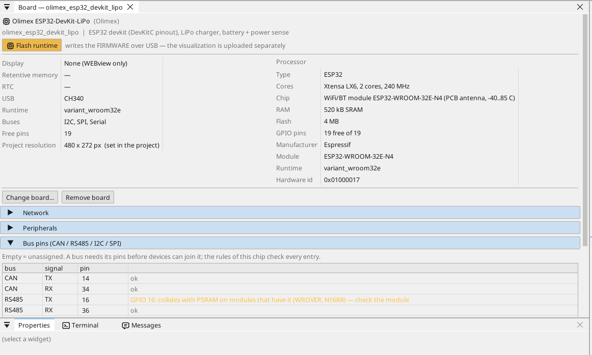
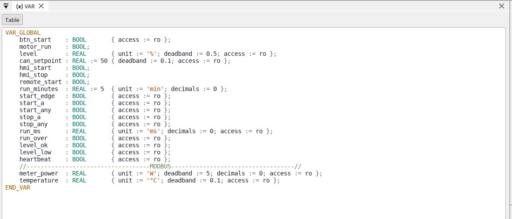
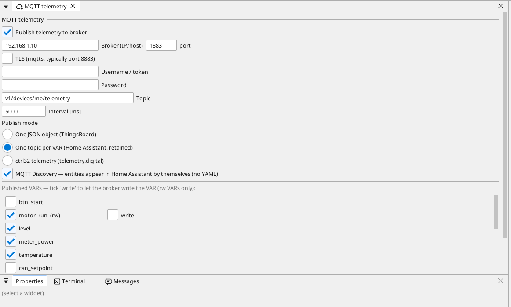

# Configurer la carte

## La page de la carte

Double-cliquez sur la carte dans l'arbre des appareils. La page montre ce que porte la carte et chaque broche : une broche libre reçoit une variable en un clic - une entrée, une sortie, ou sur une broche analogique une entrée analogique.

## Réseau

La carte rejoint votre Wi-Fi : ouvrez la page **WiFi** de l'arbre des
appareils et saisissez le nom et le mot de passe du réseau (l'exemple
contient des valeurs de remplacement). Elle reçoit son adresse du routeur
(DHCP) ; une adresse fixe se définit sur la page de la carte, dans sa
section **Network**.

## Entrées, sorties et variables

Chaque signal du programme est une **variable**. Une variable sur une broche lit ou pilote la broche ; une variable analogique indique ce qui y est raccordé (une tension, 4-20 mA, une thermistance) et sa plage en unités.

## Communication

**Modbus TCP.** Un appareil du réseau s'ajoute sous **Ethernet → Modbus TCP master** ; ses registres deviennent des variables.

**Modbus RTU / RS-485.** La carte n'a pas de transceiver RS-485 : placez un module transceiver 3,3 V sur des broches libres (TX, RX et la broche de direction DE) et indiquez-les sur la page de la carte (Bus pins) - ctrl32 est alors maître ou esclave Modbus RTU sur cette ligne. Les appareils Modbus TCP du réseau n'ont besoin de rien.

**CAN.** Le ESP32 possède un contrôleur CAN (TWAI). La carte n'a pas de transceiver CAN : placez un module transceiver 3,3 V sur deux broches libres et indiquez-les sur la page de la carte (Bus pins) - les appareils CANopen, les trames CAN brutes et les bus véhicule (J1939) y fonctionnent alors.

**MQTT.** La carte publie des variables choisies vers un broker ; en mode Home Assistant, le broker les trouve de lui-même, et une variable marquée *write* peut être réglée depuis là.

## WEBview

La carte sert sa page opérateur à tout navigateur du réseau - ouvrez l'adresse de la carte. La page se dessine dans l'éditeur comme un écran.

---

[← Installer le runtime](install.fr.md) | [Vue d'ensemble](README.fr.md) | [Projets d'exemple →](examples/README.fr.md)
