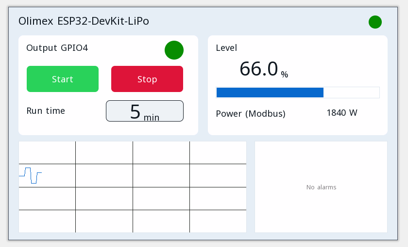

# Proiecte exemplu

Fiecare proiect se deschide în editorul ctrl32 (**File → Open**) și rulează pe Olimex ESP32-DevKit-LiPo așa cum este.

| | Proiect | Ce arată |
|---|---|---|
|  | [All-in-one](all-in-one/README.ro.md) | O ieșire de motor cu start / stop, un temporizator de funcționare, un nivel analogic, o temperatură Modbus RTU, cadre CAN, un contor Modbus TCP, MQTT și pagina operatorului într-un browser. |

---

[← Configurare](../configure.ro.md) | [Prezentare](../README.ro.md) | [Depanare →](../troubleshooting.ro.md)
