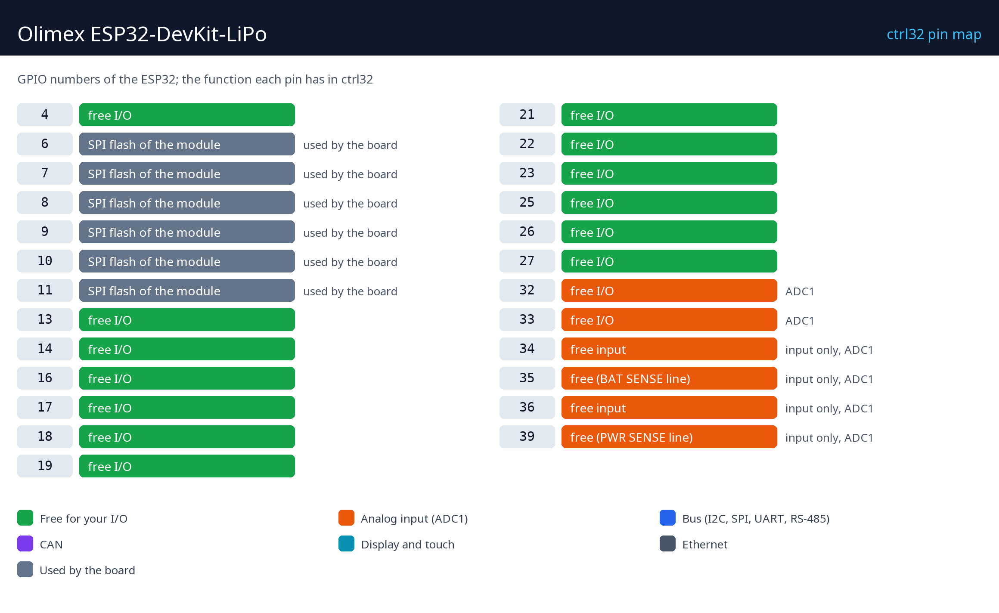

# Hardware and wiring

## What you need

- The Olimex ESP32-DevKit-LiPo.
- A micro-USB data cable - for the upload and for power (5 V).
- The name and the password of your 2.4 GHz Wi-Fi.
- A PC with the [ctrl32 editor](https://ctrl32.com/download/) (Windows).
- Optional, for the all-in-one example: a push-button from GPIO13 to GND; a relay module or an LED with a resistor on GPIO4; a potentiometer (10 k) between 3.3 V and GND with its wiper on GPIO32; a 3.3 V CAN transceiver on GPIO14 / GPIO34 and an RS-485 transceiver on GPIO16 / GPIO36 / GPIO17 (DE); a Li-Po cell for backup.

## Power

| Source | Where | Note |
|---|---|---|
| USB 5 V | the micro-USB connector | power and programming |
| Li-Po battery | the battery connector | charged on board, takes over when USB fails |

## Pin map

| GPIO | Function in ctrl32 | Note |
|---|---|---|
| 4 | free I/O |  |
| 6 | SPI flash of the module | ⚠ used by the board |
| 7 | SPI flash of the module | ⚠ used by the board |
| 8 | SPI flash of the module | ⚠ used by the board |
| 9 | SPI flash of the module | ⚠ used by the board |
| 10 | SPI flash of the module | ⚠ used by the board |
| 11 | SPI flash of the module | ⚠ used by the board |
| 13 | free I/O |  |
| 14 | free I/O |  |
| 16 | free I/O |  |
| 17 | free I/O |  |
| 18 | free I/O |  |
| 19 | free I/O |  |
| 21 | free I/O |  |
| 22 | free I/O |  |
| 23 | free I/O |  |
| 25 | free I/O |  |
| 26 | free I/O |  |
| 27 | free I/O |  |
| 32 | free I/O | ADC1 |
| 33 | free I/O | ADC1 |
| 34 | free input | ⚠ input only, ADC1 |
| 35 | free (BAT SENSE line) | ⚠ input only, ADC1 |
| 36 | free input | ⚠ input only, ADC1 |
| 39 | free (PWR SENSE line) | ⚠ input only, ADC1 |

The two headers carry the module's free GPIO. GPIO34 to GPIO39 are inputs
only; GPIO0, 2, 12 and 15 are strapping pins - leave them for inputs or
test before using them. A button to GND needs no resistor: ctrl32 reads it
inverted with the chip's pull-up.

## Safety

- The board is not intended for safety functions. An emergency stop, a
  door switch or a light curtain is wired in hardware, never through a
  program.
- The GPIO pins are 3.3 V. A 24 V signal needs an opto-coupler or a level
  shifter; a relay coil needs a driver (a relay module has one).

---

[← Overview](README.md) | [Overview](README.md) | [Install the runtime →](install.md)
