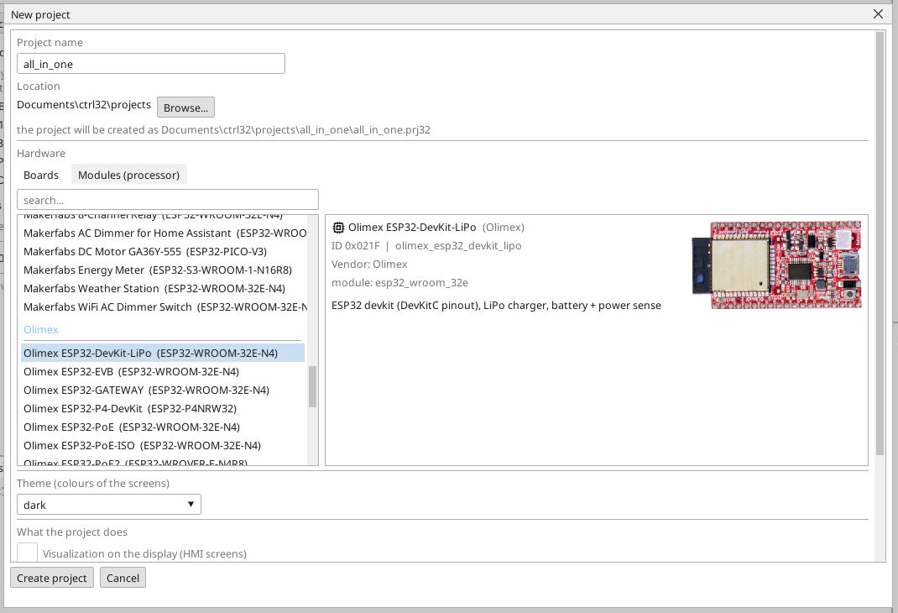
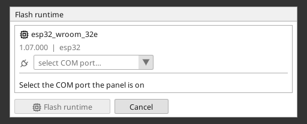
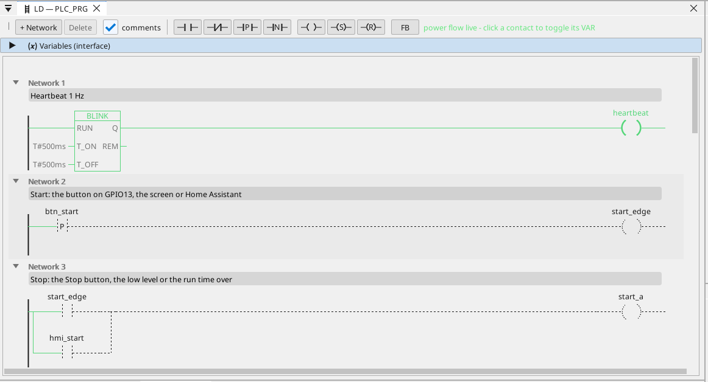

# Installer le runtime ctrl32

Le runtime est le programme de la carte qui exécute votre projet - le cycle de l'automate, les écrans, la communication. Il s'installe une fois sur la carte ; ensuite chaque modification du projet est un chargement qui ne réécrit rien d'autre que le projet.

## 1. Brancher la carte

Branchez la carte au PC avec le câble USB. La carte possède un convertisseur USB-UART CH340. Windows 10 et 11
installent son pilote d'eux-mêmes ; si le port n'apparaît pas, installez
le pilote CH340 du fabricant de la puce (WCH).

## 2. Créer le projet

Lancez l'éditeur ctrl32 et choisissez **New project** (Ctrl+N). Saisissez le **nom** du projet, choisissez **Olimex ESP32-DevKit-LiPo** dans la liste des cartes (sous **Olimex**) et appuyez sur **Create project**.

Pour partir plutôt de l'exemple prêt, ouvrez le [projet tout-en-un](examples/all-in-one/README.fr.md) (**File → Open**).

## 3. Écrire le runtime

Choisissez le port COM de la carte dans le sélecteur de port de la barre d'outils, cliquez sur la carte dans l'arbre des appareils et appuyez sur **Flash runtime**. L'éditeur écrit le runtime, le relit et le vérifie ; cela prend environ une minute et la carte redémarre. Cela se fait une fois - et à nouveau seulement quand l'éditeur apporte une nouvelle ligne de runtime.

## 4. Charger le projet

Appuyez sur le bouton de chargement dans la barre d'outils (F5). L'éditeur compile le projet, l'écrit dans l'emplacement de programme inactif de la carte, le vérifie et seulement ensuite bascule - un chargement échoué laisse le programme en cours intact.

## 5. Vérifier que cela fonctionne

Appuyez sur **ONLINE** (l'icône de prise à côté du sélecteur de port) pour observer le programme sur la carte : ce qui conduit est vert, chaque variable porte sa valeur en direct. Sans carte sous la main, la même vue vient de la **simulation** (le bouton de la barre d'outils à côté de ONLINE).

Quelque chose ne fonctionne pas ? Voir [Dépannage](troubleshooting.fr.md).

*Captures d'écran : éditeur ctrl32 1.07.*

---

[← Matériel et câblage](hardware.fr.md) | [Vue d'ensemble](README.fr.md) | [Configurer →](configure.fr.md)
