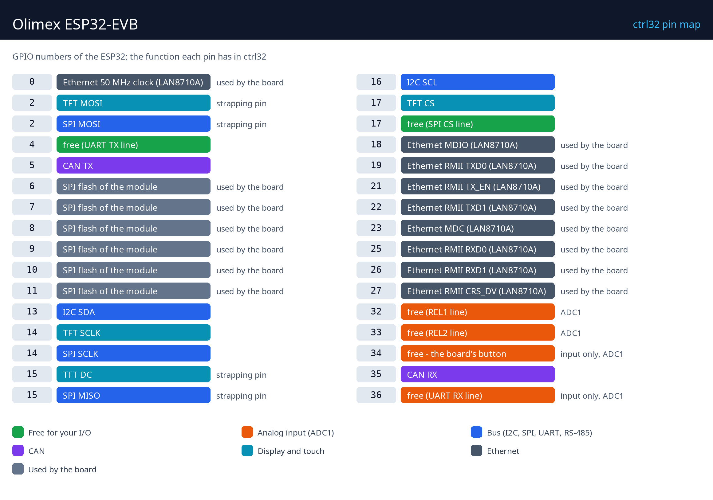

# Olimex ESP32-EVB

     

The Olimex ESP32-EVB is an ESP32 board built for control: two relays (10 A / 250 VAC), a CAN transceiver, Ethernet and Wi-Fi on one board. With ctrl32 it is a ready PLC - the relays and the button are variables of a ladder program, CAN talks to drives and I/O nodes, and the operator page runs in any browser (WEBview). An optional 2.8" touch display on the UEXT connector turns it into a small panel.

**Good for:**

- A relay controller - heating, pumps, lights - with Ethernet
- A CAN master for a drive or CANopen I/O nodes
- A thermostat or a small panel with the optional 2.8" display

Board page in the catalog: [Olimex ESP32-EVB](https://ctrl32.com/hardware/boards/olimex-esp32-evb/)

## What ctrl32 can do on this board

<!-- capabilities:start -->
| Feature | On this board | Notes |
|---|---|---|
| Chip | ESP32 (ESP32-WROOM-32E-N4) |  |
| Memory | 4 MB flash |  |
| Program size | 128 variables, 32 alarms, 128 blocks | checked by the editor before a download |
| Digital inputs / outputs | 6 free GPIO | 2 of them inputs only |
| Analog inputs | 4 on the chip (ADC1) | GPIO32, GPIO33, GPIO34, GPIO36 |
| Ethernet | yes - LAN8710A |  |
| Wi-Fi | Wi-Fi 2.4 GHz |  |
| CAN (TWAI) | 1 |  |
| Modbus RTU (RS-485) | no transceiver on the board |  |
| Modbus TCP | client and server |  |
| MQTT | yes | Home Assistant discovery |
| WEBview | yes | the operator page in any browser |
| Display / touch (HMI) | - 240x320, - |  |
| USB | Micro-USB (CH340T USB-UART) |  |
| Power | 5 V USB, 3.7 V Li-Po / Li-Ion |  |
<!-- capabilities:end -->

### What is not supported

- Bluetooth.
- The IR receiver and transmitter - ctrl32 does not use them on this board.
- The microSD slot - ctrl32 keeps the program and the screens in the chip's own flash.

## The guide

| Step | Page |
|---|---|
| 1 | [Hardware and wiring](hardware.md) - what you need, power, the pin map |
| 2 | [Install the runtime](install.md) - the editor, the board, the first upload |
| 3 | [Configure](configure.md) - network, I/O, communication |
| 4 | [Example projects](examples/README.md) - everything the board does, ready to open |
| - | [Troubleshooting](troubleshooting.md) |

## Files

-

## Next steps

- [ctrl32 documentation](https://ctrl32.com/docs/) - the editor, the languages, every block
- [Download the editor](https://ctrl32.com/download/)
- [All tested boards](../../README.md)
- [Olimex ESP32-PoE](../olimex-esp32-poe/README.md) - Ethernet and Power over Ethernet

