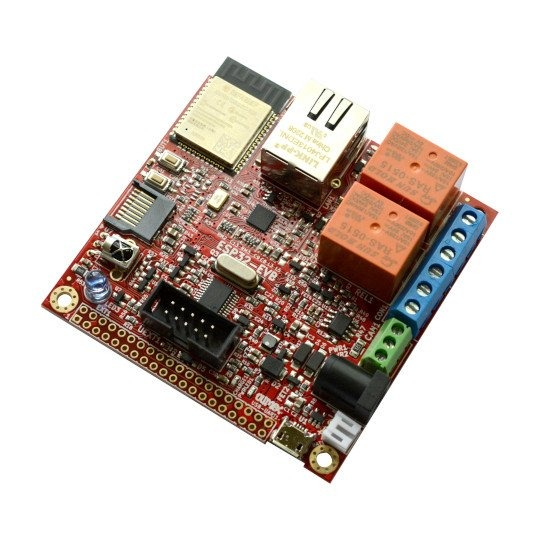

# Olimex ESP32-EVB

     

Olimex ESP32-EVB to płytka z ESP32 zbudowana do sterowania: dwa przekaźniki (10 A / 250 VAC), transceiver CAN, Ethernet i Wi-Fi na jednej płytce. Z ctrl32 jest gotowym PLC - przekaźniki i przycisk są zmiennymi programu drabinkowego, CAN rozmawia z napędami i węzłami I/O, a strona operatora działa w każdej przeglądarce (WEBview). Opcjonalny wyświetlacz dotykowy 2,8" na złączu UEXT zmienia ją w mały panel.

**Nadaje się do:**

- Sterownik przekaźnikowy - ogrzewanie, pompy, oświetlenie - z Ethernetem
- Master CAN dla napędu lub węzłów I/O CANopen
- Termostat lub mały panel z opcjonalnym wyświetlaczem 2,8"

Strona płytki w katalogu: [Olimex ESP32-EVB](https://ctrl32.com/hardware/boards/olimex-esp32-evb/)

## Co ctrl32 potrafi na tej płytce

<!-- capabilities:start -->
| Funkcja | Na tej płytce | Uwagi |
|---|---|---|
| Układ | ESP32 (ESP32-WROOM-32E-N4) |  |
| Pamięć | 4 MB flash |  |
| Rozmiar programu | 128 zmiennych, 32 alarmów, 128 bloków | edytor sprawdza to przed wgraniem |
| Wejścia / wyjścia cyfrowe | 6 wolnych GPIO | 2 z nich tylko wejścia |
| Wejścia analogowe | 4 w układzie (ADC1) | GPIO32, GPIO33, GPIO34, GPIO36 |
| Ethernet | tak - LAN8710A |  |
| Wi-Fi | Wi-Fi 2.4 GHz |  |
| CAN (TWAI) | 1 |  |
| Modbus RTU (RS-485) | tak - na wolnych pinach | wymaga zewnętrznego transceivera |
| Modbus TCP | klient i serwer |  |
| MQTT | tak | wykrywanie w Home Assistant |
| WEBview | tak | strona operatora w każdej przeglądarce |
| Wyświetlacz / dotyk (HMI) | - 240x320, - |  |
| USB | Micro-USB (CH340T USB-UART) |  |
| Zasilanie | 5 V USB, 3.7 V Li-Po / Li-Ion |  |
<!-- capabilities:end -->

### Czego nie obsługujemy

- Bluetooth.
- Odbiornik i nadajnik podczerwieni - ctrl32 nie używa ich na tej płytce.
- Gniazdo microSD - ctrl32 trzyma program i ekrany we własnej pamięci flash układu.

## Poradnik

| Krok | Strona |
|---|---|
| 1 | [Sprzęt i okablowanie](hardware.pl.md) - czego potrzebujesz, zasilanie, mapa pinów |
| 2 | [Instalacja runtime](install.pl.md) - edytor, płytka, pierwsze wgranie |
| 3 | [Konfiguracja](configure.pl.md) - sieć, I/O, komunikacja |
| 4 | [Przykładowe projekty](examples/README.pl.md) - wszystko, co płytka potrafi, gotowe do otwarcia |
| - | [Rozwiązywanie problemów](troubleshooting.pl.md) |

## Pliki

-

## Dalsze kroki

- [Dokumentacja ctrl32](https://ctrl32.com/docs/) - edytor, języki, każdy blok
- [Pobierz edytor](https://ctrl32.com/download/)
- [Wszystkie przetestowane płytki](../../README.pl.md)
- [Olimex ESP32-PoE](../olimex-esp32-poe/README.pl.md) - Ethernet i zasilanie przez Ethernet (PoE)

