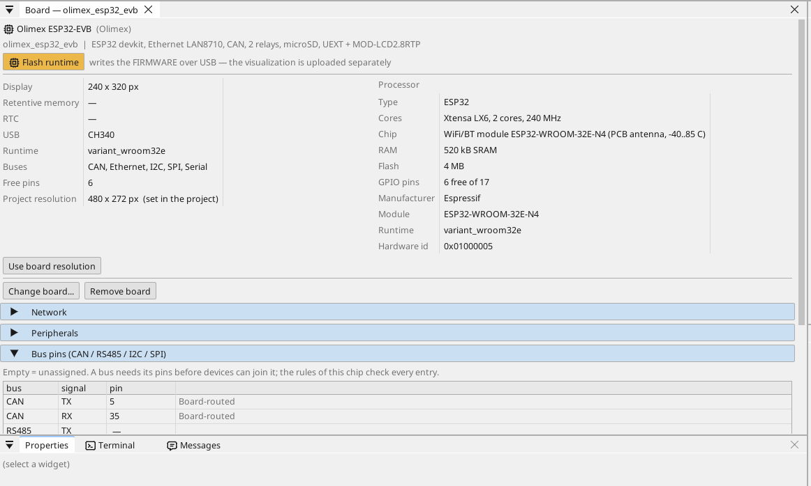
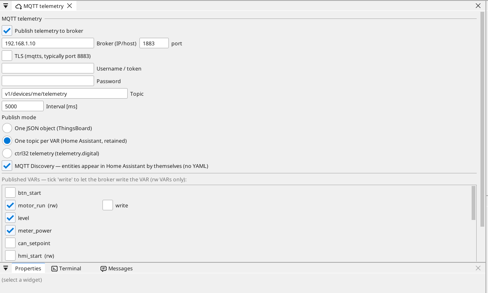
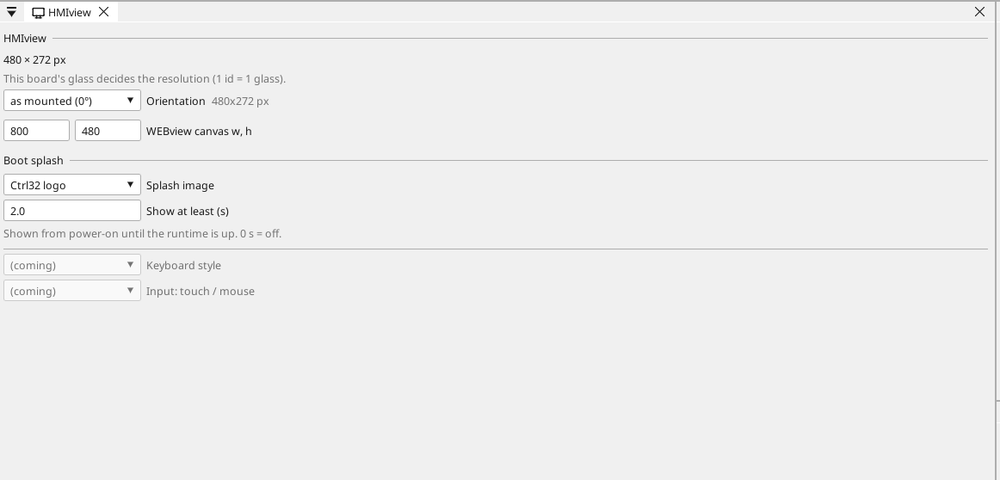
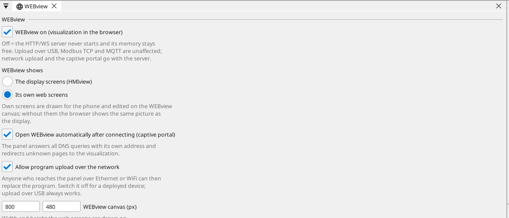

# Nastavení desky

## Stránka desky

Dvakrát klikni na desku ve stromu zařízení. Stránka ukáže, co deska nese, a každý pin: volný pin dostane proměnnou jedním kliknutím - vstup, výstup, nebo na analogovém pinu analogový vstup.

## Síť

Ethernetový port se spustí sám a adresu si vezme z routeru (DHCP). Pevnou
adresu nastavíš na stránce desky v sekci **Network**; Wi-Fi na stránce
**WiFi** ve stromu zařízení.

## Vstupy, výstupy a proměnné

Každý signál programu je **proměnná**. Proměnná na pinu pin čte nebo ovládá; analogová proměnná říká, co je na ni zapojeno (napětí, 4-20 mA, termistor), a její rozsah v jednotkách.

## Komunikace

**Modbus TCP.** Zařízení v síti se přidá pod **Ethernet → Modbus TCP master**; jeho registry se stanou proměnnými.

**Modbus RTU / RS-485.** Deska nemá převodník RS-485: dej 3,3 V modul převodníku na volné piny (TX, RX a směrový pin DE) a urči je na stránce desky (Bus pins) - ctrl32 je pak na té lince Modbus RTU master nebo slave. Zařízení Modbus TCP v síti nepotřebují nic.

**CAN.** ESP32 má jeden řadič CAN (TWAI) a tato deska nese jeho převodník: CAN_H / CAN_L na svorce, GPIO5 / GPIO35. Běží na něm zařízení CANopen (měnič, I/O uzly), surové rámce CAN i vozidlové sběrnice (J1939).

**MQTT.** Deska posílá vybrané proměnné do brokeru; v režimu Home Assistant si je broker najde sám a proměnnou označenou *write* lze odtud nastavit.

## Displej a dotyk

S MOD-LCD2.8RTP na konektoru UEXT může projekt nést obrazovky
(240 x 320, na výšku nebo otočené). Deska nemá PSRAM: se zapnutým
displejem si runtime drží paměť pro obrazovku a síť běží jen na Ethernetu
(bez Wi-Fi, bez MQTT). Proto příklad all-in-one obrazovku nemá; WEBview
běží v obou případech.

## WEBview

Deska nabízí svou stránku operátora každému prohlížeči v síti - otevři adresu desky. Stránka se kreslí v editoru jako obrazovka.

---

[← Nahrání runtime](install.cs.md) | [Přehled](README.cs.md) | [Vzorové projekty →](examples/README.cs.md)
