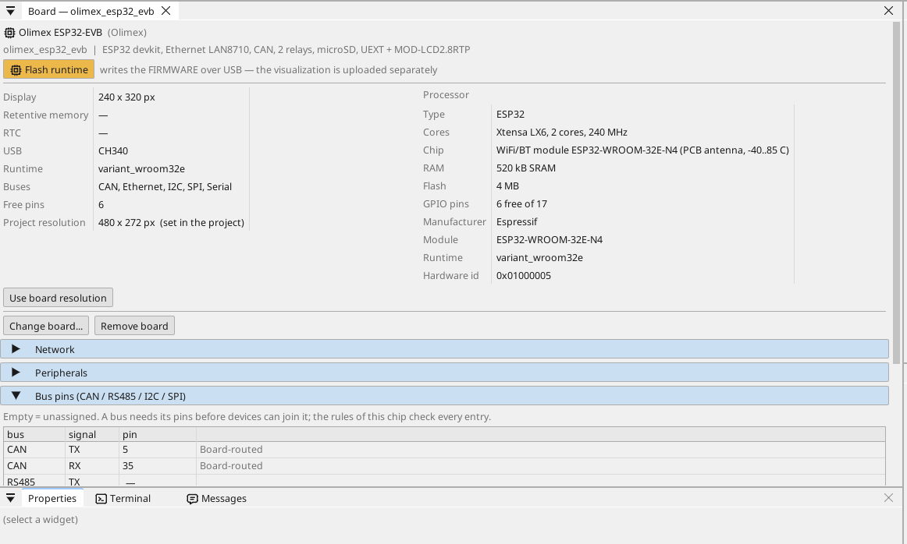
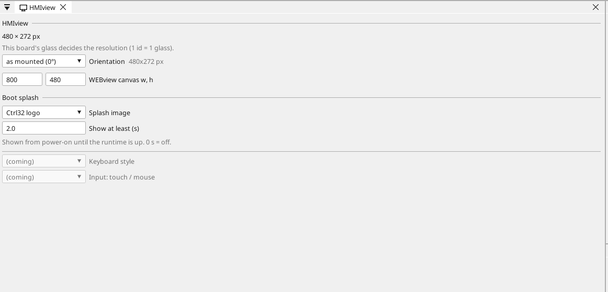

# Configurează placa

## Pagina plăcii

Fă dublu clic pe placă în arborele de dispozitive. Pagina arată ce are placa și fiecare pin: un pin liber primește o variabilă dintr-un clic - o intrare, o ieșire sau, pe un pin cu capacitate analogică, o intrare analogică.

## Rețea

Portul Ethernet pornește singur și își ia adresa de la routerul tău
(DHCP). O adresă fixă se setează pe pagina plăcii, în secțiunea
**Network**; Wi-Fi pe pagina **WiFi** din arborele de dispozitive.

## Intrări, ieșiri și variabile

Fiecare semnal al programului este o **variabilă**. O variabilă pe un pin citește sau comandă pinul; o variabilă analogică spune ce este conectat la ea (o tensiune, 4-20 mA, un termistor) și domeniul ei în unități.

## Comunicație

**Modbus TCP.** Un dispozitiv din rețea se adaugă sub **Ethernet → Modbus TCP master**; registrele lui devin variabile.

**Modbus RTU / RS-485.** Placa nu are transceiver RS-485: pune un modul transceiver de 3,3 V pe pini liberi (TX, RX și pinul de direcție DE) și numește-i pe pagina plăcii (Bus pins) - ctrl32 este atunci master sau slave Modbus RTU pe acea linie. Dispozitivele Modbus TCP din rețea nu au nevoie de nimic.

**CAN.** ESP32 are un controler CAN (TWAI), iar această placă are transceiverul lui: CAN_H / CAN_L pe clemă, GPIO5 / GPIO35. Dispozitivele CANopen (o acționare, noduri I/O), cadrele CAN brute și magistralele de vehicul (J1939) rulează toate pe el.

**MQTT.** Placa publică variabilele alese către un broker; în modul Home Assistant brokerul le găsește singur, iar o variabilă marcată *write* poate fi setată de acolo.

## Display și touch

Cu MOD-LCD2.8RTP pe conectorul UEXT proiectul poate avea ecrane (240 x 320,
portret sau rotit). Placa nu are PSRAM: cu display-ul aprins runtime-ul
își păstrează memoria pentru ecran și rulează rețeaua doar pe Ethernet
(fără Wi-Fi, fără MQTT). De aceea exemplul all-in-one nu are ecran;
WEBview rulează în ambele cazuri.

## WEBview

Placa servește pagina operatorului oricărui browser din rețea - deschide adresa plăcii. Pagina se desenează în editor ca un ecran.

---

[← Instalarea runtime-ului](install.ro.md) | [Prezentare](README.ro.md) | [Proiecte exemplu →](examples/README.ro.md)
