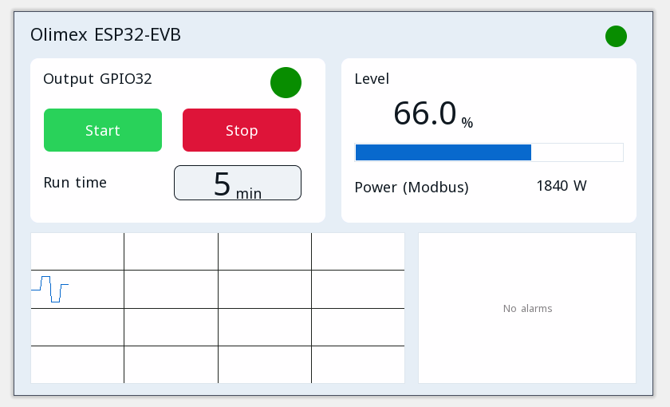

# Example projects

Each project opens in the ctrl32 editor (**File → Open**) and runs on the Olimex ESP32-EVB as it is.

| | Project | What it shows |
|---|---|---|
|  | [All-in-one](all-in-one/README.md) | A motor output with start / stop, a run timer, an analog level, CAN frames, a Modbus TCP meter, MQTT and the operator page in a browser. |

---

[← Configure](../configure.md) | [Overview](../README.md) | [Troubleshooting →](../troubleshooting.md)
