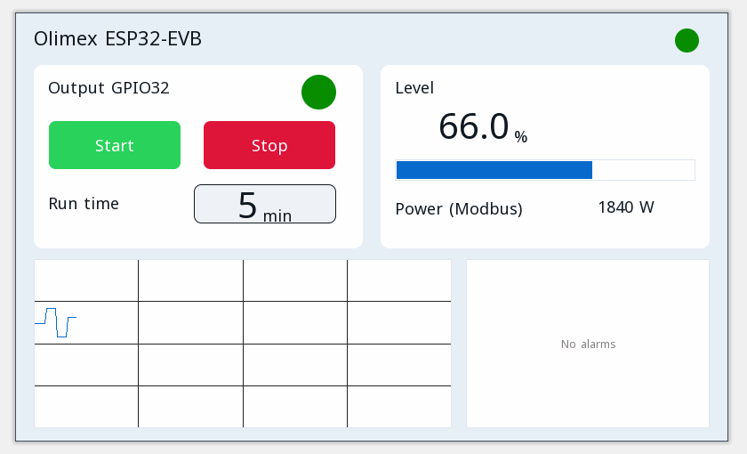

# Przykładowe projekty

Każdy projekt otwiera się w edytorze ctrl32 (**File → Open**) i działa na Olimex ESP32-EVB bez zmian.

| | Projekt | Co pokazuje |
|---|---|---|
|  | [All-in-one](all-in-one/README.pl.md) | Wyjście silnika ze start / stop, czasem pracy, poziomem analogowym, ramkami CAN, licznikiem Modbus TCP, MQTT i stroną operatora w przeglądarce. |

---

[← Konfiguracja](../configure.pl.md) | [Przegląd](../README.pl.md) | [Rozwiązywanie problemów →](../troubleshooting.pl.md)
