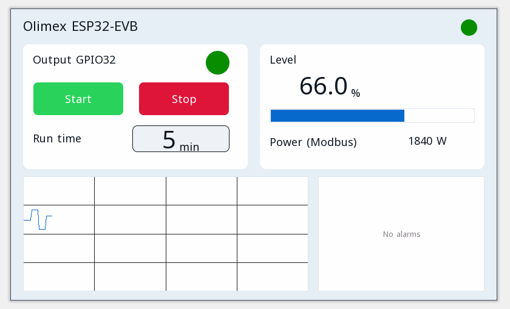

# Örnek projeler

Her proje ctrl32 editöründe açılır (**File → Open**) ve Olimex ESP32-EVB üzerinde olduğu gibi çalışır.

| | Proje | Ne gösterir |
|---|---|---|
|  | [All-in-one](all-in-one/README.tr.md) | Start / stop'lu bir motor çıkışı, bir çalışma zamanlayıcısı, analog bir seviye, CAN çerçeveleri, bir Modbus TCP sayacı, MQTT ve tarayıcıda operatör sayfası. |

---

[← Yapılandırma](../configure.tr.md) | [Genel bakış](../README.tr.md) | [Sorun giderme →](../troubleshooting.tr.md)
