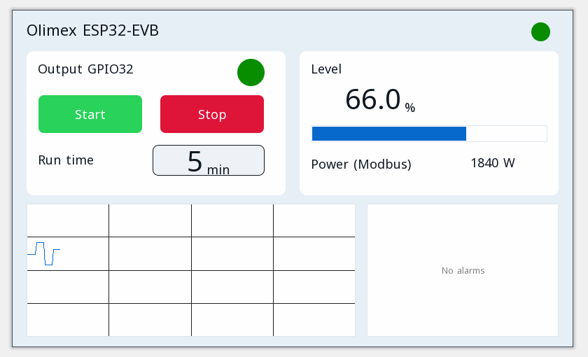

# Приклади проєктів

Кожен проєкт відкривається в редакторі ctrl32 (**File → Open**) і працює на Olimex ESP32-EVB як є.

| | Проєкт | Що він показує |
|---|---|---|
|  | [All-in-one](all-in-one/README.uk.md) | Вихід двигуна з пуском / зупинкою, таймер роботи, аналоговий рівень, кадри CAN, лічильник Modbus TCP, MQTT і сторінка оператора в браузері. |

---

[← Налаштування](../configure.uk.md) | [Огляд](../README.uk.md) | [Усунення несправностей →](../troubleshooting.uk.md)
