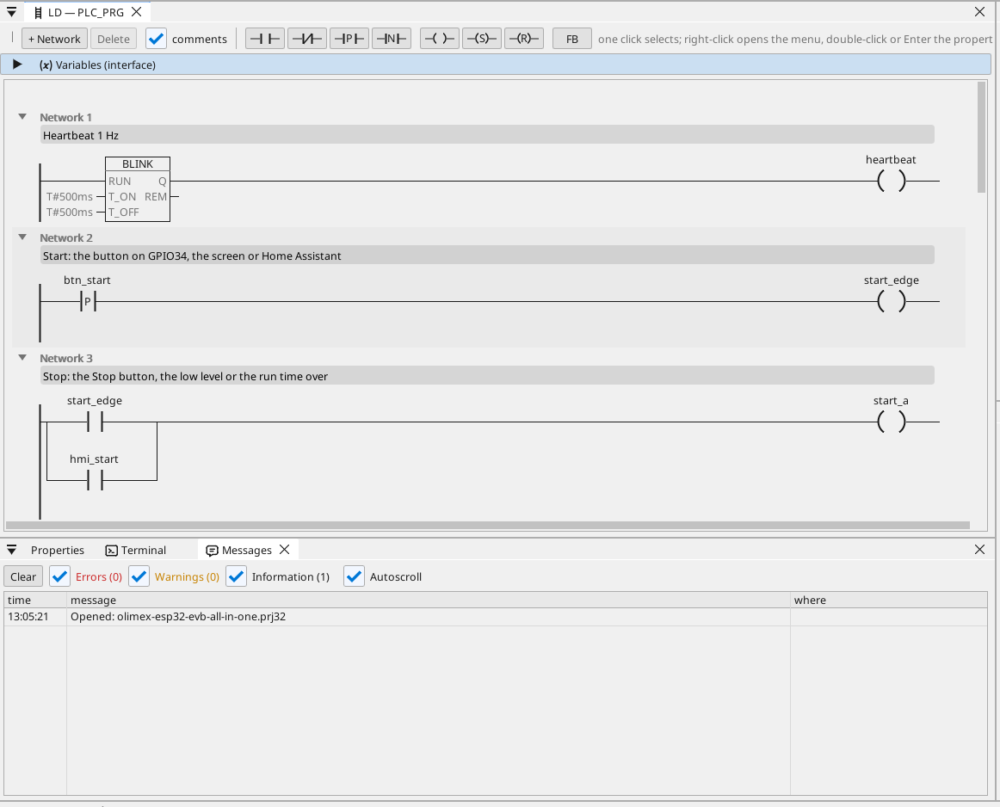

# All-in-one

A motor output with start / stop, a run timer, an analog level, CAN frames, a Modbus TCP meter, MQTT and the operator page in a browser.

**Download:** [all-in-one.prj32](all-in-one.prj32) - open it in the ctrl32 editor (**File → Open**).

## What it does

The program is a small machine controller - the shape of most machines:

- **Start** comes from the button on GPIO34, from **Start** on the operator page, or from Home Assistant over MQTT.
- **Stop** comes from **Stop**, from a low level or from the run time running out - the latch drops the output on **GPIO32**.
- The **run time** is set in minutes and kept through a power cut.
- The **level** is an analog input on **GPIO36** (0 to 3.3 V scaled to 0 to 100 %); below 10 % the output stops and an alarm is raised, above 15 % it may start again.
- **CAN** sends the level and the output state in frame 0x181 every 100 ms and receives a setpoint in frame 0x201.
- A **Modbus TCP** energy meter on the network gives the power demand (192.168.1.60 - change it to your meter).
- **MQTT** publishes the values to a Home Assistant broker, which finds them by itself; the output can be started from Home Assistant.
- **WEBview** serves the operator page to any browser on the network.

## The program

## The operator page

## Open and run it

1. Open `all-in-one.prj32` in the editor.
2. Change the addresses (the Modbus device, the MQTT broker) to the ones of your network.
3. Run the **simulation** (toolbar) to try it on the PC, or download it to the board - see [Install the runtime](../../install.md).

## What you should see

Press the button on GPIO34: the output on GPIO32 switches on and its LED on the page lights. After the run time it switches off by itself, and when the level drops under 10 % the alarm appears in the table. In Home Assistant the board shows up with its values.

---

[← Example projects](../README.md) | [Overview](../../README.md)
