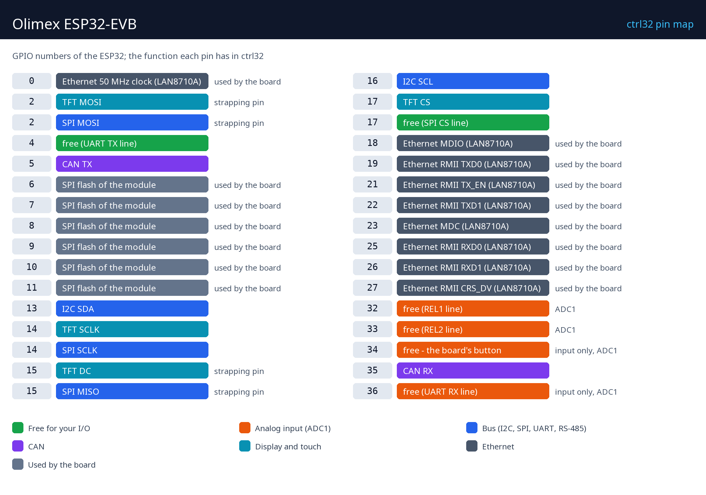

# Hardvér a zapojenie

## Čo treba

- Olimex ESP32-EVB.
- Dátový kábel micro-USB - na prvé nahratie runtime.
- Napájanie: zdroj 5 V cez USB, alebo 5 V na skrutkovej svorke.
- Sieťový kábel a voľný port v sieti.
- PC s [editorom ctrl32](https://ctrl32.com/download/) (Windows).
- Voliteľne pre príklad all-in-one: potenciometer (10 k) medzi 3,3 V a GND s bežcom na GPIO36 (UEXT); uzol CAN alebo CAN adaptér a dva zakončovacie odpory 120 ohm.
- Voliteľne: displej Olimex MOD-LCD2.8RTP (2,8 palca, 240 x 320, odporový dotyk) na konektore UEXT.

## Napájanie

| Zdroj | Kde | Poznámka |
|---|---|---|
| USB 5 V | konektor micro-USB | cesta na prvé nahratie |
| 5 V DC | skrutková svorka | do rozvádzača |
| Li-Po batéria | konektor batérie | nabíja sa na doske |

!!! warning "Relé spínajú sieťové napätie"
    Kontakty relé zapájaj len pri odpojenej doske, v krabici, a len osoba
    oprávnená pracovať na sieťových inštaláciách. Kontakty znesú
    10 A / 250 VAC; motor alebo ohrievač nad túto hodnotu potrebuje
    stýkač spínaný relé.

## Mapa pinov

| GPIO | Funkcia v ctrl32 | Poznámka |
|---|---|---|
| 0 | Ethernet 50 MHz clock (LAN8710A) | ⚠ používa doska |
| 2 | TFT MOSI | ⚠ strapping pin |
| 2 | SPI MOSI | ⚠ strapping pin |
| 4 | free (UART TX line) |  |
| 5 | CAN TX |  |
| 6 | SPI flash modulu | ⚠ používa doska |
| 7 | SPI flash modulu | ⚠ používa doska |
| 8 | SPI flash modulu | ⚠ používa doska |
| 9 | SPI flash modulu | ⚠ používa doska |
| 10 | SPI flash modulu | ⚠ používa doska |
| 11 | SPI flash modulu | ⚠ používa doska |
| 13 | I2C SDA |  |
| 14 | TFT SCLK |  |
| 14 | SPI SCLK |  |
| 15 | TFT DC | ⚠ strapping pin |
| 15 | SPI MISO | ⚠ strapping pin |
| 16 | I2C SCL |  |
| 17 | TFT CS |  |
| 17 | free (SPI CS line) |  |
| 18 | Ethernet MDIO (LAN8710A) | ⚠ používa doska |
| 19 | Ethernet RMII TXD0 (LAN8710A) | ⚠ používa doska |
| 21 | Ethernet RMII TX_EN (LAN8710A) | ⚠ používa doska |
| 22 | Ethernet RMII TXD1 (LAN8710A) | ⚠ používa doska |
| 23 | Ethernet MDC (LAN8710A) | ⚠ používa doska |
| 25 | Ethernet RMII RXD0 (LAN8710A) | ⚠ používa doska |
| 26 | Ethernet RMII RXD1 (LAN8710A) | ⚠ používa doska |
| 27 | Ethernet RMII CRS_DV (LAN8710A) | ⚠ používa doska |
| 32 | free (REL1 line) | ADC1 |
| 33 | free (REL2 line) | ADC1 |
| 34 | voľný - tlačidlo dosky | ⚠ len vstup, ADC1 |
| 35 | CAN RX |  |
| 36 | free (UART RX line) | ⚠ len vstup, ADC1 |

**Relé:** REL1 na GPIO32, REL2 na GPIO33. **Tlačidlo:** BUT1 na GPIO34
(len vstup). **CAN:** prevodník na doske na GPIO5 (TX) / GPIO35 (RX),
CAN_H / CAN_L na svorke - zbernicu zakonči odporom 120 ohm na oboch
koncoch. Konektor **UEXT** nesie I2C (GPIO13 / GPIO16), SPI a voľný UART
(GPIO4 / GPIO36); voliteľný displej používa jeho linky SPI.

## Bezpečnosť

- Doska nie je určená na bezpečnostné funkcie. Núdzové zastavenie, dverový
  spínač či svetelná závora sa zapájajú v hardvéri, nikdy cez program.
- Piny GPIO majú 3,3 V. Signál 24 V potrebuje optočlen alebo prevodník
  úrovní; cievka relé potrebuje budič (reléový modul ho má).

---

[← Prehľad](README.sk.md) | [Prehľad](README.sk.md) | [Nahratie runtime →](install.sk.md)
