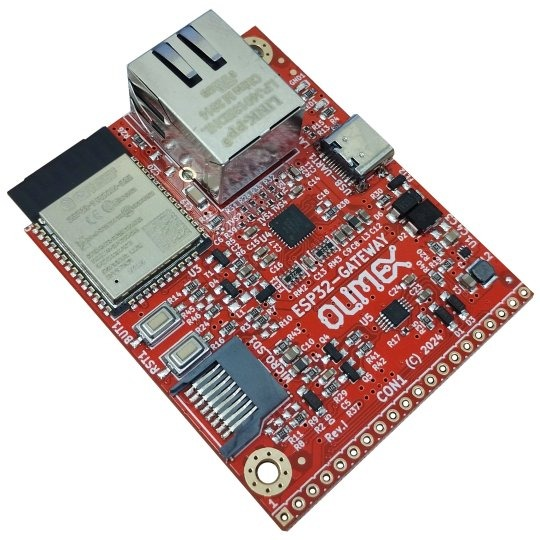
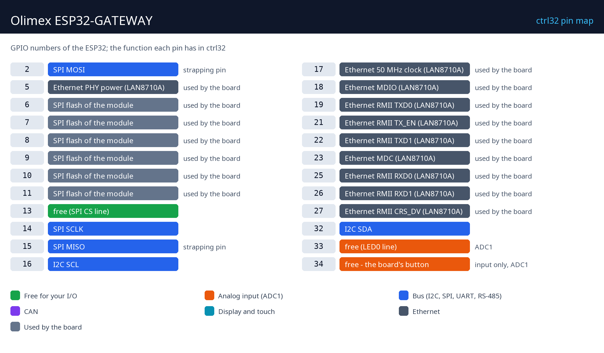

# Olimex ESP32-GATEWAY

   

La Olimex ESP32-GATEWAY es una placa ESP32 compacta con Ethernet de 100 Mb y Wi-Fi - lo bastante pequeña para una caja de derivación. Con ctrl32 es una pasarela con su propia lógica: dispositivos Modbus TCP leídos y publicados por MQTT, un programa ladder en el chip y su página del operador en cualquier navegador (WEBview).

**Ideal para:**

- Una pasarela de Modbus TCP a MQTT con su propia lógica
- Un pequeño control en una caja de derivación, por Ethernet
- Domótica - lectura de contadores, conmutación mediante módulos de E/S Modbus

Página de la placa en el catálogo: [Olimex ESP32-GATEWAY](https://ctrl32.com/hardware/boards/olimex-esp32-gateway/)

## Qué puede hacer ctrl32 en esta placa

<!-- capabilities:start -->
| Característica | En esta placa | Notas |
|---|---|---|
| Chip | ESP32 (ESP32-WROOM-32E-N4) |  |
| Memoria | 4 MB flash |  |
| Tamaño del programa | 128 variables, 32 alarmas, 128 bloques | el editor lo comprueba antes de una descarga |
| Entradas / salidas digitales | 3 GPIO libres | 1 de ellos solo entradas |
| Entradas analógicas | 2 en el chip (ADC1) | GPIO33, GPIO34 |
| Ethernet | sí - LAN8710A |  |
| Wi-Fi | Wi-Fi 2.4 GHz |  |
| CAN (TWAI) | 1 - en pines libres | necesita un transceptor externo |
| Modbus RTU (RS-485) | sí - en pines libres | necesita un transceptor externo |
| Modbus TCP | cliente y servidor |  |
| MQTT | sí | descubrimiento en Home Assistant |
| WEBview | sí | la página del operador en cualquier navegador |
| Pantalla / táctil (HMI) | no | la página del operador es WEBview |
| USB | USB-C (CH340 USB-UART) |  |
| Alimentación | 5 V USB |  |
<!-- capabilities:end -->

### Qué no está soportado

- Bluetooth - el ESP32 lo tiene, ctrl32 no lo usa.
- La ranura microSD - ctrl32 guarda el programa y las pantallas en la propia flash del chip.

## La guía

| Paso | Página |
|---|---|
| 1 | [Hardware y cableado](hardware.es.md) - qué necesitas, alimentación, el mapa de pines |
| 2 | [Instalar el runtime](install.es.md) - el editor, la placa, la primera carga |
| 3 | [Configurar](configure.es.md) - red, E/S, comunicación |
| 4 | [Proyectos de ejemplo](examples/README.es.md) - todo lo que hace la placa, listo para abrir |
| - | [Solución de problemas](troubleshooting.es.md) |

## Archivos

-

## Siguientes pasos

- [Documentación de ctrl32](https://ctrl32.com/docs/) - el editor, los lenguajes, cada bloque
- [Descargar el editor](https://ctrl32.com/download/)
- [Todas las placas probadas](../../README.es.md)
- [Olimex ESP32-PoE](../olimex-esp32-poe/README.es.md) - Ethernet y Power over Ethernet

