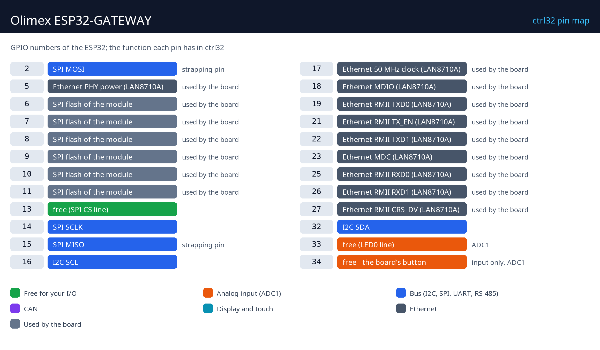

# Olimex ESP32-GATEWAY

   

The Olimex ESP32-GATEWAY is a compact ESP32 board with 100 Mb Ethernet and Wi-Fi - small enough for a junction box. With ctrl32 it is a gateway with its own logic: Modbus TCP devices read and published over MQTT, a ladder program on the chip and its operator page in any browser (WEBview).

**Good for:**

- A Modbus TCP to MQTT gateway with its own logic
- A small controller in a junction box, on Ethernet
- Home automation - reading meters, switching through Modbus I/O modules

Board page in the catalog: [Olimex ESP32-GATEWAY](https://ctrl32.com/hardware/boards/olimex-esp32-gateway/)

## What ctrl32 can do on this board

<!-- capabilities:start -->
| Feature | On this board | Notes |
|---|---|---|
| Chip | ESP32 (ESP32-WROOM-32E-N4) |  |
| Memory | 4 MB flash |  |
| Program size | 128 variables, 32 alarms, 128 blocks | checked by the editor before a download |
| Digital inputs / outputs | 3 free GPIO | 1 of them inputs only |
| Analog inputs | 2 on the chip (ADC1) | GPIO33, GPIO34 |
| Ethernet | yes - LAN8710A |  |
| Wi-Fi | Wi-Fi 2.4 GHz |  |
| CAN (TWAI) | 1 - on free pins | needs an external transceiver |
| Modbus RTU (RS-485) | yes - on free pins | needs an external transceiver |
| Modbus TCP | client and server |  |
| MQTT | yes | Home Assistant discovery |
| WEBview | yes | the operator page in any browser |
| Display / touch (HMI) | no | the operator page is WEBview |
| USB | USB-C (CH340 USB-UART) |  |
| Power | 5 V USB |  |
<!-- capabilities:end -->

### What is not supported

- Bluetooth - the ESP32 has it, ctrl32 does not use it.
- The microSD slot - ctrl32 keeps the program and the screens in the chip's own flash.

## The guide

| Step | Page |
|---|---|
| 1 | [Hardware and wiring](hardware.md) - what you need, power, the pin map |
| 2 | [Install the runtime](install.md) - the editor, the board, the first upload |
| 3 | [Configure](configure.md) - network, I/O, communication |
| 4 | [Example projects](examples/README.md) - everything the board does, ready to open |
| - | [Troubleshooting](troubleshooting.md) |

## Files

-

## Next steps

- [ctrl32 documentation](https://ctrl32.com/docs/) - the editor, the languages, every block
- [Download the editor](https://ctrl32.com/download/)
- [All tested boards](../../README.md)
- [Olimex ESP32-PoE](../olimex-esp32-poe/README.md) - Ethernet and Power over Ethernet

